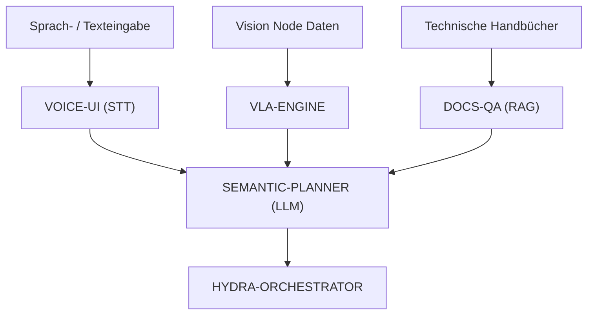

<!-- =============================================================================
HYDRA-UMC-COGNITIVE-NODE - Cognitive AI node (Hailo-10)
Copyright (C) JuanenRac (Electro Hobby 3D) <electrohobby3d@gmail.com>
GPL-3.0-or-later - see LICENSE
============================================================================= -->

<p align="center">
  
</p>

# 🧠 HYDRA-UMC-COGNITIVE-NODE

<p align="center"><a href="README.md">🇺🇸 English</a> | <a href="README_spa.md">🇪🇸 Español</a> | <a href="README_fra.md">🇫🇷 Français</a> | <a href="README_ita.md">🇮🇹 Italiano</a> | 🇩🇪 <b>Deutsch</b> | <a href="README_zho.md">🇨🇳 简体中文</a> | <a href="README_jpn.md">🇯🇵 日本語</a> | <a href="README_por.md">🇵🇹 Português</a></p>

### 🤖 Semantisches Denken & GenAI Edge Node (Hailo-10 + Raspberry Pi CM5)

<p align="center">
  
  
  
  
  
  
</p>

---

> **Ehrlichkeitscheck - was heute wirklich läuft:** die Familien-Bereitschaftsprüfung mit ihrem versionierten JSON-Schema (`family.py`, `manifest.py`, `models.py`) und die einfache stdlib-HTTP-Oberfläche (`api.py`) sind real und durch 56 bestehende Tests abgedeckt (`pytest tests/` - `test_manifest.py`, `test_models.py`, `test_family.py`, `test_api.py`, `test_cli.py`). Dieser Knoten führt selbst kein Modell aus: „Lokale LLM-Ausführung", „VLA-Integration" und „Sprachbefehlsverarbeitung" in den Kernfunktionen weiter unten sind ausdrücklich als `(geplant)` markiert - es gibt in diesem Repository keinen Hailo-10-Laufzeitcode. `docker-compose.yml` referenziert inzwischen ein echtes Dockerfile für alle 4 Kinder, wurde aber in dieser Entwicklungsumgebung nie tatsächlich als ein Stack ausgeführt (hier ist keine Docker-Laufzeit verfügbar) - die Befehls-/Port-Zuordnung jedes Dockerfiles wurde von Hand mit dem abgeglichen, was die eigene systemd-Unit jedes Kindes bereits auf der echten CM5 ausführt, nicht live verifiziert. Siehe `CHANGELOG.md` für das, was bisher genau ausgeliefert wurde.

> **Stand von Sicherheit (Safety) und Security:** Dieses Ökosystem ist kein zertifiziertes Sicherheitssystem. Es gibt noch keinen Hardware-E-STOP-Pfad, keine von der Firmware durchgesetzten Grenzen oder Verriegelungen und keinen verifizierten Bewegungsbefehl; Firmware-Images werden mit CRC32 und einem HMAC-SHA256 mit gemeinsamem Schlüssel geprüft, nicht mit einer asymmetrischen Signatur; TLS und gegenseitiges TLS sind optional und standardmäßig aus; noch keine eigene Platine wurde bestückt oder getestet. Lesen Sie die [Sicherheitsbasis](https://github.com/JuanenRac/HYDRA-UMC-DOCS/blob/main/docs/SECURITY_BASELINE.md) und das [Bedrohungsmodell](https://github.com/JuanenRac/HYDRA-UMC-DOCS/blob/main/docs/THREAT_MODEL.md), bevor Sie sich für die Sicherheit einer Person auf eine Aussage hier verlassen.

---

## 📋 Auf einen Blick

| | |
|---|---|
| Version | `0.1.5` |
| Reifegrad | Funktionsfähig |
| Tests | 56 (`python -m pytest -q tests`) |
| Technik | Python / CM5 / Hailo-10 |
| Ziel | Der Raspberry Pi CM5 einer HYDRA-UMC-Zelle |
| Auf echter Hardware | Noch nicht: für diese Version ist kein Lauf auf echter Hardware vermerkt |

**Springe zu:** [Überblick](#-überblick) · [Architektur](#-architektur) · [Funktionen](#-funktionen) · [Sicherheit und Schutz](#-sicherheit-und-schutz) · [Schnittstellen](#-schnittstellen) · [Konfiguration](#-konfiguration) · [Schnellstart](#-schnellstart) · [Tests](#-tests) · [Fehlerbehebung](#-fehlerbehebung) · [Struktur des Repositorys](#-struktur-des-repositorys) · [Verwandte Projekte](#-verwandte-projekte)

## 🚦 Projektstatus

Jede Zeile ist ein Teil dieses Repositorys, und die Ampel sagt, wie weit er heute ist. Sie beruht auf dem, was das Repository zeigen kann (Tests, Builds, Läufe), nicht auf dem, was geplant ist.

🟢 Fertig und überprüft · 🟡 Funktioniert, mit bekannten Grenzen · 🟠 Teilweise fertig oder noch nicht überprüft · 🔴 Nicht gemacht oder funktioniert nicht

| Bereich | Stand | Was das hier bedeutet |
|---|---|---|
| Software | 🟡 | Funktioniert für seinen Hauptzweck; die Ehrlichkeitsprüfung oben nennt, was noch fehlt |
| Tests | 🟢 | 56 automatische Tests, bei jeder Änderung ausgeführt |
| Echte Hardware | 🔴 | Noch nicht: für diese Version ist kein Lauf auf echter Hardware vermerkt |
| Dokumentation | 🟢 | README in acht Sprachen, bei jeder Änderung gegen das Manifest geprüft |

## 🎯 Überblick

**HYDRA-UMC-COGNITIVE-NODE** dient als "Frontallappen" des HYDRA-UMC-Ökosystems. Angetrieben von der Hailo-10 NPU (40 TOPS), ermöglicht er komplexes semantisches Denken, natürliches Sprachverständnis und Vision-Language-Action (VLA) Aufgabenplanung direkt am Edge.

Er transformiert hochgradige menschliche Anweisungen in logische Robotersequenzen und verwaltet die Fehlerbehebung sowie die Missionsoptimierung ohne Cloud-Abhängigkeit.

## 🧩 Rolle in HYDRA-UMC

**HYDRA-UMC-COGNITIVE-NODE** ist der Integrationspunkt der kognitiven Hailo-10-Familie. Heute ist seine echte Aufgabe eine Bereitschaftsprüfung: Er liest das Manifest der vier Kinder (VLA-ENGINE, VOICE-UI, SEMANTIC-PLANNER, DOCS-QA), schaut in den gemeinsamen Modellgewichte-Ordner und fragt auf Wunsch jedes Kind per HTTP ab. Er ist keine Schlussfolgerungs-Engine.

## 🏛️ Architektur

<p align="center">
  
</p>

<details>
<summary>Textversion des Diagramms (Mermaid)</summary>



</details>

**Warum es so gebaut ist**

Dieses Repository ist der **Eltern-/Integrationspunkt** der Cognitive AI
Node-Familie. Es führt selbst kein Modell aus - es besitzt die
gemeinsamen Ressourcen und die Verdrahtung, die es seinen vier Kindern
ermöglichen, als eine kognitive Einheit auf derselben physischen Platine
zu agieren:

* **Warum dieser Knoten keine eigene Hardware/Firmware hat.** Anders als
  die Firmware auf Motherboard-Ebene von HYDRA-UMC läuft dieser Knoten
  vollständig auf einem bereits vorhandenen Raspberry Pi CM5 + Hailo-10
  M.2-Modul - es gibt hier keine eigene Leiterplatte oder einen eigenen
  Mikrocontroller zu entwerfen, daher wurden die Ordner
  `hardware/`/`firmware/` entfernt, statt sie leer zu lassen.
* **Warum `os/` und `models/` nur im Elternteil liegen.** Das
  HydraOS-Image und die quantisierten LLM/VLA-Gewichte sind gemeinsam
  genutzte Ressourcen auf Platinenebene - eine einzige Kopie im
  Elternteil zu behalten und sie schreibgeschützt in jeden
  Kind-Container zu mounten (siehe `docker-compose.yml`) vermeidet vier
  abweichende Kopien mehrere Gigabyte großer Modellgewichte.
* **Warum ein `src/`-Layout.** Trennt das installierbare Paket
  (`hydra_umc_cognitive_node`) vom Tooling im Repo-Root
  (`bump_version.py`, `docker-compose.yml`) und entspricht dem Layout
  aller anderen Python-Projekte im Ökosystem.
* **Warum der Einstiegspunkt heute nur Identität/Version/Rolle
  ausgibt.** Dies ist die Andamiaje- (Gerüst-) Phase: zu beweisen, dass
  sich das Paket auf der tatsächlichen Ziel-Python-Version sauber
  installieren, kompilieren und importieren lässt, ist Voraussetzung,
  bevor echte LLM/VLA/Sprach-Orchestrierungslogik hinzugefügt wird, und
  hält diese spätere Arbeit von Packaging-Fragen getrennt.
* **Warum `docker-compose.yml` den Integrationsvertrag dokumentiert,
  nicht nur Images verdrahtet.** Zu entscheiden, welcher Dienst von
  welchem abhängt und welche Geräte-/Volume-Mounts jeder benötigt, wurde
  festgehalten, bevor irgendein Kind ein Dockerfile hatte - so wurde
  verhindert, dass diese Form später ad hoc erfunden wird. Alle 4 Kinder
  (VLA-Engine, Voice-UI, Semantic-Planner, Docs-QA) haben inzwischen ein
  echtes eigenes Dockerfile - schließt eine echte Lücke -
  `docker compose up` baut und startet jetzt das echte Ding.
* **Wie sich das in den Rest des Ökosystems einfügt.** Dieser Knoten
  sitzt eine Schicht über der Wahrnehmung (HYDRA-UMC-VISION-NODE,
  Hailo-8) und eine Schicht unter der Missionsorchestrierung
  (HYDRA-UMC-ORCHESTRATOR): Er wandelt Sprach-/Textanweisungen und
  Erkennungen in semantische Entscheidungen um, die der Orchestrator
  anschließend in physische Roboterbefehle umsetzt.
* **Warum `family-status` das eigene Manifest jedes Kindes liest, statt
  einer von Hand gepflegten Liste.** `hydra-umc.project.json` ist bereits
  die einzige Quelle der Wahrheit, der das ökosystemweite Dashboard und
  der Updater vertrauen - eine zweite
  Liste hier würde in dem Moment auseinanderdriften, in dem sich der
  echte Reifegrad eines Kindes ändert und niemand daran denkt, sie zu
  aktualisieren.
* **Warum ein fehlendes Geschwister-Checkout ein echtes, ehrliches
  "nicht gefunden" ist, kein Fehler.** Ein Integrations-Hub weiß
  wirklich nicht, ob ein Entwickler alle vier Kinder lokal ausgecheckt
  hat - `manifest.py` gibt für jeden echten Fehlerfall (fehlendes Repo,
  fehlendes Manifest, fehlerhaftes JSON) `None` zurück, sodass
  `family-status` dies klar meldet, statt abzustürzen.
* **Warum Manifest-Lesevorgänge von Geschwistern auf 64 KiB begrenzt
  sind.** Jedes echte Manifest in diesem Ökosystem ist einige hundert
  Byte bis wenige KiB groß - ein beschädigtes oder manipuliertes
  Checkout, dessen Manifest durch eine überdimensionierte Datei ersetzt
  wurde, darf eine routinemäßige Bereitschaftsprüfung niemals dazu
  bringen, eine unbegrenzte Menge an Daten in den Speicher zu laden. Es
  degradiert zu `None`, genau wie jedes andere fehlerhafte Manifest.
* **Warum `family-status` `models/` meldet, obwohl dieser Knoten selbst
  kein Modell ausführt.** "Die Geschwister-Repos sind ausgecheckt" und
  "die gemeinsam genutzten Gewichte, die sie bräuchten, sind tatsächlich
  vorhanden" sind zwei unterschiedliche echte Fakten -
  `check_shared_models()` in `models.py` prüft den zweiten ehrlich (leer,
  aber vorhanden zählt als fehlend), statt einen Betreiber allein aus der
  Präsenz der Kinder auf Bereitschaft schließen zu lassen.

## ✨ Funktionen

* 🧠 **Lokale LLM-Ausführung:** Hardwarebeschleunigte Inferenz für quantisierte Modelle (Llama/Mistral). *(geplant - benötigt die echte Hailo-10-Modell-Laufzeitumgebung)*
* 👁️ **VLA-Integration:** Vision-Language-Action-Modelle für eine intuitive Aufgabenausführung. *(geplant)*
* 🎙️ **Sprachbefehlsverarbeitung:** Echtzeit-STT/TTS für die Mensch-Roboter-Interaktion. *(geplant)*
* 🛡️ **Datenschutz zuerst:** 100% Offline-Verarbeitung aller kognitiven Aufgaben. *(schon jetzt so konzipiert, sobald das Obige existiert - hier ruft heute nichts ein Netzwerk auf)*
* 🧩 **Integrations-Hub (v0):** Besitzt das gemeinsam genutzte HydraOS-Image
  und die quantisierten Modellgewichte, die von seinen 4 Kindern genutzt
  werden, und verbindet sie als Schwesterdienste in einer einzigen
  `docker-compose.yml`. Die echte `family-status`-Prüfung liest das echte
  Manifest jedes Kindes, um Präsenz/Version/Reifegrad zu melden.
  *(implementiert als echte Bereitschaftsprüfung - siehe BUILD UND
  AUSFÜHRUNG unten)*
* 🔒 **Versioniertes Status-Schema + ressourcenbeschränkte Manifest-Lesevorgänge:** `family-status --json` gibt ein echtes, versioniertes, maschinenlesbares Ergebnis aus; jedes Geschwister-Manifest, das größer als 64 KiB ist (ein beschädigtes oder manipuliertes Checkout), degradiert zu "nicht gefunden", statt unbegrenzt eingelesen zu werden. *(implementiert)*
* 🩺 **Gesundheit der laufenden Kinder, Image-Tags und die Gewichte im Container der Engine:** `family-status --probe` (oder `GET /family-status?probe=1`) fragt zusätzlich jedes laufende Kind nach seiner Gesundheit, auf der Route, die sein eigenes Manifest angibt (sonst `/stats`), und meldet, ob es geantwortet hat, mit welchem Status und wie schnell, und was das Kind über sich selbst sagt; bei einem nicht gesunden Kind endet es mit einem Fehlercode. Wo die Kinder sind, wird beim Start des Knotens festgelegt: standardmäßig ihre Loopback-Ports oder `HYDRA_UMC_COGNITIVE_NODE_CHILD_URLS` (wie die Compose-Datei es im Stack setzt). Die Images der Compose-Datei tragen das Tag `HYDRA_UMC_<NAME>_VERSION` (aus der `.env`; `family-versions` gibt diese Zeilen aus den Manifesten aus) oder `latest`, nie eine erfundene Nummer, der vla-engine-Container bekommt `models/` nun dort eingehängt, wo die Engine sucht, und ein zweiter Workflow prüft, dass `docker compose config` noch aufgelöst wird. *(mit Ersatzdiensten erprobt, nicht mit den echten Kindern oder einem Hailo-10)*
* 🪫 **Degradationsprüfung für gemeinsam genutzte Modellgewichte:** `family-status` meldet ehrlich, ob das eigene `models/`-Verzeichnis dieses Knotens tatsächlich echte Gewichte enthält - nicht nur, ob die Geschwister-Repos ausgecheckt sind. *(implementiert)*
* 📦 **Ausdrückliche Versionserhöhung:** Die Version in `pyproject.toml` wird nur vom expliziten `bump`-Befehl erhöht (`python tools/hydra_project_tool.py bump`, der `bump_version.py` ausführt) - Bauen ändert sie nie.

## 🔒 Sicherheit und Schutz

| Bedrohung | Abwehr | Wo |
|---|---|---|
| Ein riesiges oder feindliches Manifest, ein riesiger Modellordner | Das Manifest eines Geschwister-Repos wird bis 64 KiB gelesen; der Modellordner wird auf höchstens 20 000 Dateien geprüft, und nur die Gewichtssuffixe `.bin .gguf .har .hef .onnx .safetensors .tflite` zählen | `manifest.py`, `models.py` |
| Ein Kind, das Müll antwortet oder hängt | Die Sonde wartet höchstens 2 Sekunden und liest höchstens 64 KiB; der Gesundheitspfad aus einem Manifest wird nur angenommen, wenn er mit `/` beginnt, kürzer als 128 Zeichen ist und keine Leerzeichen hat, sonst gilt `/stats` | `probe.py` |
| Offenlegung im Netz | Die HTTP-Schnittstelle ist schreibgeschützt und lauscht standardmäßig auf `127.0.0.1:8096`; sie durchsucht den beim Start festgelegten Arbeitsbereich und antwortet `400` auf eine Anfrage, die einen anderen wählen will. Sie hat kein Token: ob sie eines braucht, ist offen | `api.py`, `main.py` |

**Was er nie tut:** er ist keine Schlussfolgerungs-Engine: In diesem Repository läuft kein Modell, und er schreibt nichts in die Kinder.

## 🔌 Schnittstellen

`family-status [--workspace DIR] [--models-dir DIR] [--probe] [--json]` und `serve [--addr 127.0.0.1] [--port 8096] [--workspace DIR] [--models-dir DIR]`. Die Standard-Ports der Kinder sind VLA-ENGINE 8098, VOICE-UI 8091, SEMANTIC-PLANNER 8109 und DOCS-QA 8110.

`serve` führt genau denselben `family-status`-Check als kleinen
`http.server` der Standardbibliothek aus statt als einmaligen CLI-Aufruf
- das ist der Befehl, den die eigene
`hydra-umc-cognitive-node.service`-systemd-Unit der CM5 auszuführen
konfiguriert ist:

```bash
./run.sh serve --addr 127.0.0.1 --port 8096
# GET /family-status  -> dasselbe JSON, das `family-status --json` oben ausgibt
# GET /stats          -> { "status": "ok" }
```

`GET /family-status` durchsucht den beim Start festgelegten Workspace (`--workspace`, `--models-dir` oder `HYDRA_UMC_COGNITIVE_NODE_WORKSPACE` / `HYDRA_UMC_COGNITIVE_NODE_MODELS_DIR`) und antwortet mit `400`, wenn eine Anfrage einen anderen wählen will; jeder andere Pfad liefert `404`. Siehe die
[CLI-Referenz](docs/CLI_REFERENCE.md) für die vollständige
Befehlsreferenz: jedes Flag, echte erfasste `-h`/`curl`-Ausgabe und die
Exit-Code-Tabelle.

## ⚙️ Konfiguration

| Variable | Standard | Was sie festlegt |
|---|---|---|
| `HYDRA_UMC_COGNITIVE_NODE_WORKSPACE` | der Elternordner dieses Repositorys | wo die Geschwister-Repositories liegen |
| `HYDRA_UMC_COGNITIVE_NODE_MODELS_DIR` | `models/` | die gemeinsamen Modellgewichte |
| `HYDRA_UMC_COGNITIVE_NODE_CHILD_URLS` | die obigen Standard-Ports | die URLs der Kinder für `--probe` |

## 🚀 Schnellstart

Erfordert Python >= 3.10.

```bash
# Linux / macOS / Git Bash
./build.sh   # erstellt .venv, installiert das Paket (editable), prüft den Import
./run.sh     # führt den Einstiegspunkt aus

# Windows (cmd)
build.bat
run.bat
```

`build.sh`/`build.bat` ändern die Version nie (nur `python tools/hydra_project_tool.py bump` erhöht sie) und führen die echte Testsuite
aus (`pytest tests/`). Erwartete Ausgabe eines `run.sh` ohne Argumente:

```text
HYDRA-UMC-COGNITIVE-NODE v0.1.5
Semantic reasoning & GenAI edge node (Hailo-10) - integrates VLA-Engine, Voice-UI, Semantic-Planner and Docs-QA into one cognitive node.
```

Siehe `docker-compose.yml` dafür, wie die vier Kind-Dienste (VLA-Engine,
Voice-UI, Semantic-Planner, Docs-QA) an diesen Knoten angebunden werden -
jeder hat inzwischen sein eigenes echtes Dockerfile.

Das echte Subcommand `family-status` prüft die echten Kinder in einem
echten lokalen Checkout:

```bash
./run.sh family-status
./run.sh family-status --workspace /pfad/zu/einem/anderen/checkout
./run.sh family-status --json

# Windows
run.bat family-status
```

`family-status` meldet immer auch die eigenen gemeinsam genutzten
Modellgewichte dieses Knotens - ein echtes, leeres `models/` auf einer
Entwicklungsmaschine ist ehrlich `MISSING`, niemals stillschweigend
ignoriert:

```text
Cognitive AI Node family status (workspace: /path/to/workspace):
  HYDRA-UMC-VLA-ENGINE: v0.1.8, maturity=functional, role=service
  ...

Shared model weights: MISSING (.../HYDRA-UMC-COGNITIVE-NODE/models) - this node's own os/models weights have not been provisioned on this machine; children that need them will run in their own honest degraded/no-hardware mode.

All 4 children present.
```

`--json` gibt stattdessen dieselben echten Daten als versioniertes,
maschinenlesbares Objekt aus:

```bash
$ ./run.sh family-status --json
{
  "schema_version": "1.0",
  "shared_models": { "present": false, "path": ".../models" },
  "children": [
    { "name": "HYDRA-UMC-VLA-ENGINE", "present": true, "version": "0.1.8", "maturity": "functional", "role": "service" },
    ...
  ],
  "all_children_present": true
}
```

Standardmäßig wird das eigene übergeordnete Verzeichnis dieses Repos
verwendet - dasselbe Layout, das jeder echte Checkout dieses Ökosystems
bereits nutzt (alle Repos als Geschwister unter einem gemeinsamen
Workspace-Ordner). Beendet sich mit `1`, wenn ein echtes Kind fehlt.

## 🧪 Tests

56 automatische Tests laufen mit `python -m pytest -q tests`. Sie prüfen die Manifeste, den Modellordner, die Sonde, die Kommandozeile und die HTTP-Schnittstelle gegen lokale Fixtures; keine Hardware, kein äußeres Netz.

Die CI führt `HYDRA_UMC_CI=1 python tools/ci_validate.py` aus; das prüft das Manifest, die Dokumente, die acht READMEs und die Bilder.

## 🏗️ Build und Veröffentlichung

Für eine Veröffentlichung gibt es nichts zu kompilieren: `build.sh` / `build.bat` legen die virtuelle Umgebung an, installieren das Paket im editierbaren Modus und führen die Tests aus, `build-test` prüft nur. Bauen ändert nie die Version; sie wird nur von `python tools/hydra_project_tool.py bump` erhöht, das auch das Änderungsprotokoll fortschreibt. Die Version von Paket, Manifest und Änderungsprotokoll muss übereinstimmen, sonst schlägt `ci_validate.py` fehl.

## 🩺 Fehlerbehebung

* **`python: Befehl nicht gefunden` / der Build schlägt bei Schritt 1
  fehl.** Erfordert Python >= 3.10 im `PATH`. Unter Windows von
  [python.org](https://python.org) installieren und bei der Installation
  "Add to PATH" ankreuzen; unter Linux/macOS heißt es meist `python3`.
* **`build.sh` kann das venv nicht aktivieren.** `python3 -m venv .venv`
  legt das Aktivierungsskript je nach Plattform an anderer Stelle ab:
  `.venv/bin/activate` unter Linux/macOS, `.venv/Scripts/activate` unter
  Windows (auch bei einem Windows-Python-venv, das aus Git Bash heraus
  verwendet wird). `build.sh` prüft bereits beide Pfade - schlägt es
  weiterhin fehl, `.venv/` löschen und `./build.sh` erneut ausführen, um
  es von Grund auf neu zu erstellen.
* **`pip install -e .` schlägt fehl.** Meist wegen eines veralteten
  `.venv/`. Den Ordner `.venv/` löschen und `./build.sh`/`build.bat`
  erneut ausführen, um ihn neu zu erstellen.
* **`import OK` erscheint nie.** Bedeutet, dass `python -c "import
  hydra_umc_cognitive_node"` selbst fehlgeschlagen ist - mit aktivem venv
  erneut ausführen, um den echten Traceback zu sehen (eine defekte
  manuelle Änderung an `pyproject.toml` ist nach einem manuellen Merge
  meist die Ursache).
* **`docker compose up` scheitert beim Start von `voice-ui`.** Dessen
  Container weigert sich (absichtlich - siehe den Kommentar in
  `docker-compose.yml` selbst), ohne echtes
  `HYDRA_UMC_VOICE_UI_TOKEN` über loopback hinaus zu binden; setze es in
  einer echten `.env`-Datei oder deinem Secret-Manager, niemals
  committen. Jeden Dienst während der Entwicklung direkt mit seinem
  eigenen `run.sh`/`run.bat` auszuführen braucht dieses Token nicht, da
  `--host` dort auf loopback bleibt.

## 📂 Struktur des Repositorys

<p align="center">
  
</p>

<details>
<summary>Textversion des Baums</summary>

```text
HYDRA-UMC-COGNITIVE-NODE/
├── src/hydra_umc_cognitive_node/
│   ├── family.py                                Bereitschaft der vier Kinddienste
│   ├── manifest.py                              liest das Manifest eines Geschwister-Repos
│   ├── models.py                                prüft den gemeinsamen Gewichte-Ordner
│   ├── probe.py                                 antwortet jedes Kind per HTTP
│   └── api.py main.py                           HTTP-Schnittstelle und Kommandozeile
├── tests/                                       56 Tests
├── docs/                                        die Kommandozeilen-Referenz
├── models/                                      gemeinsame Modellgewichte
├── os/                                          Notizen zur OS-Schicht
├── tools/                                       Build- und Testläufer, Versionserhöhung, CI-Prüfer, README- und Bildgeneratoren samt Prüfungen
├── images/                                      Banner und die Bilder der README
├── .github/                                     CI-Workflow und Issue-Vorlagen
├── pyproject.toml                               Paketmetadaten und Abhängigkeiten
├── hydra-umc.project.json                       Manifest: Version, Reifegrad, Familie
├── CHANGELOG.md                                 was sich in jeder Version geändert hat
├── build.sh build.bat                           Build-Skripte (ändern die Version nie)
├── build-test.sh build-test.bat                 Build-Skripte (ändern die Version nie)
├── test.sh test.bat                             führen die Tests aus
├── systemd/                                     Dienst-Unit für den CM5
├── docker-compose.yml / Dockerfile              der Knoten mit seinen vier Kindern
├── bump_version.py / bump_manifest_version.py   ausdrückliche Versionserhöhung
├── run.sh run.bat                               den Knoten starten
└── SECURITY.md SUPPORT.md CONTRIBUTING.md CODE_OF_CONDUCT.md LICENSE LICENSE.md
```

</details>

## 🗺️ Roadmap und bekannte Grenzen

**Bekannte Grenzen heute**

* **Phase 1:** VLA-Engine-Bereitstellung und multimodale Eingabeverarbeitung auf Hailo-10.
* **Phase 2:** Integration des semantischen Planers mit Schwarmverhaltensmodellen und Langzeitgedächtnis.
* **Phase 3:** Lokale Ausführung der Voice-UI mit niedriger Latenz und industrielle Geräuschunterdrückung.
* **Phase 4:** Audits zur autonomen Entscheidungsfindung und vollständige Integration mit Dashboard AI für „See and Ask“-Feedback.

## 🌍 Sprachen

Diese README und die Dokumente des Repositorys gibt es in acht Sprachen: Englisch, Spanisch, Deutsch, Französisch, Italienisch, Japanisch, Chinesisch und Portugiesisch (Portugal). Sie entstehen gemeinsam, und die CI prüft, dass die acht Dateien dieselben Abschnitte und dieselben Links haben. Dieses Repository hat weder eine eigene Oberfläche noch einen eigenen Meldungskatalog, es gibt also keine Oberflächentexte zu übersetzen.

## 🔗 Verwandte Projekte

Dieses Projekt ist Teil des HYDRA-UMC-Robotik-Ökosystems desselben Autors (JuanenRac / Electro Hobby 3D). Gut zu wissen, da eine Anfrage eigentlich eines dieser Projekte betreffen könnte statt dieses Repositorys.

**Untergeordnete Projekte** — vier davon sind Stufen im eigenen kognitiven Ablauf dieses Knotens (Spracheingabe, Entscheidung, Aktion, Verankerung); das fünfte ist eine eigenständige Wartungsanwendung auf derselben Hailo-10-Pipeline
- **[HYDRA-UMC-VOICE-UI](https://github.com/JuanenRac/HYDRA-UMC-VOICE-UI)** — echtes Sprach-Frontend (VAD + Intent-Parser) mit einem begrenzten, bestätigungsgesicherten Watch-Relay.
- **[HYDRA-UMC-SEMANTIC-PLANNER](https://github.com/JuanenRac/HYDRA-UMC-SEMANTIC-PLANNER)** — echte regelbasierte Aufgabenzerlegung und semantische Fehlerbehebung über MCU-Fehlercodes.
- **[HYDRA-UMC-VLA-ENGINE](https://github.com/JuanenRac/HYDRA-UMC-VLA-ENGINE)** — echte Aktions-Token-Kodierung/-Dekodierung und Trajektoriengenerierung für ein Vision-Language-Action-Modell.
- **[HYDRA-UMC-DOCS-QA](https://github.com/JuanenRac/HYDRA-UMC-DOCS-QA)** — echte, nur auf der Standardbibliothek basierende TF-IDF-Dokumentensuche über die eigenen Markdown-Dokumente dieses Ökosystems.
- **[HYDRA-UMC-LOCAL-TECHNICIAN](https://github.com/JuanenRac/HYDRA-UMC-LOCAL-TECHNICIAN)** — lokaler, richtlinien-gesteuerter KI-Wartungstechniker für das Ökosystem selbst - beobachtet, diagnostiziert und schlägt Korrekturen vor; die zwei höchsten Risikostufen sind absichtlich noch nicht implementiert.

**Direkt verwandt**
- **[HYDRA-UMC-ORCHESTRATOR](https://github.com/JuanenRac/HYDRA-UMC-ORCHESTRATOR)** — Integrationsknoten mit einem echten gRPC/Protobuf-Health-Report-Vertrag und einer Missions-Zustandsmaschine; gibt diesem Knoten seine eigenen Missionsaufträge.
- **[HYDRA-UMC-VISION-NODE](https://github.com/JuanenRac/HYDRA-UMC-VISION-NODE)** — Integrationsknoten für die Hailo-8-Vision-Pipeline, mit einer echten stufenweisen Hardware-Bereitschaftsprüfung; die eigene semantische Schicht dieses Knotens konsumiert dessen Erkennungen.
- **[HYDRA-UMC-STUDIO](https://github.com/JuanenRac/HYDRA-UMC-STUDIO)** — Web-Steuerungs-Dashboard mit Echtzeit-3D-Visualisierung mehrerer Roboter; eine der eigenen Sprachsteuerungsoberflächen dieses Knotens.
- **[HYDRA-UMC-DSI](https://github.com/JuanenRac/HYDRA-UMC-DSI)** — native Touch-UI für das eingebaute 7"-DSI-Touchscreen, direkt auf dem CM5 eingebettet; die andere eigene Sprachsteuerungsoberfläche dieses Knotens.

**Ebenfalls Teil des Ökosystems**

*Kern-Hardware & Plattform*
- **[HYDRA-UMC](https://github.com/JuanenRac/HYDRA-UMC)** — der Entwurf des Motherboards des Roboterarms: CM5-Host + Dual-Core-STM32H745, gedacht zur Koordination von bis zu 8 Werkzeugarmen über CAN-OTA/SPI-OTA (Firmware in einer frühen Phase; noch keine bestückte Platine).
- **[HYDRA-UMC-OS](https://github.com/JuanenRac/HYDRA-UMC-OS)** — reproduzierbare Raspberry-Pi-OS-Produktschicht für den CM5: schreibgeschützter Agent, validierte Konfiguration/Profile, WiFi-Ersteinrichtung.
- **[HYDRA-UMC-SDK](https://github.com/JuanenRac/HYDRA-UMC-SDK)** — der gemeinsame JSON-Schema-Vertrag und die Software-Auftragsschranke, gegen die jede Bridge ihre Befehle validiert (keine zertifizierte Sicherheitsfunktion).
- **[HYDRA-UMC-CONNECTOR-HUB](https://github.com/JuanenRac/HYDRA-UMC-CONNECTOR-HUB)** — deklaratives Adapter-Manifest-Register und Validator für Konnektoren externer Maschinen; erweitert die eigene Vertragsidee des SDK auf externe Maschinen, ohne die Industrie-Gateway-Projekte zu ersetzen.

*Kern-Backend & Clients*
- **[HYDRA-UMC-SERVER](https://github.com/JuanenRac/HYDRA-UMC-SERVER)** — das reale Headless-Backend (REST/WebSocket), mit dem jeder Steuerungsclient tatsächlich spricht.
- **[HYDRA-UMC-SUITE](https://github.com/JuanenRac/HYDRA-UMC-SUITE)** — Desktop-Schwarmleitstand (PySide6) für mehrere Server gleichzeitig, verpackt als eigenständige ausführbare Datei.
- **[HYDRA-UMC-ANDROID-CONTROL](https://github.com/JuanenRac/HYDRA-UMC-ANDROID-CONTROL)** — native Android-Steuerungs-App mit biometrischem Login und einer gekoppelten Wear-OS-Begleit-App.
- **[HYDRA-UMC-IOS-CONTROL](https://github.com/JuanenRac/HYDRA-UMC-IOS-CONTROL)** — iOS/iPadOS-Steuerungs-App (Flutter) mit Echtzeit-WebSocket-Synchronisierung.
- **[HYDRA-UMC-EDITOR-URDF](https://github.com/JuanenRac/HYDRA-UMC-EDITOR-URDF)** — grafischer Desktop-URDF-Ersteller/-Editor, der fertige Modelle in STUDIOs eigenen Katalog überträgt.
- **[HYDRA-UMC-EDITOR-STL](https://github.com/JuanenRac/HYDRA-UMC-EDITOR-STL)** — Desktop-STL-Modelleditor, der echte Teile im selben Modellkatalog transformiert/ersetzt/entfernt/hinzufügt, den auch HYDRA-UMC-EDITOR-URDF bearbeitet.
- **[HYDRA-UMC-BRIDGE-AMR](https://github.com/JuanenRac/HYDRA-UMC-BRIDGE-AMR)** — Koordinationsschranke für AGV-/AMR-Flotten über einen VDA-5050-MQTT-Publisher (nur gegen eine emulierte Flotte getestet).
- **[HYDRA-UMC-BRIDGE-CNC](https://github.com/JuanenRac/HYDRA-UMC-BRIDGE-CNC)** — High-Level-Koordinator für CNC-Zellen mit GRBL-Status-/Steuerbyte-Zugriff (nur gegen einen Emulator getestet).
- **[HYDRA-UMC-BRIDGE-DROIDS](https://github.com/JuanenRac/HYDRA-UMC-BRIDGE-DROIDS)** — Koordinationsschranke für laufende/humanoide Droiden, mit einem Boston-Dynamics-Spot-Befehlssender (nur gegen einen Emulator getestet).
- **[HYDRA-UMC-BRIDGE-LASER](https://github.com/JuanenRac/HYDRA-UMC-BRIDGE-LASER)** — Koordinator für Laserzellen, liest 3 Schlüssel-/Gehäuse-/Verriegelungs-GPIO-Signale (nur gegen einen simulierten Chip getestet; kann keinen Laser scharfschalten oder auslösen).
- **[HYDRA-UMC-BRIDGE-OPENPNP](https://github.com/JuanenRac/HYDRA-UMC-BRIDGE-OPENPNP)** — sicherer High-Level-Koordinator für den Leiterplattenfluss von OpenPnP Pick-and-Place.
- **[HYDRA-UMC-BRIDGE-PRINTER3D](https://github.com/JuanenRac/HYDRA-UMC-BRIDGE-PRINTER3D)** — sichere Koordinationsschranke für Moonraker/Klipper-3D-Drucker, mit echten gesicherten Job-Befehlen.
- **[HYDRA-UMC-BRIDGE-ROS2](https://github.com/JuanenRac/HYDRA-UMC-BRIDGE-ROS2)** — Koordinator mit einem träge importierten rclpy-ROS-2-Transport (noch nicht gegen eine ROS-2-Installation ausgeführt).
- **[HYDRA-UMC-BRIDGE-UAV](https://github.com/JuanenRac/HYDRA-UMC-BRIDGE-UAV)** — Koordinationsschranke für kameraausgestattete UAVs, mit einem MAVLink-Befehlssender (nur gegen einen Emulator getestet).

*URTC-Werkzeugplattform*
- **[URTC](https://github.com/JuanenRac/URTC)** — Firmware für die physische Universal-Robot-Tool-Controller-Platine, 25+ Werkzeugprofile über CAN-Bus.
- **[URTC-FLASHER](https://github.com/JuanenRac/URTC-FLASHER)** — Desktop-GUI-Flash-Tool für URTC-Platinen, CAN-OTA plus Full-Chip-SWD/JTAG.
- **[URTC-TESTER](https://github.com/JuanenRac/URTC-TESTER)** — Desktop-Live-CAN-Bus-Diagnosetool für URTC-Platinen, ein Panel pro Werkzeugprofil.
- **[URTC-WEB-STUDIO](https://github.com/JuanenRac/URTC-WEB-STUDIO)** — browserbasierte Alternative zu URTC-TESTER über die Web-Serial-API, ohne lokale Installation.
- **[URTC-GATEWAY](https://github.com/JuanenRac/URTC-GATEWAY)** — Gateway vor dem CAN-Bus von URTC: Liste erlaubter Kennungen, Ratenbegrenzung und Sitzungsschlüssel; Software auf dem Computer getestet, noch nicht an einem echten Bus.

*Vision-KI-Knoten (Hailo-8)*
- **[HYDRA-UMC-DETECTION-HEF](https://github.com/JuanenRac/HYDRA-UMC-DETECTION-HEF)** — echte Registry für kompilierte Modelle mit Hailo-Architektur-/Prüfsummen-Safe-Load-Verifizierung.
- **[HYDRA-UMC-VISION-STREAMER](https://github.com/JuanenRac/HYDRA-UMC-VISION-STREAMER)** — echter GStreamer-Pipeline- + MediaMTX-Konfigurationsgenerator mit einer echten HailoRT-Integrationsschranke.
- **[HYDRA-UMC-VISUAL-SERVOING-API](https://github.com/JuanenRac/HYDRA-UMC-VISUAL-SERVOING-API)** — Position-Based-Visual-Servoing-Korrekturgesetz mit Freigabe abhängig vom Zonenstatus; noch keine Posenschätzung per Kamera.
- **[HYDRA-UMC-SAFETY-ZONES](https://github.com/JuanenRac/HYDRA-UMC-SAFETY-ZONES)** — v0-Logik für Zonenverletzung, Kalibrierungsaktualität und E-STOP-Anforderung, die Objektpositionen aus einer Datei nimmt; kein Detektor speist sie, und noch kein physischer E-STOP ist angeschlossen.

*Orchestrierung & Schwarm*
- **[HYDRA-UMC-JOB-DISPATCHER](https://github.com/JuanenRac/HYDRA-UMC-JOB-DISPATCHER)** — echte prioritätsbasierte Job-Queue mit Deduplizierung, über eine echte HTTP-API.
- **[HYDRA-UMC-NODE-HEALING](https://github.com/JuanenRac/HYDRA-UMC-NODE-HEALING)** — echter gRPC-basierter Flotten-Health-Watchdog mit Retry/Backoff und Identitäts-Mismatch-Erkennung.
- **[HYDRA-UMC-PATH-PLANNER-3D](https://github.com/JuanenRac/HYDRA-UMC-PATH-PLANNER-3D)** — echter RRT-basierter 3D-Pfadplaner mit echter Hindernis-/Arbeitsraum-Kollisionsvalidierung.
- **[HYDRA-UMC-SWARM-SYNC](https://github.com/JuanenRac/HYDRA-UMC-SWARM-SYNC)** — echte CRDT-LWW-Element-Map-Zustandssynchronisation, eigenschaftsgetestet auf Multi-Zellen-Konvergenz.

*Digitaler Zwilling & Simulation*
- **[HYDRA-UMC-TWIN](https://github.com/JuanenRac/HYDRA-UMC-TWIN)** — Integrationsknoten für die Digital-Twin-Engine, mit einem echten Versionskompatibilitäts-Sync-Vertrag.
- **[HYDRA-UMC-HIL-BRIDGE](https://github.com/JuanenRac/HYDRA-UMC-HIL-BRIDGE)** — Hardware-in-the-Loop-Router mit einer Software-Kollisionsverriegelung zwischen Simulation und echter Hardware (ohne echte Hardware getestet).
- **[HYDRA-UMC-PHYSICS-REPLICA](https://github.com/JuanenRac/HYDRA-UMC-PHYSICS-REPLICA)** — echte Vorwärtskinematik und Gelenkgrenzenvalidierung über eine echte URDF-Teilmenge.
- **[HYDRA-UMC-SYNTHETIC-DATA-GEN](https://github.com/JuanenRac/HYDRA-UMC-SYNTHETIC-DATA-GEN)** — echter prozeduraler 2D-Szenengenerator mit YOLO/COCO-Annotationsexport.

*Daten & Analytik*
- **[HYDRA-UMC-DATALAKE](https://github.com/JuanenRac/HYDRA-UMC-DATALAKE)** — echter sqlite3-gestützter Zeitreihenspeicher mit einer echten Ingest-/Abfrage-HTTP-API.
- **[HYDRA-UMC-ANOMALY-DETECTOR](https://github.com/JuanenRac/HYDRA-UMC-ANOMALY-DETECTOR)** — echter FFT- + statistischer Basislinien-Anomaliedetektor mit Drift-Überwachung.
- **[HYDRA-UMC-PRODUCTION-REPORTS](https://github.com/JuanenRac/HYDRA-UMC-PRODUCTION-REPORTS)** — echte OEE-/Verfügbarkeitsberechnung über den DATALAKE-Verlauf, mit reproduzierbarem CSV-Export.
- **[HYDRA-UMC-TELEMETRY-COLLECTOR](https://github.com/JuanenRac/HYDRA-UMC-TELEMETRY-COLLECTOR)** — echte CAN/WebSocket-Ingestion-Pipeline in DATALAKE, mit Sequenz-Deduplizierung.

*Industrie-Gateway*
- **[HYDRA-UMC-GATEWAY-INDUSTRIAL](https://github.com/JuanenRac/HYDRA-UMC-GATEWAY-INDUSTRIAL)** — Integrationsknoten, der zu Industrieprotokollen weiterleitet, mit einer echten Befehls-Allowlist-/Backpressure-Schicht.
- **[HYDRA-UMC-OPCUA-SERVER](https://github.com/JuanenRac/HYDRA-UMC-OPCUA-SERVER)** — echter OPC-UA-Adressraum, verifiziert mit einer echten Binärprotokoll-Client-Session.
- **[HYDRA-UMC-MQTT-BROKER](https://github.com/JuanenRac/HYDRA-UMC-MQTT-BROKER)** — echter MQTT-Broker mit optionaler Pro-Client-Authentifizierung und Topic-ACLs.
- **[HYDRA-UMC-MTCONNECT-ADAPTER](https://github.com/JuanenRac/HYDRA-UMC-MTCONNECT-ADAPTER)** — echte MTConnect-`/probe`- und `/current`-XML-Endpunkte mit Degraded-Mode-Ausgabe.

*Ergänzende Tools & Ökosystembetrieb*
- **[HYDRA-UMC-DASHBOARD-AI](https://github.com/JuanenRac/HYDRA-UMC-DASHBOARD-AI)** — Smart-Summaries- und Anomaly-Highlighting-Panels über DATALAKE/ANOMALY-DETECTOR, mit einem ehrlichen statistischen Fallback.
- **[HYDRA-UMC-TOOL-CLI](https://github.com/JuanenRac/HYDRA-UMC-TOOL-CLI)** — Flotten-CLI mit einem echten, stabilen Exit-Code-Vertrag, ein echter Live-Client der eigenen API von HYDRA-UMC-SERVER.
- **[HYDRA-UMC-WATCH](https://github.com/JuanenRac/HYDRA-UMC-WATCH)** — WearOS-Begleit-App mit haptischen Alarmmustern und einem Sprach-Relay zum gekoppelten Telefon (noch nicht auf einer physischen Uhr ausgeführt).
- **[URTC-SMART-RACK](https://github.com/JuanenRac/URTC-SMART-RACK)** — Firmware für ein Platinenmontagegestell mit echter Werkzeug-ID-Dekodierung und Smart-Idle-Vorheizlogik.
- **[URTC-VISION-TOOL](https://github.com/JuanenRac/URTC-VISION-TOOL)** — Firmware plus ein echter Python-Vision-Begleiter für einen Thermal-/RGB-Inspektionswerkzeugkopf.
- **[HYDRA-UMC-UPDATER](https://github.com/JuanenRac/HYDRA-UMC-UPDATER)** — administratives Desktop-Tool, das jedes Repository in diesem Ökosystem entdeckt, klont und aktualisiert.
- **[HYDRA-UMC-OS-REBUILDER](https://github.com/JuanenRac/HYDRA-UMC-OS-REBUILDER)** — Windows/Linux-Desktop-Tool, das ein flashbereites CM5-Image baut, vorgeladen mit den aktuellsten Versionen des Ökosystems, mit Ersteinrichtungs-Konfiguration für WLAN/Benutzer/SSH im Stil von Raspberry Pi Imager.
- **[HYDRA-UMC-OPS-AGENT](https://github.com/JuanenRac/HYDRA-UMC-OPS-AGENT)** — Wartungsvorfall-Koordinator: eine Edge-Rolle mit niedrigem Privileg sammelt einen bereinigten Inventar-/Gesundheits-Snapshot, eine Control-Plane-Rolle rendert ihn schreibgeschützt und bittet einen KI-Anbieter um einen Diagnosevorschlag - wendet nie einen Patch an und stellt nie etwas bereit.
- **[HYDRA-UMC-DEV-SERVER](https://github.com/JuanenRac/HYDRA-UMC-DEV-SERVER)** — reproduzierbarer Entwicklungshost (Raspberry Pi 5 / CM5), der den Quellcode des Ökosystems vorhält und begrenzte Build-/Test-Aufgaben über eine dauerhafte Warteschlange ausführt; eine dedizierte Entwicklerrolle, ausdrücklich kein operativer CM5.

## 📚 Dokumentation

Hier steht mehr:

* [docs/CLI_REFERENCE.md](docs/CLI_REFERENCE.md) - jeder Befehl und jede Option, echte aufgezeichnete Ausgaben und die Exit-Codes
* [Sicherheitsgrundlage des Ökosystems](https://github.com/JuanenRac/HYDRA-UMC-DOCS/blob/main/docs/SECURITY_BASELINE.md)
* [Bedrohungsmodell des Ökosystems](https://github.com/JuanenRac/HYDRA-UMC-DOCS/blob/main/docs/THREAT_MODEL.md)
* [Änderungsprotokoll dieses Repositorys](CHANGELOG.md)
* [Lizenz dieses Repositorys](LICENSE.md)

## 🤝 Mitwirken und Community

* Führe vor einem Pull Request `HYDRA_UMC_CI=1 py -3 tools/ci_validate.py` (oder `HYDRA_UMC_CI=1 python3 tools/ci_validate.py`) aus: Es muss `CI_VALIDATION=PASS` ausgeben. Führe dafür nicht `build.sh` oder `build.bat` aus; Bauen ist keine Prüfung.
* Die acht READMEs entstehen aus einer einzigen Quelle in HYDRA-UMC-DOCS; bearbeite sie nicht von Hand. Ändere die Quelle und schreibe sie mit `tools/make_readmes.py` neu.
* Behaupte in einer README nichts, was nicht gelaufen ist: Schreibe „simuliert“ oder „nicht auf Hardware erprobt“, wo das stimmt.
* Siehe [CONTRIBUTING.md](CONTRIBUTING.md), den [Verhaltenskodex](CODE_OF_CONDUCT.md), [SECURITY.md](SECURITY.md) und [SUPPORT.md](SUPPORT.md).

## 👤 AUTOR

**JuanenRac (Electro Hobby 3D)** · electrohobby3d@gmail.com

## 📜 LIZENZ

GPL-3.0-or-later - [LICENSE](LICENSE).
