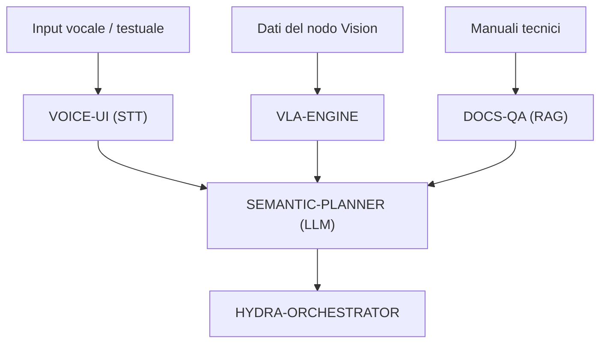

<!-- =============================================================================
HYDRA-UMC-COGNITIVE-NODE - Cognitive AI node (Hailo-10)
Copyright (C) JuanenRac (Electro Hobby 3D) <electrohobby3d@gmail.com>
GPL-3.0-or-later - see LICENSE
============================================================================= -->

<p align="center">
  
</p>

# 🧠 HYDRA-UMC-COGNITIVE-NODE

<p align="center"><a href="README.md">🇺🇸 English</a> | <a href="README_spa.md">🇪🇸 Español</a> | <a href="README_fra.md">🇫🇷 Français</a> | 🇮🇹 <b>Italiano</b> | <a href="README_deu.md">🇩🇪 Deutsch</a> | <a href="README_zho.md">🇨🇳 简体中文</a> | <a href="README_jpn.md">🇯🇵 日本語</a> | <a href="README_por.md">🇵🇹 Português</a></p>

### 🤖 Nodo AI Edge per Ragionamento Semantico & GenAI (Hailo-10 + Raspberry Pi CM5)

<p align="center">
  
  
  
  
  
  
</p>

---

> **Verifica di onestà - cosa funziona davvero oggi:** il controllo di disponibilità della famiglia e il suo schema JSON versionato (`family.py`, `manifest.py`, `models.py`) e la semplice superficie HTTP della stdlib (`api.py`) sono reali e coperti da 61 test superati (`pytest tests/` - `test_manifest.py`, `test_models.py`, `test_family.py`, `test_api.py`, `test_cli.py`). Questo nodo non esegue alcun modello da solo: "Esecuzione locale LLM", "Integrazione VLA" e "Elaborazione comandi vocali" nelle Funzionalità Chiave qui sotto sono esplicitamente contrassegnate come `(pianificato)` - non esiste codice runtime Hailo-10 in questo repository. `docker-compose.yml` ora fa riferimento a un vero Dockerfile per tutti e 4 i figli, ma non è mai stato effettivamente eseguito come un unico stack in questo ambiente di sviluppo (nessun runtime Docker disponibile qui) - la mappatura comando/porta di ogni Dockerfile è stata verificata a mano rispetto a ciò che la propria unità systemd di ogni figlio esegue già sulla vera CM5, non verificata dal vivo. Vedi `CHANGELOG.md` per cosa è stato esattamente consegnato finora.

> **Stato di sicurezza (safety e security):** questo ecosistema non è un sistema di sicurezza certificato. Non esiste ancora un percorso E-STOP hardware, né limiti o interblocchi imposti dal firmware, né un comando di movimento verificato; le immagini firmware sono controllate con CRC-32 e una firma Ed25519, e una compilazione di rilascio rifiuta le chiavi di sviluppo pubblicate (le teste utensile e le schede di espansione dietro il relè usano ancora i bootloader di URTC, che accettano un HMAC-SHA256 a chiave condivisa invece di una firma); TLS e TLS reciproco sono opzionali e disattivati per impostazione predefinita; nessuna scheda propria è stata ancora assemblata o provata. Leggi la [base di sicurezza](https://github.com/JuanenRac/HYDRA-UMC-DOCS/blob/main/docs/SECURITY_BASELINE.md) e il [modello delle minacce](https://github.com/JuanenRac/HYDRA-UMC-DOCS/blob/main/docs/THREAT_MODEL.md) prima di fidarti di qualsiasi affermazione qui per la sicurezza di una persona.

---

## 📋 In breve

| | |
|---|---|
| Versione | `0.1.6` |
| Maturità | Funzionale |
| Test | 61 (`python -m pytest -q tests`) |
| Tecnologia | Python / CM5 / Hailo-10 |
| Destinazione | Il Raspberry Pi CM5 di una cella HYDRA-UMC |
| Su hardware reale | Non ancora: per questa versione non risulta alcuna esecuzione su hardware reale |

**Vai a:** [Panoramica](#-panoramica) · [Architettura](#-architettura) · [Funzionalità](#-funzionalità) · [Sicurezza e protezione](#-sicurezza-e-protezione) · [Interfacce](#-interfacce) · [Configurazione](#-configurazione) · [Avvio rapido](#-avvio-rapido) · [Test](#-test) · [Risoluzione dei problemi](#-risoluzione-dei-problemi) · [Struttura del repository](#-struttura-del-repository) · [Progetti correlati](#-progetti-correlati)

## 🚦 Stato del progetto

Ogni riga è una parte di questo repository e il semaforo dice a che punto è oggi. È scritta in base a ciò che il repository può mostrare (test, compilazioni, esecuzioni), non a ciò che è previsto.

🟢 Fatto e verificato · 🟡 Funziona, con limiti noti · 🟠 Fatto a metà o non ancora verificato · 🔴 Non fatto o non funzionante

| Area | Stato | Cosa significa qui |
|---|---|---|
| Software | 🟡 | Funziona per il suo scopo principale; la verifica di onestà qui sopra elenca ciò che manca ancora |
| Test | 🟢 | 61 test automatici, eseguiti a ogni modifica |
| Hardware reale | 🔴 | Non ancora: per questa versione non risulta alcuna esecuzione su hardware reale |
| Documentazione | 🟢 | README in otto lingue, verificato rispetto al manifesto a ogni modifica |

## 🎯 Panoramica

**HYDRA-UMC-COGNITIVE-NODE** funge da "lobo frontale" dell'ecosistema HYDRA-UMC. Alimentato dalla NPU Hailo-10 (40 TOPS), consente ragionamenti semantici complessi, comprensione del linguaggio naturale e pianificazione di compiti vision-language-action (VLA) direttamente all'edge.

Trasforma le istruzioni umane di alto livello in sequenze robotiche logiche, gestendo il recupero degli errori e l'ottimizzazione della missione senza dipendenza dal cloud.

## 🧩 Ruolo in HYDRA-UMC

**HYDRA-UMC-COGNITIVE-NODE** è il punto di integrazione della famiglia cognitiva Hailo-10. Oggi il suo lavoro reale è un controllo di prontezza: legge il manifesto dei quattro figli (VLA-ENGINE, VOICE-UI, SEMANTIC-PLANNER, DOCS-QA), guarda la cartella condivisa dei pesi dei modelli e, su richiesta, interroga ogni figlio via HTTP. Non è un motore di ragionamento.

## 🏛️ Architettura

<p align="center">
  
</p>

<details>
<summary>Versione testuale del diagramma (Mermaid)</summary>



</details>

**Perché è fatto così**

Questo repository è il **punto padre/di integrazione** della famiglia
Cognitive AI Node. Non esegue esso stesso alcun modello - possiede le
risorse condivise e il cablaggio che permettono ai suoi quattro figli di
agire come un'unica unità cognitiva sulla stessa scheda fisica:

* **Perché questo nodo non ha hardware/firmware proprio.** A differenza
  del firmware a livello di scheda madre di HYDRA-UMC, questo nodo gira
  interamente su un modulo Raspberry Pi CM5 + Hailo-10 M.2 già
  esistente - non c'è alcun PCB o microcontrollore proprio da
  progettare qui, quindi le cartelle `hardware/`/`firmware/` sono state
  potate invece di essere lasciate vuote.
* **Perché `os/` e `models/` vivono solo nel padre.** L'immagine HydraOS
  e i pesi LLM/VLA quantizzati sono risorse condivise a livello di
  scheda - mantenere un'unica copia nel padre e montarla in sola lettura
  in ogni container figlio (vedi `docker-compose.yml`) evita quattro
  copie divergenti di pesi di più gigabyte.
* **Perché una struttura `src/`.** Mantiene il pacchetto installabile
  (`hydra_umc_cognitive_node`) separato dal tooling nella radice del repo
  (`bump_version.py`, `docker-compose.yml`), coerentemente con il resto
  dei progetti Python dell'ecosistema.
* **Perché il punto di ingresso oggi si limita a stampare
  identità/versione/ruolo.** Questa è la fase di andamiaje
  (impalcatura): dimostrare che il pacchetto si installa, compila e
  importa correttamente - sulla versione Python reale di destinazione -
  è un prerequisito prima di aggiungere la vera logica di orchestrazione
  LLM/VLA/vocale, e mantiene quel lavoro successivo isolato dalle
  questioni di packaging.
* **Perché `docker-compose.yml` documenta il contratto di integrazione,
  non solo collega le immagini.** Decidere quale servizio dipende da
  quale e quali mount di dispositivo/volume serve a ciascuno è stato
  scritto prima che qualsiasi figlio avesse un Dockerfile - evitando che
  questa forma venisse inventata più tardi in modo improvvisato. Tutti e
  4 i figli (VLA-Engine, Voice-UI, Semantic-Planner, Docs-QA) hanno ora
  un proprio vero Dockerfile, chiudendo un vero gap - `docker compose up`
  ora compila ed esegue davvero.
* **Come si inserisce nel resto dell'ecosistema.** Questo nodo si trova
  un livello sopra la percezione (HYDRA-UMC-VISION-NODE, Hailo-8) e un
  livello sotto l'orchestrazione della missione
  (HYDRA-UMC-ORCHESTRATOR): trasforma istruzioni vocali/testuali e
  rilevamenti in decisioni semantiche, che l'orchestratore trasforma poi
  in comandi fisici per i robot.
* **Perché `family-status` legge il manifest proprio di ciascun figlio
  invece di un elenco mantenuto a mano.** `hydra-umc.project.json` è già
  l'unica fonte di verità di cui si fidano dashboard e updater di tutto
  l'ecosistema - un secondo elenco qui
  andrebbe fuori sincrono non appena la maturità reale di un figlio
  cambiasse e nessuno si ricordasse di aggiornarlo.
* **Perché un figlio senza checkout locale è un "non trovato" reale e
  onesto, non un errore.** Un hub di integrazione non sa davvero se uno
  sviluppatore ha clonato localmente tutti e quattro i figli -
  `manifest.py` restituisce `None` per ogni fallimento reale (repo
  assente, manifest assente, JSON malformato) affinché `family-status`
  lo segnali chiaramente invece di andare in crash.
* **Perché le letture del manifest di un fratello sono limitate a
  64 KiB.** Ogni manifest reale in questo ecosistema pesa da poche
  centinaia di byte a un paio di KiB - un checkout corrotto o malevolo il
  cui manifest sia stato sostituito con un file sovradimensionato non
  deve mai far caricare in memoria una quantità illimitata di dati da un
  normale controllo di disponibilità. Degrada a `None`, come qualsiasi
  altro manifest malformato.
* **Perché `family-status` segnala `models/` anche se questo nodo non
  esegue esso stesso alcun modello.** "I repository fratelli sono
  clonati" e "i pesi condivisi di cui avrebbero bisogno sono realmente
  presenti" sono due fatti reali distinti - `check_shared_models()` di
  `models.py` verifica onestamente il secondo (vuoto ma presente conta
  come mancante) invece di lasciare che un operatore presuma la
  disponibilità solo dalla presenza dei figli.

## ✨ Funzionalità

* 🧠 **Esecuzione LLM locale:** Inferenza accelerata dall'hardware per modelli quantizzati (Llama/Mistral). *(pianificato - richiede il vero runtime di modelli Hailo-10)*
* 👁️ **Integrazione VLA:** Modelli Vision-Language-Action per un'esecuzione intuitiva dei compiti. *(pianificato)*
* 🎙️ **Elaborazione comandi vocali:** STT/TTS in tempo reale per l'interazione uomo-robot. *(pianificato)*
* 🛡️ **Privacy innanzitutto:** Elaborazione 100% offline di tutte le attività cognitive. *(vero per progettazione una volta che quanto sopra esista - nulla qui chiama una rete oggi)*
* 🧩 **Hub di Integrazione (v0):** Possiede l'immagine HydraOS condivisa e i
  pesi dei modelli quantizzati consumati dai suoi 4 figli, e li collega
  tra loro come servizi fratelli in un unico `docker-compose.yml`. Il vero
  controllo `family-status` legge il manifest reale di ciascun figlio per
  segnalare presenza/versione/maturità. *(implementato come un vero
  controllo di disponibilità - vedi BUILD ED ESECUZIONE sotto)*
* 🔒 **Schema di stato versionato + letture del manifest con limite di risorse:** `family-status --json` stampa un risultato reale, versionato e leggibile da macchina; qualsiasi manifest di un fratello superiore a 64 KiB (un checkout corrotto o malevolo) degrada a "non trovato" invece di essere letto senza limiti. *(implementato)*
* 🩺 **Salute dei figli in esecuzione, tag delle immagini e i pesi nel contenitore del motore:** `family-status --probe` (o `GET /family-status?probe=1`) chiede inoltre a ciascun figlio in esecuzione la sua salute, sulla rotta che dichiara il suo manifesto (altrimenti `/stats`), e riporta se ha risposto, con quale stato e quanto in fretta, e cosa dice di sé il figlio; termina con codice diverso da zero se uno non sta bene. Dove si trovano i figli è fissato all'avvio del nodo: le loro porte di loopback per impostazione predefinita, o `HYDRA_UMC_COGNITIVE_NODE_CHILD_URLS` (come lo imposta il file compose nello stack). Le immagini del file compose sono etichettate `HYDRA_UMC_<NOME>_VERSION` (dal `.env`; `family-versions` stampa quelle righe dai manifesti) o `latest`, mai un numero inventato, il contenitore vla-engine ora ha `models/` montato dove il motore lo cerca, e un secondo workflow controlla che `docker compose config` si risolva ancora. *(provato con servizi sostitutivi, non con i veri figli né con un Hailo-10)*
* 🪫 **Controllo di degrado dei pesi di modello condivisi:** `family-status` segnala onestamente se la directory `models/` di questo nodo contiene realmente pesi veri, non solo se i repository fratelli sono clonati. *(implementato)*
* 📦 **Versionamento Contachilometri:** La versione di `pyproject.toml` viene alzata solo dal comando `bump` esplicito (`python tools/hydra_project_tool.py bump`, che esegue `bump_version.py`) - compilare non la cambia mai.

## 🔒 Sicurezza e protezione

| Minaccia | Difesa | Dove |
|---|---|---|
| Un manifesto enorme o ostile, una cartella di modelli enorme | Il manifesto di un repo fratello viene letto fino a 64 KiB; la cartella dei modelli viene ispezionata per al massimo 20 000 file e contano solo i suffissi dei pesi `.bin .gguf .har .hef .onnx .safetensors .tflite` | `manifest.py`, `models.py` |
| Un figlio che risponde con spazzatura o si blocca | La sonda attende al massimo 2 secondi e legge al massimo 64 KiB; il percorso di salute di un manifesto è accettato solo se inizia con `/`, è più corto di 128 caratteri e non ha spazi, altrimenti si usa `/stats` | `probe.py` |
| Esposizione alla rete | L'interfaccia HTTP è di sola lettura e ascolta su `127.0.0.1:8096` per impostazione predefinita; scansiona lo spazio di lavoro fissato all'avvio e risponde `400` a una richiesta che cerca di sceglierne un altro. Non ha token: se ne abbia bisogno è ancora aperto | `api.py`, `main.py` |

**Cosa non fa mai:** non è un motore di ragionamento: in questo repository non gira alcun modello e non scrive nulla nei figli.

## 🔌 Interfacce

`family-status [--workspace DIR] [--models-dir DIR] [--probe] [--json]` e `serve [--addr 127.0.0.1] [--port 8096] [--workspace DIR] [--models-dir DIR]`. Le porte predefinite dei figli sono VLA-ENGINE 8098, VOICE-UI 8091, SEMANTIC-PLANNER 8109 e DOCS-QA 8110.

`serve` esegue lo stesso identico controllo `family-status` come un
piccolo `http.server` della libreria standard invece di un'unica
chiamata CLI - è il comando che l'unit systemd
`hydra-umc-cognitive-node.service` della CM5 è configurata per eseguire:

```bash
./run.sh serve --addr 127.0.0.1 --port 8096
# GET /family-status  -> lo stesso JSON stampato sopra da `family-status --json`
# GET /stats          -> { "status": "ok" }
```

`GET /family-status` esamina il workspace fissato all'avvio del servizio (`--workspace`, `--models-dir` oppure `HYDRA_UMC_COGNITIVE_NODE_WORKSPACE` / `HYDRA_UMC_COGNITIVE_NODE_MODELS_DIR`) e risponde `400` se una richiesta prova a sceglierne un altro; qualsiasi altro percorso restituisce `404`. Vedi il
[Riferimento CLI](docs/CLI_REFERENCE.md) per il riferimento completo dei
comandi: ogni flag, l'output reale catturato di `-h`/`curl` e la tabella
dei codici di uscita.

## ⚙️ Configurazione

| Variabile | Predefinito | Cosa imposta |
|---|---|---|
| `HYDRA_UMC_COGNITIVE_NODE_WORKSPACE` | la cartella padre di questo repository | dove si trovano i repository fratelli |
| `HYDRA_UMC_COGNITIVE_NODE_MODELS_DIR` | `models/` | i pesi dei modelli condivisi |
| `HYDRA_UMC_COGNITIVE_NODE_CHILD_URLS` | le porte predefinite sopra | gli URL dei figli per `--probe` |

## 🚀 Avvio rapido

Richiede Python >= 3.10.

```bash
# Linux / macOS / Git Bash
./build.sh   # crea .venv, installa il pacchetto (editable), verifica l'import
./run.sh     # esegue il punto di ingresso

# Windows (cmd)
build.bat
run.bat
```

`build.sh`/`build.bat` non cambiano mai la versione (solo `python tools/hydra_project_tool.py bump` la alza), ed eseguono la vera
suite di test (`pytest tests/`). Output atteso di un `run.sh` senza
argomenti:

```text
HYDRA-UMC-COGNITIVE-NODE v0.1.6
Semantic reasoning & GenAI edge node (Hailo-10) - integrates VLA-Engine, Voice-UI, Semantic-Planner and Docs-QA into one cognitive node.
```

Vedere `docker-compose.yml` per come i quattro servizi figli (VLA-Engine,
Voice-UI, Semantic-Planner, Docs-QA) si collegano a questo nodo - ognuno
ha ora un proprio vero Dockerfile.

Il vero sottocomando `family-status` controlla i veri figli in un vero
checkout locale:

```bash
./run.sh family-status
./run.sh family-status --workspace /percorso/a/un/altro/checkout
./run.sh family-status --json

# Windows
run.bat family-status
```

`family-status` segnala sempre anche i pesi di modello condivisi propri
di questo nodo - una `models/` reale e vuota su una macchina di sviluppo
è onestamente `MISSING`, mai ignorata silenziosamente:

```text
Cognitive AI Node family status (workspace: /path/to/workspace):
  HYDRA-UMC-VLA-ENGINE: v0.1.8, maturity=functional, role=service
  ...

Shared model weights: MISSING (.../HYDRA-UMC-COGNITIVE-NODE/models) - this node's own os/models weights have not been provisioned on this machine; children that need them will run in their own honest degraded/no-hardware mode.

All 4 children present.
```

`--json` stampa invece gli stessi dati reali come un oggetto versionato
e leggibile da macchina:

```bash
$ ./run.sh family-status --json
{
  "schema_version": "1.0",
  "shared_models": { "present": false, "path": ".../models" },
  "children": [
    { "name": "HYDRA-UMC-VLA-ENGINE", "present": true, "version": "0.1.8", "maturity": "functional", "role": "service" },
    ...
  ],
  "all_children_present": true
}
```

Per impostazione predefinita usa la propria directory padre di questo
repo - lo stesso layout che qualsiasi checkout reale di questo
ecosistema già usa (tutti i repo come fratelli sotto un'unica cartella
di workspace). Termina con `1` se manca un figlio reale.

## 🧪 Test

61 test automatici si eseguono con `python -m pytest -q tests`. Controllano i manifesti, la cartella dei modelli, la sonda, la riga di comando e l'interfaccia HTTP con fixture locali; né hardware né rete esterna.

La CI esegue `HYDRA_UMC_CI=1 python tools/ci_validate.py`, che controlla il manifesto, i documenti, gli otto README e le immagini.

## 🏗️ Compilazione e rilascio

Per un rilascio non c'è nulla da compilare: `build.sh` / `build.bat` creano l'ambiente virtuale, installano il pacchetto in modalità modificabile ed eseguono i test, e `build-test` si limita a controllare. Compilare non cambia mai la versione; la alza soltanto `python tools/hydra_project_tool.py bump`, che sposta anche il registro delle modifiche. La versione del pacchetto, del manifesto e del registro deve coincidere, altrimenti `ci_validate.py` fallisce.

## 🩺 Risoluzione dei problemi

* **`python: comando non trovato` / il build fallisce al passo 1.**
  Richiede Python >= 3.10 nel `PATH`. Su Windows, installalo da
  [python.org](https://python.org) e spunta "Add to PATH" durante
  l'installazione; su Linux/macOS di solito si chiama `python3`.
* **`build.sh` non riesce ad attivare il venv.** `python3 -m venv .venv`
  posiziona lo script di attivazione in un percorso diverso a seconda
  della piattaforma: `.venv/bin/activate` su Linux/macOS,
  `.venv/Scripts/activate` su Windows (anche per un venv Python Windows
  usato da Git Bash). `build.sh` verifica già entrambi i percorsi - se
  continua a fallire, elimina `.venv/` e riesegui `./build.sh` per
  ricrearlo da zero.
* **`pip install -e .` fallisce.** Di solito per un `.venv/` obsoleto.
  Elimina la cartella `.venv/` e riesegui `./build.sh`/`build.bat` per
  ricrearla.
* **`import OK` non viene mai stampato.** Significa che `python -c
  "import hydra_umc_cognitive_node"` è fallito - riesegui con il venv
  attivo per vedere il traceback reale (una modifica manuale rotta di
  `pyproject.toml` è la causa abituale dopo un merge manuale).
* **`docker compose up` non riesce ad avviare `voice-ui`.** Il suo
  container rifiuta di ascoltare oltre loopback senza un vero
  `HYDRA_UMC_VOICE_UI_TOKEN` (di proposito - vedi il commento dello
  stesso `docker-compose.yml`); impostalo in un vero file `.env` o nel
  tuo gestore di segreti, non commetterlo mai. Eseguire ogni servizio
  direttamente con il proprio `run.sh`/`run.bat` durante lo sviluppo non
  richiede questo token, perché lì `--host` resta su loopback.

## 📂 Struttura del repository

<p align="center">
  
</p>

<details>
<summary>Versione testuale dell'albero</summary>

```text
HYDRA-UMC-COGNITIVE-NODE/
├── src/hydra_umc_cognitive_node/
│   ├── family.py                                stato dei quattro servizi figli
│   ├── manifest.py                              legge il manifesto di un repo fratello
│   ├── models.py                                controlla la cartella condivisa dei pesi
│   ├── probe.py                                 ogni figlio risponde via HTTP
│   └── api.py main.py                           interfaccia HTTP e riga di comando
├── tests/                                       56 test
├── docs/                                        il riferimento della riga di comando
├── models/                                      pesi dei modelli condivisi
├── os/                                          note del livello OS
├── tools/                                       esecutore di build e test, aumento di versione, validatore CI, generatori e controlli di README e immagini
├── images/                                      banner e immagini del README
├── .github/                                     workflow CI e modelli di segnalazione
├── pyproject.toml                               metadati del pacchetto e dipendenze
├── hydra-umc.project.json                       manifesto: versione, maturità, famiglia
├── CHANGELOG.md                                 cosa è cambiato in ogni versione
├── build.sh build.bat                           script di build (non cambiano mai la versione)
├── build-test.sh build-test.bat                 script di build (non cambiano mai la versione)
├── test.sh test.bat                             eseguono i test
├── systemd/                                     unità di servizio per la CM5
├── docker-compose.yml / Dockerfile              il nodo con i suoi quattro figli
├── bump_version.py / bump_manifest_version.py   aumento di versione esplicito
├── run.sh run.bat                               avviare il nodo
└── SECURITY.md SUPPORT.md CONTRIBUTING.md CODE_OF_CONDUCT.md LICENSE LICENSE.md
```

</details>

## 🗺️ Roadmap e limiti noti

**Limiti noti oggi**

* **Fase 1:** Distribuzione del motore VLA e elaborazione dell'input multi-modale su Hailo-10.
* **Fase 2:** Integrazione del pianificatore semantico con modelli comportamentali di sciame e memoria a lungo termine.
* **Fase 3:** Esecuzione locale a bassa latenza dell'interfaccia vocale e cancellazione del rumore industriale.
* **Fase 4:** Audit del processo decisionale autonomo e integrazione completa con Dashboard AI per il feedback "Verifica e Chiedi".

## 🌍 Lingue

Questo README e i documenti del repository esistono in otto lingue: inglese, spagnolo, tedesco, francese, italiano, giapponese, cinese e portoghese (Portogallo). Sono scritti insieme e la CI verifica che gli otto file abbiano le stesse sezioni e gli stessi link. Questo repository non ha uno schermo né un catalogo di messaggi propri, quindi non ci sono stringhe di interfaccia da tradurre.

## 🔗 Progetti correlati

Questo progetto fa parte dell'ecosistema robotico HYDRA-UMC dello stesso autore (JuanenRac / Electro Hobby 3D). Vale la pena conoscerlo, poiché una richiesta potrebbe in realtà riguardare uno di questi invece di questo repository.

**Progetti Figli** — quattro sono fasi del flusso cognitivo di questo nodo (ingresso vocale, decisione, azione, fondamento); il quinto è un'applicazione di manutenzione separata costruita sulla stessa pipeline Hailo-10
- **[HYDRA-UMC-VOICE-UI](https://github.com/JuanenRac/HYDRA-UMC-VOICE-UI)** — vero front-end vocale (VAD + parser di intenti) con un relay verso Watch limitato e soggetto a conferma.
- **[HYDRA-UMC-SEMANTIC-PLANNER](https://github.com/JuanenRac/HYDRA-UMC-SEMANTIC-PLANNER)** — vera scomposizione dei task basata su regole e recupero semantico degli errori sui codici errore MCU.
- **[HYDRA-UMC-VLA-ENGINE](https://github.com/JuanenRac/HYDRA-UMC-VLA-ENGINE)** — vera codifica/decodifica di token d'azione e generazione di traiettoria per un modello Vision-Language-Action.
- **[HYDRA-UMC-DOCS-QA](https://github.com/JuanenRac/HYDRA-UMC-DOCS-QA)** — vera ricerca documentale TF-IDF (solo libreria standard) sui documenti Markdown di questo ecosistema.
- **[HYDRA-UMC-LOCAL-TECHNICIAN](https://github.com/JuanenRac/HYDRA-UMC-LOCAL-TECHNICIAN)** — tecnico di manutenzione IA locale e con cancelli di policy per l'ecosistema stesso - osserva, diagnostica e propone correzioni; i due livelli di rischio più alti non sono deliberatamente ancora implementati.

**Direttamente Correlati**
- **[HYDRA-UMC-ORCHESTRATOR](https://github.com/JuanenRac/HYDRA-UMC-ORCHESTRATOR)** — hub di integrazione con un vero contratto di health-report gRPC/Protobuf e una macchina a stati di missione; è ciò che dà a questo nodo i propri ordini di missione.
- **[HYDRA-UMC-VISION-NODE](https://github.com/JuanenRac/HYDRA-UMC-VISION-NODE)** — hub di integrazione per la pipeline di visione Hailo-8, con un vero controllo di prontezza hardware per fase; lo strato semantico di questo nodo ne consuma le rilevazioni.
- **[HYDRA-UMC-STUDIO](https://github.com/JuanenRac/HYDRA-UMC-STUDIO)** — dashboard di controllo web con visualizzazione 3D multi-robot in tempo reale; una delle superfici di controllo vocale di questo nodo.
- **[HYDRA-UMC-DSI](https://github.com/JuanenRac/HYDRA-UMC-DSI)** — interfaccia touch nativa per il touchscreen DSI da 7" a bordo, incorporata direttamente nel CM5; l'altra superficie di controllo vocale di questo nodo.

**Fa Anche Parte dell'Ecosistema**

*Hardware e Piattaforma di Base*
- **[HYDRA-UMC](https://github.com/JuanenRac/HYDRA-UMC)** — il progetto della scheda madre del braccio robotico: host CM5 + coprocessore STM32H745 dual-core, pensato per coordinare fino a 8 bracci utensile via CAN-OTA/SPI-OTA (firmware in fase iniziale; nessuna scheda assemblata per ora).
- **[HYDRA-UMC-OS](https://github.com/JuanenRac/HYDRA-UMC-OS)** — livello prodotto riproducibile su Raspberry Pi OS per il CM5: agente in sola lettura, config/profili validati, provisioning WiFi al primo contatto.
- **[HYDRA-UMC-SDK](https://github.com/JuanenRac/HYDRA-UMC-SDK)** — il contratto JSON-Schema condiviso e la barriera software di controllo dei job contro cui ogni bridge valida i propri comandi (non è una funzione di sicurezza certificata).
- **[HYDRA-UMC-CONNECTOR-HUB](https://github.com/JuanenRac/HYDRA-UMC-CONNECTOR-HUB)** — registro dichiarativo e validatore di manifesti adattatore per connettori di macchine esterne; estende la propria idea di contratto dell'SDK alle macchine esterne senza sostituire i progetti di gateway industriale.

*Backend Centrale e Client*
- **[HYDRA-UMC-SERVER](https://github.com/JuanenRac/HYDRA-UMC-SERVER)** — il vero backend headless (REST/WebSocket) con cui parla davvero ogni client di controllo.
- **[HYDRA-UMC-SUITE](https://github.com/JuanenRac/HYDRA-UMC-SUITE)** — centro di comando sciame desktop (PySide6) per più server contemporaneamente, pacchettizzato come eseguibile standalone.
- **[HYDRA-UMC-ANDROID-CONTROL](https://github.com/JuanenRac/HYDRA-UMC-ANDROID-CONTROL)** — app di controllo nativa per Android con login biometrico e un companion Wear OS abbinato.
- **[HYDRA-UMC-IOS-CONTROL](https://github.com/JuanenRac/HYDRA-UMC-IOS-CONTROL)** — app di controllo per iOS/iPadOS (Flutter) con sincronizzazione WebSocket in tempo reale.
- **[HYDRA-UMC-EDITOR-URDF](https://github.com/JuanenRac/HYDRA-UMC-EDITOR-URDF)** — creatore/editor grafico desktop di URDF che invia i modelli finiti al catalogo di STUDIO.
- **[HYDRA-UMC-EDITOR-STL](https://github.com/JuanenRac/HYDRA-UMC-EDITOR-STL)** — editor desktop di modelli STL, che trasforma/sostituisce/rimuove/aggiunge veri pezzi nello stesso catalogo di modelli modificato anche da HYDRA-UMC-EDITOR-URDF.
- **[HYDRA-UMC-BRIDGE-AMR](https://github.com/JuanenRac/HYDRA-UMC-BRIDGE-AMR)** — barriera di coordinamento per flotte AGV/AMR tramite un publisher MQTT VDA 5050 (testato solo contro una flotta emulata).
- **[HYDRA-UMC-BRIDGE-CNC](https://github.com/JuanenRac/HYDRA-UMC-BRIDGE-CNC)** — coordinatore ad alto livello per celle CNC con accesso a stato/byte di controllo GRBL (testato solo contro un emulatore).
- **[HYDRA-UMC-BRIDGE-DROIDS](https://github.com/JuanenRac/HYDRA-UMC-BRIDGE-DROIDS)** — barriera di coordinamento per droidi con zampe/umanoidi, con un mittente di comandi per Boston Dynamics Spot (testato solo contro un emulatore).
- **[HYDRA-UMC-BRIDGE-LASER](https://github.com/JuanenRac/HYDRA-UMC-BRIDGE-LASER)** — coordinatore per celle laser che legge 3 segnali GPIO di chiave/involucro/interblocco (testato solo contro un chip simulato; non può armare né far partire un laser).
- **[HYDRA-UMC-BRIDGE-OPENPNP](https://github.com/JuanenRac/HYDRA-UMC-BRIDGE-OPENPNP)** — coordinatore ad alto livello sicuro per il flusso schede del pick-and-place OpenPnP.
- **[HYDRA-UMC-BRIDGE-PRINTER3D](https://github.com/JuanenRac/HYDRA-UMC-BRIDGE-PRINTER3D)** — barriera di coordinamento sicura per stampanti 3D Moonraker/Klipper, con comandi di lavoro reali e controllati.
- **[HYDRA-UMC-BRIDGE-ROS2](https://github.com/JuanenRac/HYDRA-UMC-BRIDGE-ROS2)** — coordinatore con un trasporto ROS 2 rclpy importato in modo lazy (non ancora eseguito contro un'installazione ROS 2).
- **[HYDRA-UMC-BRIDGE-UAV](https://github.com/JuanenRac/HYDRA-UMC-BRIDGE-UAV)** — barriera di coordinamento per UAV dotati di fotocamera, con un mittente di comandi MAVLink (testato solo contro un emulatore).

*Piattaforma Strumenti URTC*
- **[URTC](https://github.com/JuanenRac/URTC)** — firmware per la scheda fisica dell'Universal Robot Tool Controller, oltre 25 profili utensile su bus CAN.
- **[URTC-FLASHER](https://github.com/JuanenRac/URTC-FLASHER)** — strumento desktop con GUI per il flashing delle schede URTC, CAN-OTA più SWD/JTAG a chip intero.
- **[URTC-TESTER](https://github.com/JuanenRac/URTC-TESTER)** — strumento desktop di diagnostica CAN-bus dal vivo per schede URTC, un pannello per profilo utensile.
- **[URTC-WEB-STUDIO](https://github.com/JuanenRac/URTC-WEB-STUDIO)** — alternativa basata su browser a URTC-TESTER tramite la Web Serial API, senza installazione locale.
- **[URTC-GATEWAY](https://github.com/JuanenRac/URTC-GATEWAY)** — gateway davanti al bus CAN di URTC: elenco di identificatori consentiti, limite di frequenza e chiave di sessione; software provato su computer, non ancora su un bus reale.

*Nodo IA Visione (Hailo-8)*
- **[HYDRA-UMC-DETECTION-HEF](https://github.com/JuanenRac/HYDRA-UMC-DETECTION-HEF)** — registro reale di modelli compilati con verifica di caricamento sicuro per architettura Hailo/checksum.
- **[HYDRA-UMC-VISION-STREAMER](https://github.com/JuanenRac/HYDRA-UMC-VISION-STREAMER)** — generatore reale di pipeline GStreamer + config MediaMTX, con una vera barriera di integrazione HailoRT.
- **[HYDRA-UMC-VISUAL-SERVOING-API](https://github.com/JuanenRac/HYDRA-UMC-VISUAL-SERVOING-API)** — legge di correzione Position-Based Visual Servoing con autorizzazione condizionata allo stato di zona; ancora nessuna stima di posa da telecamera.
- **[HYDRA-UMC-SAFETY-ZONES](https://github.com/JuanenRac/HYDRA-UMC-SAFETY-ZONES)** — logica v0 di violazione zona, freschezza di calibrazione e richiesta E-STOP che legge le posizioni degli oggetti da un file; nessun rilevatore la alimenta e nessun E-STOP fisico è ancora collegato.

*Orchestrazione e Sciame*
- **[HYDRA-UMC-JOB-DISPATCHER](https://github.com/JuanenRac/HYDRA-UMC-JOB-DISPATCHER)** — vera coda di lavori basata su priorità con deduplicazione, su una vera API HTTP.
- **[HYDRA-UMC-NODE-HEALING](https://github.com/JuanenRac/HYDRA-UMC-NODE-HEALING)** — vero watchdog di salute della flotta basato su gRPC, con retry/backoff e rilevamento di discrepanza d'identità.
- **[HYDRA-UMC-PATH-PLANNER-3D](https://github.com/JuanenRac/HYDRA-UMC-PATH-PLANNER-3D)** — vero pianificatore di percorsi 3D basato su RRT, con vera validazione delle collisioni ostacolo/spazio di lavoro.
- **[HYDRA-UMC-SWARM-SYNC](https://github.com/JuanenRac/HYDRA-UMC-SWARM-SYNC)** — vera sincronizzazione di stato CRDT LWW-Element-Map, con property test per la convergenza multi-cella.

*Gemello Digitale e Simulazione*
- **[HYDRA-UMC-TWIN](https://github.com/JuanenRac/HYDRA-UMC-TWIN)** — hub di integrazione per il motore di gemello digitale, con un vero contratto di sincronizzazione per compatibilità di versione.
- **[HYDRA-UMC-HIL-BRIDGE](https://github.com/JuanenRac/HYDRA-UMC-HIL-BRIDGE)** — router hardware-in-the-loop con un interblocco software di collisione tra simulazione e hardware reale (testato senza hardware reale).
- **[HYDRA-UMC-PHYSICS-REPLICA](https://github.com/JuanenRac/HYDRA-UMC-PHYSICS-REPLICA)** — vera cinematica diretta e validazione dei limiti articolari su un vero sottoinsieme URDF.
- **[HYDRA-UMC-SYNTHETIC-DATA-GEN](https://github.com/JuanenRac/HYDRA-UMC-SYNTHETIC-DATA-GEN)** — vero generatore procedurale di scene 2D con esportazione di annotazioni YOLO/COCO.

*Dati e Analisi*
- **[HYDRA-UMC-DATALAKE](https://github.com/JuanenRac/HYDRA-UMC-DATALAKE)** — vero archivio di serie temporali basato su sqlite3, con una vera API HTTP di ingestione/query.
- **[HYDRA-UMC-ANOMALY-DETECTOR](https://github.com/JuanenRac/HYDRA-UMC-ANOMALY-DETECTOR)** — vero rilevatore di anomalie FFT + baseline statistica, con monitoraggio della deriva.
- **[HYDRA-UMC-PRODUCTION-REPORTS](https://github.com/JuanenRac/HYDRA-UMC-PRODUCTION-REPORTS)** — vero calcolo OEE/disponibilità sullo storico di DATALAKE, con esportazione CSV riproducibile.
- **[HYDRA-UMC-TELEMETRY-COLLECTOR](https://github.com/JuanenRac/HYDRA-UMC-TELEMETRY-COLLECTOR)** — vera pipeline di ingestione CAN/WebSocket verso DATALAKE, con deduplicazione per sequenza.

*Gateway Industriale*
- **[HYDRA-UMC-GATEWAY-INDUSTRIAL](https://github.com/JuanenRac/HYDRA-UMC-GATEWAY-INDUSTRIAL)** — hub di integrazione che inoltra ai protocolli industriali, con un vero livello di allowlist dei comandi/backpressure.
- **[HYDRA-UMC-OPCUA-SERVER](https://github.com/JuanenRac/HYDRA-UMC-OPCUA-SERVER)** — vero spazio di indirizzi OPC-UA, verificato con una vera sessione client del protocollo binario.
- **[HYDRA-UMC-MQTT-BROKER](https://github.com/JuanenRac/HYDRA-UMC-MQTT-BROKER)** — vero broker MQTT con autenticazione opzionale per client e ACL sui topic.
- **[HYDRA-UMC-MTCONNECT-ADAPTER](https://github.com/JuanenRac/HYDRA-UMC-MTCONNECT-ADAPTER)** — veri endpoint XML `/probe` e `/current` di MTConnect, con output in modalità degradata.

*Strumenti Complementari e Operazioni dell'Ecosistema*
- **[HYDRA-UMC-DASHBOARD-AI](https://github.com/JuanenRac/HYDRA-UMC-DASHBOARD-AI)** — pannelli Smart Summaries e Anomaly Highlighting su DATALAKE/ANOMALY-DETECTOR, con un fallback statistico onesto.
- **[HYDRA-UMC-TOOL-CLI](https://github.com/JuanenRac/HYDRA-UMC-TOOL-CLI)** — CLI di flotta con un vero e stabile contratto di exit-code, un client live reale della stessa API di HYDRA-UMC-SERVER.
- **[HYDRA-UMC-WATCH](https://github.com/JuanenRac/HYDRA-UMC-WATCH)** — app companion WearOS con schemi di avviso aptico e un relay vocale verso il telefono abbinato (non ancora eseguita su un orologio fisico).
- **[URTC-SMART-RACK](https://github.com/JuanenRac/URTC-SMART-RACK)** — firmware per un rack di montaggio schede con decodifica reale dell'ID utensile e logica di preriscaldamento Smart Idle.
- **[URTC-VISION-TOOL](https://github.com/JuanenRac/URTC-VISION-TOOL)** — firmware più un vero companion di visione Python per una testa utensile di ispezione termica/RGB.
- **[HYDRA-UMC-UPDATER](https://github.com/JuanenRac/HYDRA-UMC-UPDATER)** — strumento amministrativo desktop che scopre, clona e aggiorna ogni repository di questo ecosistema.
- **[HYDRA-UMC-OS-REBUILDER](https://github.com/JuanenRac/HYDRA-UMC-OS-REBUILDER)** — strumento desktop Windows/Linux che costruisce un'immagine della CM5 pronta da scrivere, precaricata con le versioni più aggiornate dell'ecosistema, con configurazione di primo avvio Wi-Fi/utente/SSH in stile Raspberry Pi Imager.
- **[HYDRA-UMC-OPS-AGENT](https://github.com/JuanenRac/HYDRA-UMC-OPS-AGENT)** — coordinatore di incidenti di manutenzione: un ruolo edge a basso privilegio raccoglie uno snapshot di inventario/salute sanificato, un ruolo control-plane lo rende in sola lettura e chiede a un provider di IA di suggerire una diagnosi - non applica mai una patch né distribuisce nulla.
- **[HYDRA-UMC-DEV-SERVER](https://github.com/JuanenRac/HYDRA-UMC-DEV-SERVER)** — host di sviluppo riproducibile (Raspberry Pi 5 / CM5) che conserva il codice sorgente dell'ecosistema ed esegue attività delimitate di build/test tramite una coda durevole; un ruolo di sviluppo dedicato, esplicitamente distinto da un CM5 operativo.

## 📚 Documentazione

Dove leggere di più:

* [docs/CLI_REFERENCE.md](docs/CLI_REFERENCE.md) - ogni comando e opzione, output reale catturato e i codici di uscita
* [Base di sicurezza dell'ecosistema](https://github.com/JuanenRac/HYDRA-UMC-DOCS/blob/main/docs/SECURITY_BASELINE.md)
* [Modello delle minacce dell'ecosistema](https://github.com/JuanenRac/HYDRA-UMC-DOCS/blob/main/docs/THREAT_MODEL.md)
* [Registro delle modifiche di questo repository](CHANGELOG.md)
* [Licenza di questo repository](LICENSE.md)

## 🤝 Contribuire e comunità

* Prima di una pull request esegui `HYDRA_UMC_CI=1 py -3 tools/ci_validate.py` (oppure `HYDRA_UMC_CI=1 python3 tools/ci_validate.py`): deve stampare `CI_VALIDATION=PASS`. Non eseguire `build.sh` né `build.bat` per questa verifica; compilare non è verificare.
* I otto README sono scritti da un'unica fonte in HYDRA-UMC-DOCS; non modificarli a mano. Cambia la fonte e riscrivili con `tools/make_readmes.py`.
* Non affermare in un README ciò che non è stato eseguito: scrivi «simulato» o «non provato su hardware» quando è la verità.
* Vedi [CONTRIBUTING.md](CONTRIBUTING.md), il [codice di condotta](CODE_OF_CONDUCT.md), [SECURITY.md](SECURITY.md) e [SUPPORT.md](SUPPORT.md).

## 👤 AUTORE

**JuanenRac (Electro Hobby 3D)** · electrohobby3d@gmail.com

## 📜 LICENZA

GPL-3.0-or-later - [LICENSE](LICENSE).
