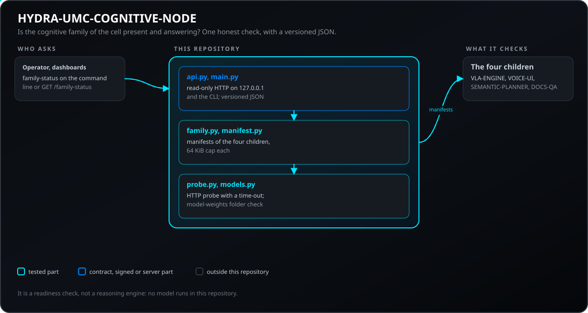
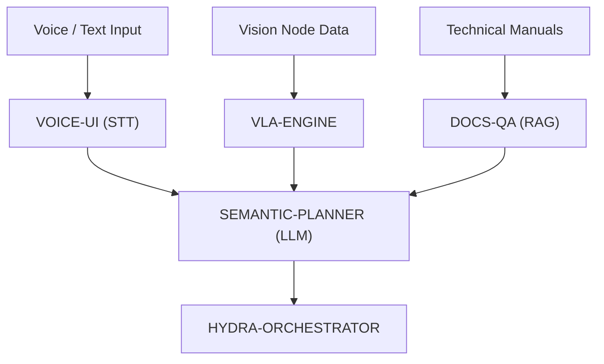
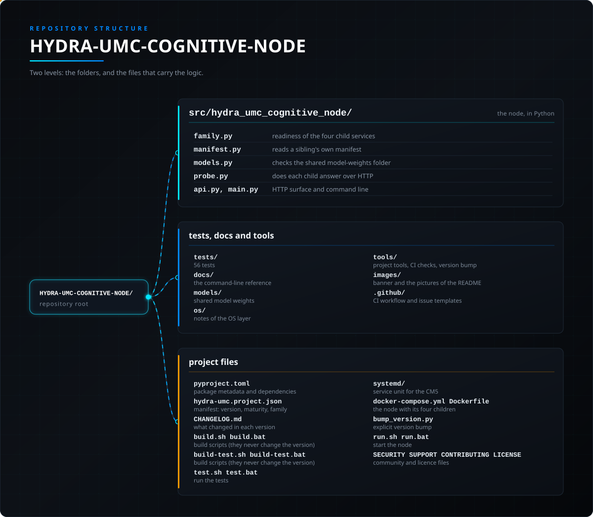

<!-- =============================================================================
HYDRA-UMC-COGNITIVE-NODE - Cognitive AI node (Hailo-10)
Copyright (C) JuanenRac (Electro Hobby 3D) <electrohobby3d@gmail.com>
GPL-3.0-or-later - see LICENSE
============================================================================= -->

<p align="center">
  
</p>

# 🧠 HYDRA-UMC-COGNITIVE-NODE

<p align="center"><a href="README.md">🇺🇸 English</a> | <a href="README_spa.md">🇪🇸 Español</a> | <a href="README_fra.md">🇫🇷 Français</a> | <a href="README_ita.md">🇮🇹 Italiano</a> | <a href="README_deu.md">🇩🇪 Deutsch</a> | <a href="README_zho.md">🇨🇳 简体中文</a> | 🇯🇵 <b>日本語</b> | <a href="README_por.md">🇵🇹 Português</a></p>

### 🤖 意味推論と生成 AI エッジノード（Hailo-10 + Raspberry Pi CM5）

<p align="center">
  
  
  
  
  
  
</p>

---

> **誠実性チェック - 今日実際に動くもの:** ファミリー準備状況チェックとそのバージョン管理された JSON スキーマ（`family.py`、`manifest.py`、`models.py`）、および標準ライブラリのみによる素の HTTP インターフェース（`api.py`）は本物であり、56件の通過するテストで検証されている（`pytest tests/` - `test_manifest.py`、`test_models.py`、`test_family.py`、`test_api.py`、`test_cli.py`）。このノード自体はモデルを一切実行しない - 下記の主要機能にある「ローカル LLM 実行」「VLA 統合」「音声コマンド処理」は明示的に `(計画中)` と表示されており、本リポジトリには Hailo-10 のランタイムコードは存在しない。`docker-compose.yml` は現在、4つの子サービスすべてに対して本物の Dockerfile を参照しているが、この開発環境では一つのスタックとして実際に実行されたことは一度もない（ここには利用可能な Docker ランタイムがない）- 各 Dockerfile のコマンド/ポートのマッピングは、各子サービス自身の systemd unit が実際の CM5 上で既に実行している内容と手作業で照合されたものであり、ライブでは検証されていない。これまでに実際に出荷された内容は `CHANGELOG.md` を参照。

> **安全性とセキュリティの現状:** このエコシステムは認証された安全システムではありません。ハードウェアの E-STOP 経路、ファームウェアが強制する制限やインターロック、検証済みの動作コマンドはまだありません。ファームウェアイメージは CRC-32 と Ed25519 署名で検査し、リリースビルドは公開済みの開発用鍵を拒否します(リレーの先のツールヘッドと拡張ボードは引き続き URTC のブートローダーを使い、署名ではなく共有鍵の HMAC-SHA256 を使います)。TLS と相互 TLS は任意で、既定では無効です。独自基板はまだ実装も試験もされていません。ここに書かれた内容を人の安全のために頼る前に、[セキュリティベースライン](https://github.com/JuanenRac/HYDRA-UMC-DOCS/blob/main/docs/SECURITY_BASELINE.md)と[脅威モデル](https://github.com/JuanenRac/HYDRA-UMC-DOCS/blob/main/docs/THREAT_MODEL.md)をお読みください。

---

## 📋 ひと目で

| | |
|---|---|
| バージョン | `0.1.6` |
| 成熟度 | 機能する |
| テスト | 56 (`python -m pytest -q tests`) |
| 技術 | Python / CM5 / Hailo-10 |
| 対象 | HYDRA-UMC セルの Raspberry Pi CM5 |
| 実機での確認 | まだです：このバージョンについて実機での動作記録はありません |

**移動：** [概要](#-概要) · [アーキテクチャ](#-アーキテクチャ) · [機能](#-機能) · [セキュリティと安全](#-セキュリティと安全) · [インターフェース](#-インターフェース) · [設定](#-設定) · [クイックスタート](#-クイックスタート) · [テスト](#-テスト) · [トラブルシューティング](#-トラブルシューティング) · [リポジトリの構成](#-リポジトリの構成) · [関連プロジェクト](#-関連プロジェクト)

## 🚦 プロジェクトの状況

各行はこのリポジトリの一部分で、信号は今日どこまで進んでいるかを示します。計画ではなく、リポジトリが示せるもの（テスト、ビルド、実行）に基づいて書かれています。

🟢 完了・検証済み · 🟡 動作する（既知の制限あり） · 🟠 一部のみ、または未検証 · 🔴 未実装または動作しない

| 領域 | 状態 | ここでの意味 |
|---|---|---|
| ソフトウェア | 🟡 | 主な目的では動作します。足りない点は上の正直さの確認に書かれています |
| テスト | 🟢 | 自動テスト 56 件。変更のたびに実行されます |
| 実機 | 🔴 | まだです：このバージョンについて実機での動作記録はありません |
| ドキュメント | 🟢 | 8 言語の README。変更のたびにマニフェストと照合されます |

## 🎯 概要

**HYDRA-UMC-COGNITIVE-NODE** は、HYDRA-UMC エコシステムの「前頭葉」として
機能します。Hailo-10 NPU（40 TOPS）によって駆動され、エッジ上で直接、
複雑な意味推論、自然言語理解、そして視覚言語行動（VLA）タスクプランニング
を可能にします。

高レベルの人間の指示を論理的なロボット操作シーケンスに変換し、クラウドに
依存することなくエラー回復とミッション最適化を管理します。

## 🧩 HYDRA-UMC での役割

**HYDRA-UMC-COGNITIVE-NODE** は Hailo-10 の認知ファミリーの統合点です。現時点の実際の仕事は準備状況の確認で、4 つの子（VLA-ENGINE、VOICE-UI、SEMANTIC-PLANNER、DOCS-QA）のマニフェストを読み、共有モデル重みフォルダーを調べ、求められれば各子を HTTP で問い合わせます。推論エンジンではありません。

## 🏛️ アーキテクチャ

<p align="center">
  
</p>

<details>
<summary>図のテキスト版（Mermaid）</summary>



</details>

**この作りにした理由**

本リポジトリは Cognitive AI Node ファミリーの**親/統合ポイント**です。
それ自体はモデルを実行しません——共有リソースと、4 つの子プロジェクトが
同一の物理基板上で単一の認知ユニットとして機能するための配線を保持して
います：

* **本ノードに独自のハードウェア/ファームウェアがない理由。** マザーボードレベルの HYDRA-UMC ファームウェアとは異なり、本ノードは既存の Raspberry Pi CM5 + Hailo-10 M.2 モジュール上で完全に動作します——ここには設計すべきカスタム PCB やマイクロコントローラーが存在しないため、`hardware/`/`firmware/` フォルダは空のまま残すのではなく意図的に省略されています。
* **`os/` と `models/` が親プロジェクトにのみ存在する理由。** HydraOS イメージと量子化された LLM/VLA の重みは共有される基板レベルのリソースです——親プロジェクトに 1 つのコピーを保持し、それを各子プロジェクトのコンテナに読み取り専用でマウントすること（`docker-compose.yml` 参照）で、数 GB にも及ぶモデルの重みが 4 つの食い違ったコピーとして存在することを避けられます。
* **`src/` レイアウトを採用した理由。** インストール可能なパッケージ（`hydra_umc_cognitive_node`）をリポジトリルートのツール（`bump_version.py`、`docker-compose.yml`）から分離し、エコシステム内の他のすべての Python プロジェクトで使用されているレイアウトと一致させるためです。
* **エントリポイントが今日は身元/バージョン/役割のみを表示する理由。** これは足場（アンダミアヘ、スキャフォールディング）段階です：実際のターゲット Python バージョン上で、本パッケージが正しくインストール・コンパイルされ、問題なくインポートできることを証明することが、後で実際の LLM/VLA/音声オーケストレーションロジックを追加するための前提条件であり、その後の作業をパッケージングの懸念から切り離しておきます。
* **`docker-compose.yml` が単にイメージを配線するだけでなく、統合契約を文書化している理由。** どのサービスがどのサービスに依存するか、それぞれがどのデバイス/ボリュームマウントを必要とするかは、どの子プロジェクトも Dockerfile を持つ前に書き留められました——この形が後から場当たり的に考案されるのを防ぐためです。4 つの子プロジェクト(VLA-Engine、Voice-UI、Semantic-Planner、Docs-QA)は現在それぞれ本物の Dockerfile を持っています——実際のギャップを埋めるものです——`docker compose up` は今や本物をビルド・実行します。
* **エコシステムの他の部分との関係。** 本ノードは、知覚層（HYDRA-UMC-VISION-NODE、Hailo-8）の 1 つ上の層、ミッションオーケストレーション（HYDRA-UMC-ORCHESTRATOR）の 1 つ下の層に位置します：音声/テキストによる指示や検知結果を意味的な決定へと変換し、オーケストレーターがそれを物理的なロボットコマンドへと変換します。
* **`family-status` が手作業で管理するリストではなく、各子プロジェクト自身のマニフェストを読み取る理由。** `hydra-umc.project.json` は、エコシステム全体のダッシュボードとアップデーターがすでに信頼している唯一の真実の情報源です。ここに第 2 のリストを持つと、子プロジェクトの実際の成熟度が変わった瞬間、すぐに食い違いが生じてしまいます。
* **兄弟プロジェクトのローカルチェックアウトが見つからない場合、エラーではなく実際の正直な「見つかりません」になる理由。** 統合ハブは、開発者が実際に 4 つの子プロジェクトすべてをローカルにチェックアウトしているかどうかを本当には知り得ません——`manifest.py` は実際に起こりうるあらゆる失敗（リポジトリなし、マニフェストなし、不正な JSON）に対して `None` を返すため、`family-status` はクラッシュする代わりにそれを明確に報告します。
* **兄弟プロジェクトのマニフェスト読み込みが 64 KiB に制限されている理由。** このエコシステム内の実際のマニフェストは、どれも数百バイトから数 KiB 程度です——マニフェストが巨大なファイルに置き換えられた、破損または悪意のあるチェックアウトによって、通常のレディネスチェックが無制限の量のデータをメモリに読み込んでしまうことは決してあってはなりません。他の不正な形式のマニフェストと同様に `None` に縮退します。
* **本ノード自身はモデルを一切実行しないにもかかわらず、`family-status` が `models/` を報告する理由。** 「兄弟リポジトリがチェックアウトされている」ことと「それらが必要とする共有の重みが実際に存在する」ことは、2 つの異なる実際の事実です——`models.py` の `check_shared_models()` は、子プロジェクトの存在だけからレディネスを推測させるのではなく、後者を正直にチェックします（空だが存在する場合も「なし」として扱われます）。

## ✨ 機能

* 🧠 **ローカル LLM 実行：** 量子化モデル（Llama/Mistral）向けのハードウェアアクセラレーション推論。*（計画中——実際の Hailo-10 モデルランタイムが必要です）*
* 👁️ **VLA 統合：** 直感的なタスク実行のための視覚言語行動モデル。*（計画中）*
* 🎙️ **音声コマンド処理：** 人間とロボットのインタラクション向けのリアルタイム STT/TTS。*（計画中）*
* 🛡️ **プライバシー第一：** すべての認知タスクを 100% オフラインで処理。*（上記が実現すれば設計上当然にそうなります——現時点ではここから外部ネットワークを呼び出す処理は一切ありません）*
* 🧩 **統合ハブ（v0）：** 4 つの子プロジェクトが消費する共有 HydraOS イメージと
  量子化モデルの重みを保持し、単一の `docker-compose.yml` で兄弟サービス
  として結び付けます。実際の `family-status` チェックは各子プロジェクト
  自身の実際のマニフェストを読み取り、存在/バージョン/成熟度を報告します。
  *（実際のレディネスチェックとして実装済み——下記の「ビルドとリリース」を
  参照）*
* 🔒 **バージョン管理されたステータススキーマ + リソース制限付きマニフェスト読み込み：** `family-status --json` は実際の、バージョン管理された機械可読の結果を出力します。64 KiB を超える兄弟プロジェクトのマニフェスト（破損または悪意のあるチェックアウト）は、無制限に読み込まれるのではなく「見つかりません」に縮退します。*（実装済み）*
* 🩺 **稼働中の子の健全性、イメージタグ、エンジンのコンテナ内の重み:** `family-status --probe`(または `GET /family-status?probe=1`)は、稼働中の各子にも、その子自身のマニフェストが宣言するルート(なければ `/stats`)で健全性を尋ね、応答したか、どのステータスで、どれだけ速かったか、子が自分について何と言っているかを報告し、1 つでも良好でなければ 0 以外で終了します。子の場所はノードの起動時に固定されます(既定ではループバックのポート、または compose ファイルがスタック内で設定する `HYDRA_UMC_COGNITIVE_NODE_CHILD_URLS`)。compose ファイルのイメージは `HYDRA_UMC_<名前>_VERSION`(`.env` から。`family-versions` がマニフェストからその行を出力)または `latest` でタグ付けされ、作り上げた番号は使いません。vla-engine コンテナにはエンジンが探す場所に `models/` がマウントされ、別のワークフローが `docker compose config` が引き続き解決できることを確認します。*(代替サービスで試験済み、実際の子や Hailo-10 では未検証)*
* 🪫 **共有モデル重みの縮退チェック：** `family-status` は、本ノード自身の `models/` ディレクトリに実際に重みが存在するかどうかを正直に報告します。兄弟リポジトリがチェックアウトされているかどうかだけではありません。*（実装済み）*
* 📦 **明示的なバージョン引き上げ：** `pyproject.toml` のバージョンを上げるのは明示的な `bump` コマンド（`python tools/hydra_project_tool.py bump`、内部で `bump_version.py` を実行）だけです - ビルドがバージョンを変更することはありません。

## 🔒 セキュリティと安全

| 脅威 | 防御 | 場所 |
|---|---|---|
| 巨大または悪意のあるマニフェスト、巨大なモデルフォルダー | 兄弟リポジトリのマニフェストは 64 KiB まで読み、モデルフォルダーは最大 20 000 ファイルを調べ、重みの拡張子 `.bin .gguf .har .hef .onnx .safetensors .tflite` だけを数えます | `manifest.py`, `models.py` |
| でたらめを返す、またはハングする子サービス | プローブは最長 2 秒待ち、最大 64 KiB を読みます。マニフェストの稼働確認パスは `/` で始まり、128 文字未満で空白がないときだけ受け入れ、そうでなければ `/stats` を使います | `probe.py` |
| ネットワークへの露出 | HTTP の窓口は読み取り専用で、既定は `127.0.0.1:8096` で待ち受けます。起動時に決めた作業領域を調べ、別の領域を選ぶリクエストには `400` を返します。トークンはなく、必要かどうかはまだ未定です | `api.py`, `main.py` |

**絶対にしないこと：** 推論エンジンではなく、このリポジトリではモデルは動きません。子サービスには何も書き込みません。

## 🔌 インターフェース

`family-status [--workspace DIR] [--models-dir DIR] [--probe] [--json]` と `serve [--addr 127.0.0.1] [--port 8096] [--workspace DIR] [--models-dir DIR]`。子の既定ポートは VLA-ENGINE 8098、VOICE-UI 8091、SEMANTIC-PLANNER 8109、DOCS-QA 8110 です。

`serve` は、その全く同じ `family-status` チェックを、単発の CLI 呼び出し
の代わりに小さな標準ライブラリの `http.server` として実行します——これは
CM5 自身の `hydra-umc-cognitive-node.service` systemd ユニットが実行する
よう設定されているコマンドです:

```bash
./run.sh serve --addr 127.0.0.1 --port 8096
# GET /family-status  -> 上記の `family-status --json` と同じ JSON を返す
# GET /stats          -> { "status": "ok" }
```

`GET /family-status` はサービス起動時に固定されたワークスペース（`--workspace`、`--models-dir`、または `HYDRA_UMC_COGNITIVE_NODE_WORKSPACE` / `HYDRA_UMC_COGNITIVE_NODE_MODELS_DIR`）を調べ、リクエストで別のものを選ぼうとすると `400` を返します。
それ以外のパスは `404` を返します。完全なコマンドリファレンス(全フラグ、
実際に取得した `-h`/`curl` の出力、終了コード表)については
[CLI リファレンス](docs/CLI_REFERENCE.md) を参照してください。

## ⚙️ 設定

| 変数 | 既定値 | 設定する内容 |
|---|---|---|
| `HYDRA_UMC_COGNITIVE_NODE_WORKSPACE` | このリポジトリの親フォルダー | 兄弟リポジトリの場所 |
| `HYDRA_UMC_COGNITIVE_NODE_MODELS_DIR` | `models/` | 共有モデルの重み |
| `HYDRA_UMC_COGNITIVE_NODE_CHILD_URLS` | 上記の既定ポート | `--probe` が使う子サービスの URL |

## 🚀 クイックスタート

Python >= 3.10 が必要です。

```bash
# Linux / macOS / Git Bash
./build.sh   # .venv を作成し、パッケージを（editable モードで）インストールし、インポートを検証します
./run.sh     # エントリポイントを実行します

# Windows (cmd)
build.bat
run.bat
```

`build.sh`/`build.bat` はバージョンを変更しません（上げるのは `python tools/hydra_project_tool.py bump` だけです）。`run.sh` の予期される
出力：

```text
HYDRA-UMC-COGNITIVE-NODE v0.1.6
Semantic reasoning & GenAI edge node (Hailo-10) - integrates VLA-Engine, Voice-UI, Semantic-Planner and Docs-QA into one cognitive node.
```

4 つの子サービス（VLA-Engine、Voice-UI、Semantic-Planner、Docs-QA）が
本ノードにどのように接続されるかについては `docker-compose.yml` を
参照してください——それぞれ本物の Dockerfile を持っています。

実際の `family-status` サブコマンドは、実際のローカルチェックアウトで
実際の子プロジェクトを確認します：

```bash
./run.sh family-status
./run.sh family-status --workspace /path/to/some/other/checkout
./run.sh family-status --json

# Windows
run.bat family-status
```

`family-status` は、本ノード自身の共有モデル重みについても常に報告します
——開発マシン上の実際の空の `models/` は正直に `MISSING` として報告され、
黙って無視されることはありません：

```text
Cognitive AI Node family status (workspace: /path/to/workspace):
  HYDRA-UMC-VLA-ENGINE: v0.1.8, maturity=functional, role=service
  ...

Shared model weights: MISSING (.../HYDRA-UMC-COGNITIVE-NODE/models) - this node's own os/models weights have not been provisioned on this machine; children that need them will run in their own honest degraded/no-hardware mode.

All 4 children present.
```

`--json` は、代わりに同じ実際のデータをバージョン管理された機械可読の
オブジェクトとして出力します：

```bash
$ ./run.sh family-status --json
{
  "schema_version": "1.0",
  "shared_models": { "present": false, "path": ".../models" },
  "children": [
    { "name": "HYDRA-UMC-VLA-ENGINE", "present": true, "version": "0.1.8", "maturity": "functional", "role": "service" },
    ...
  ],
  "all_children_present": true
}
```

デフォルトでは、本リポジトリ自身の親ディレクトリを使用します——これは
このエコシステムの実際のチェックアウトがすでに使用しているのと同じ
レイアウトです（すべてのリポジトリが 1 つのワークスペースフォルダの下に
兄弟として存在します）。実際の子プロジェクトが 1 つでも見つからない
場合は `1` で終了します。

## 🧪 テスト

`python -m pytest -q tests` で自動テスト 56 件を実行します。マニフェスト、モデルフォルダー、プローブ、コマンドライン、HTTP の窓口をローカルのフィクスチャで検査し、ハードウェアも外部ネットワークも不要です。

CI は `HYDRA_UMC_CI=1 python tools/ci_validate.py` を実行し、マニフェスト、文書、8 つの README、図を検査します。

## 🏗️ ビルドとリリース

リリースのためにコンパイルするものはありません。`build.sh` / `build.bat` は仮想環境を作り、パッケージを編集可能モードでインストールし、テストを実行します。`build-test` は検査だけです。ビルドでバージョンが変わることはなく、上げるのは `python tools/hydra_project_tool.py bump` だけで、変更履歴も一緒に進めます。パッケージ、マニフェスト、変更履歴のバージョンは一致する必要があり、一致しなければ `ci_validate.py` が失敗します。

## 🩺 トラブルシューティング

* **`python: command not found` / ビルドがステップ 1 で失敗する。** `PATH` 上に Python >= 3.10 が必要です。Windows では [python.org](https://python.org) からインストールし、セットアップ中に「Add to PATH」がチェックされていることを確認してください。Linux/macOS では通常 `python3` という名前が使われます。
* **`build.sh` が venv をアクティブ化できない。** `python3 -m venv .venv` は、プラットフォームごとに異なる場所にアクティベートスクリプトを配置します：Linux/macOS では `.venv/bin/activate`、Windows（Git Bash から使用される Windows Python venv を含む）では `.venv/Scripts/activate`。`build.sh` は既に両方のパスをチェックしています——それでも失敗する場合は、`.venv/` を削除して `./build.sh` を再実行し、ゼロから再構築してください。
* **`pip install -e .` が失敗する。** 通常は `.venv/` が古くなっていることが原因です。`.venv/` フォルダを削除して `./build.sh`/`build.bat` を再実行し、再作成してください。
* **`import OK` が一度も表示されない。** `python -c "import hydra_umc_cognitive_node"` 自体が失敗したことを意味します——venv がアクティブな状態で再実行し、実際のトレースバックを確認してください（手動マージ後に `pyproject.toml` が壊れていることがよくある原因です）。
* **`docker compose up` で `voice-ui` の起動に失敗する。** そのコンテナは本物の `HYDRA_UMC_VOICE_UI_TOKEN` なしに loopback を超えたバインドを拒否します(意図的な設計です——`docker-compose.yml` 自身のコメントを参照)。本物の `.env` ファイルまたはシークレットマネージャーで設定してください、決してコミットしないでください。開発中に各サービス自身の `run.sh`/`run.bat` を直接実行する場合、`--host` は loopback のままなのでこのトークンは不要です。

## 📂 リポジトリの構成

<p align="center">
  
</p>

<details>
<summary>ツリーのテキスト版</summary>

```text
HYDRA-UMC-COGNITIVE-NODE/
├── src/hydra_umc_cognitive_node/
│   ├── family.py                                4 つの子サービスの準備状況
│   ├── manifest.py                              兄弟リポジトリのマニフェストを読む
│   ├── models.py                                共有モデル重みフォルダーを検査
│   ├── probe.py                                 各子サービスが HTTP で応答するか
│   └── api.py main.py                           HTTP の窓口とコマンドライン
├── tests/                                       56 件
├── docs/                                        コマンドラインのリファレンス
├── models/                                      共有モデルの重み
├── os/                                          OS 層のメモ
├── tools/                                       ビルド・テスト実行、バージョン引き上げ、CI 検証、README と図の生成・検査
├── images/                                      バナーと README の図
├── .github/                                     CI ワークフローと Issue テンプレート
├── pyproject.toml                               パッケージのメタデータと依存関係
├── hydra-umc.project.json                       マニフェスト：バージョン・成熟度・ファミリー
├── CHANGELOG.md                                 各バージョンの変更点
├── build.sh build.bat                           ビルドスクリプト（バージョンは変えません）
├── build-test.sh build-test.bat                 ビルドスクリプト（バージョンは変えません）
├── test.sh test.bat                             テストを実行
├── systemd/                                     CM5 用のサービスユニット
├── docker-compose.yml / Dockerfile              4 つの子を含むノード
├── bump_version.py / bump_manifest_version.py   明示的なバージョン引き上げ
├── run.sh run.bat                               ノードを起動
└── SECURITY.md SUPPORT.md CONTRIBUTING.md CODE_OF_CONDUCT.md LICENSE LICENSE.md
```

</details>

## 🗺️ ロードマップと既知の制限

**現時点の既知の制限**

* **フェーズ 1：** Hailo-10 上での VLA エンジンのデプロイとマルチモーダル入力処理。
* **フェーズ 2：** 意味プランナーと群行動モデルおよび長期記憶の統合。
* **フェーズ 3：** 音声 UI の低遅延ローカル実行と産業用ノイズキャンセリング。
* **フェーズ 4：** 自律的意思決定の監査、および Dashboard AI との「見て尋ねる」フィードバックの完全統合。

## 🌍 言語

この README とリポジトリの文書は、英語・スペイン語・ドイツ語・フランス語・イタリア語・日本語・中国語・ポルトガル語（ポルトガル）の 8 言語で提供されています。8 つのファイルは同時に書かれ、同じ節と同じリンクを持つことを CI が確認します。 このリポジトリには独自の画面もメッセージカタログもないため、翻訳すべきインターフェース文字列はありません。

## 🔗 関連プロジェクト

本プロジェクトは、同じ作者(JuanenRac / Electro Hobby 3D)による HYDRA-UMC ロボティクスエコシステムの一部です。リクエストが実はこの中のどれかについてのものである可能性があるため、知っておく価値があります。

**子プロジェクト** —— 4つは本ノード自身の認知フロー(音声入力、判断、行動、根拠付け)における段階であり、5つ目は同じ Hailo-10 パイプライン上に構築された別のメンテナンスアプリケーションです
- **[HYDRA-UMC-VOICE-UI](https://github.com/JuanenRac/HYDRA-UMC-VOICE-UI)** — 確認ゲート付きの限定的な Watch リレーを備えた、実際の音声フロントエンド(VAD + 意図解析)。
- **[HYDRA-UMC-SEMANTIC-PLANNER](https://github.com/JuanenRac/HYDRA-UMC-SEMANTIC-PLANNER)** — MCU エラーコードに対する、実際のルールベースのタスク分解と意味的エラー復旧。
- **[HYDRA-UMC-VLA-ENGINE](https://github.com/JuanenRac/HYDRA-UMC-VLA-ENGINE)** — Vision-Language-Action モデル向けの、実際のアクショントークンのエンコード/デコードと軌道生成。
- **[HYDRA-UMC-DOCS-QA](https://github.com/JuanenRac/HYDRA-UMC-DOCS-QA)** — このエコシステム自身の Markdown ドキュメントに対する、標準ライブラリのみの実際の TF-IDF 文書検索。
- **[HYDRA-UMC-LOCAL-TECHNICIAN](https://github.com/JuanenRac/HYDRA-UMC-LOCAL-TECHNICIAN)** — エコシステム自身のための、ローカルでポリシーゲート付きのAIメンテナンス技術者 — 観察、診断し、修正を提案する;最上位の2つのリスクレベルは意図的にまだ実装されていない。

**直接関連**
- **[HYDRA-UMC-ORCHESTRATOR](https://github.com/JuanenRac/HYDRA-UMC-ORCHESTRATOR)** — 実際の gRPC/Protobuf ヘルスレポート契約とミッションステートマシンを持つ統合ハブ。本ノードに自身のミッション指令を与える存在。
- **[HYDRA-UMC-VISION-NODE](https://github.com/JuanenRac/HYDRA-UMC-VISION-NODE)** — Hailo-8 ビジョンパイプラインの統合ハブ、段階ごとの実際のハードウェア準備状況チェック付き。本ノード自身の意味層がその検出結果を消費する。
- **[HYDRA-UMC-STUDIO](https://github.com/JuanenRac/HYDRA-UMC-STUDIO)** — リアルタイムのマルチロボット 3D 可視化を備えたウェブ制御ダッシュボード。本ノード自身の音声制御サーフェスの一つ。
- **[HYDRA-UMC-DSI](https://github.com/JuanenRac/HYDRA-UMC-DSI)** — 本体搭載の 7 インチ DSI タッチスクリーン向けネイティブタッチ UI、CM5 自体に組み込み。本ノード自身のもう一つの音声制御サーフェス。

**エコシステムの他のプロジェクト**

*コアハードウェア&プラットフォーム*
- **[HYDRA-UMC](https://github.com/JuanenRac/HYDRA-UMC)** — ロボットアームのマザーボードの設計——CM5 ホスト + デュアルコア STM32H745、CAN-OTA/SPI-OTA 経由で最大 8 本のツールアームを統括することを目指す(ファームウェアは初期段階で、実装済みの基板はまだない)。
- **[HYDRA-UMC-OS](https://github.com/JuanenRac/HYDRA-UMC-OS)** — CM5 向けの再現可能な Raspberry Pi OS プロダクト層——読み取り専用エージェント、検証済み設定/プロファイル、WiFi 初回接続プロビジョニング。
- **[HYDRA-UMC-SDK](https://github.com/JuanenRac/HYDRA-UMC-SDK)** — すべてのブリッジが自身のコマンドを検証する共有 JSON-Schema 契約とソフトウェアのジョブゲート境界(認証済みの安全機能ではない)。
- **[HYDRA-UMC-CONNECTOR-HUB](https://github.com/JuanenRac/HYDRA-UMC-CONNECTOR-HUB)** — 外部マシン用コネクタのための宣言的アダプターマニフェストのレジストリとバリデーター。SDK 自身の契約という発想を外部マシンにまで拡張し、産業用ゲートウェイ系のプロジェクトを置き換えることはありません。

*コアバックエンド&クライアント*
- **[HYDRA-UMC-SERVER](https://github.com/JuanenRac/HYDRA-UMC-SERVER)** — すべての制御クライアントが実際に通信する、本物のヘッドレスバックエンド(REST/WebSocket)。
- **[HYDRA-UMC-SUITE](https://github.com/JuanenRac/HYDRA-UMC-SUITE)** — 複数のサーバーを同時に扱えるデスクトップ(PySide6)スウォームコマンドセンター、スタンドアロン実行ファイルとしてパッケージ化。
- **[HYDRA-UMC-ANDROID-CONTROL](https://github.com/JuanenRac/HYDRA-UMC-ANDROID-CONTROL)** — 生体認証ログインとペアリングされた Wear OS コンパニオンを備えたネイティブ Android 制御アプリ。
- **[HYDRA-UMC-IOS-CONTROL](https://github.com/JuanenRac/HYDRA-UMC-IOS-CONTROL)** — リアルタイム WebSocket 同期を備えた iOS/iPadOS 制御アプリ(Flutter)。
- **[HYDRA-UMC-EDITOR-URDF](https://github.com/JuanenRac/HYDRA-UMC-EDITOR-URDF)** — 完成したモデルを STUDIO 自身のカタログへ送信するデスクトップ用グラフィカル URDF 作成/編集ツール。
- **[HYDRA-UMC-EDITOR-STL](https://github.com/JuanenRac/HYDRA-UMC-EDITOR-STL)** — HYDRA-UMC-EDITOR-URDF も編集する同じモデルカタログ内で、実在するパーツを変換/置換/削除/追加するデスクトップ STL モデルエディタ。
- **[HYDRA-UMC-BRIDGE-AMR](https://github.com/JuanenRac/HYDRA-UMC-BRIDGE-AMR)** — VDA 5050 MQTT パブリッシャーによる AGV/AMR フリートの調整境界(エミュレートしたフリートに対してのみテスト済み)。
- **[HYDRA-UMC-BRIDGE-CNC](https://github.com/JuanenRac/HYDRA-UMC-BRIDGE-CNC)** — GRBL ステータス/制御バイトへのアクセスを持つ、CNC セルの高レベルコーディネーター(エミュレーターに対してのみテスト済み)。
- **[HYDRA-UMC-BRIDGE-DROIDS](https://github.com/JuanenRac/HYDRA-UMC-BRIDGE-DROIDS)** — Boston Dynamics Spot コマンド送信機能を持つ、脚型/ヒューマノイドドロイドの調整境界(エミュレーターに対してのみテスト済み)。
- **[HYDRA-UMC-BRIDGE-LASER](https://github.com/JuanenRac/HYDRA-UMC-BRIDGE-LASER)** — キー/筐体/インターロックの GPIO 信号 3 系統を読み取るレーザーセルのコーディネーター(模擬チップに対してのみテスト済み。レーザーの武装や発射はできない)。
- **[HYDRA-UMC-BRIDGE-OPENPNP](https://github.com/JuanenRac/HYDRA-UMC-BRIDGE-OPENPNP)** — OpenPnP ピックアンドプレースの基板フローを安全に統括する高レベルコーディネーター。
- **[HYDRA-UMC-BRIDGE-PRINTER3D](https://github.com/JuanenRac/HYDRA-UMC-BRIDGE-PRINTER3D)** — 実際にゲート制御されたジョブコマンドを持つ、Moonraker/Klipper 3D プリンター向けの安全な調整境界。
- **[HYDRA-UMC-BRIDGE-ROS2](https://github.com/JuanenRac/HYDRA-UMC-BRIDGE-ROS2)** — 遅延インポートの rclpy ROS 2 トランスポートを持つコーディネーター(ROS 2 環境ではまだ実行していない)。
- **[HYDRA-UMC-BRIDGE-UAV](https://github.com/JuanenRac/HYDRA-UMC-BRIDGE-UAV)** — MAVLink コマンド送信機能を持つ、カメラ搭載 UAV の調整境界(エミュレーターに対してのみテスト済み)。

*URTC ツールプラットフォーム*
- **[URTC](https://github.com/JuanenRac/URTC)** — 物理的な Universal Robot Tool Controller 基板向けファームウェア、CAN バス経由の 25 以上のツールプロファイル。
- **[URTC-FLASHER](https://github.com/JuanenRac/URTC-FLASHER)** — URTC 基板用のデスクトップ GUI 書き込みツール、CAN-OTA およびフルチップ SWD/JTAG。
- **[URTC-TESTER](https://github.com/JuanenRac/URTC-TESTER)** — URTC 基板向けのデスクトップ CAN バスライブ診断ツール、ツールプロファイルごとに 1 パネル。
- **[URTC-WEB-STUDIO](https://github.com/JuanenRac/URTC-WEB-STUDIO)** — Web Serial API を使ったブラウザベースの URTC-TESTER の代替、ローカルインストール不要。
- **[URTC-GATEWAY](https://github.com/JuanenRac/URTC-GATEWAY)** — URTC の CAN バスの前に置くゲートウェイ：許可する識別子のリスト、レート制限、セッション鍵。コンピューター上でテスト済みで、実際のバスではまだ試していません。

*ビジョン AI ノード(Hailo-8)*
- **[HYDRA-UMC-DETECTION-HEF](https://github.com/JuanenRac/HYDRA-UMC-DETECTION-HEF)** — Hailo アーキテクチャ/チェックサムによる安全読み込み検証を備えた、実際のコンパイル済みモデルレジストリ。
- **[HYDRA-UMC-VISION-STREAMER](https://github.com/JuanenRac/HYDRA-UMC-VISION-STREAMER)** — 実際の HailoRT 統合境界を持つ、実際の GStreamer パイプライン + MediaMTX 設定生成器。
- **[HYDRA-UMC-VISUAL-SERVOING-API](https://github.com/JuanenRac/HYDRA-UMC-VISUAL-SERVOING-API)** — ゾーン状態を条件に承認する Position-Based Visual Servoing 補正則。カメラによる姿勢推定はまだない。
- **[HYDRA-UMC-SAFETY-ZONES](https://github.com/JuanenRac/HYDRA-UMC-SAFETY-ZONES)** — ファイルから物体位置を受け取る、ゾーン侵入・キャリブレーション鮮度・E-STOP 要求の v0 ロジック。検出器は接続されておらず、物理 E-STOP もまだ配線されていない。

*オーケストレーション&スウォーム*
- **[HYDRA-UMC-JOB-DISPATCHER](https://github.com/JuanenRac/HYDRA-UMC-JOB-DISPATCHER)** — 実際の HTTP API 上に構築された、優先度ベースの実際のジョブキュー(重複排除付き)。
- **[HYDRA-UMC-NODE-HEALING](https://github.com/JuanenRac/HYDRA-UMC-NODE-HEALING)** — リトライ/バックオフとアイデンティティ不一致検出を備えた、実際の gRPC ベースのフリートヘルスウォッチドッグ。
- **[HYDRA-UMC-PATH-PLANNER-3D](https://github.com/JuanenRac/HYDRA-UMC-PATH-PLANNER-3D)** — 実際の障害物/ワークスペース衝突検証を備えた、実際の RRT ベースの 3D 経路プランナー。
- **[HYDRA-UMC-SWARM-SYNC](https://github.com/JuanenRac/HYDRA-UMC-SWARM-SYNC)** — 複数セルの収束についてプロパティテストされた、実際の CRDT LWW-Element-Map 状態同期。

*デジタルツイン&シミュレーション*
- **[HYDRA-UMC-TWIN](https://github.com/JuanenRac/HYDRA-UMC-TWIN)** — 実際のバージョン互換性同期契約を持つ、デジタルツインエンジンの統合ハブ。
- **[HYDRA-UMC-HIL-BRIDGE](https://github.com/JuanenRac/HYDRA-UMC-HIL-BRIDGE)** — シミュレーションと実機の間にソフトウェアの衝突インターロックを備えたハードウェア・イン・ザ・ループのルーター(実機なしでテスト済み)。
- **[HYDRA-UMC-PHYSICS-REPLICA](https://github.com/JuanenRac/HYDRA-UMC-PHYSICS-REPLICA)** — 実際の URDF サブセットに対する、実際の順運動学と関節限界検証。
- **[HYDRA-UMC-SYNTHETIC-DATA-GEN](https://github.com/JuanenRac/HYDRA-UMC-SYNTHETIC-DATA-GEN)** — YOLO/COCO アノテーションのエクスポート機能を持つ、実際のプロシージャル 2D シーンジェネレーター。

*データ&分析*
- **[HYDRA-UMC-DATALAKE](https://github.com/JuanenRac/HYDRA-UMC-DATALAKE)** — 実際の取り込み/クエリ HTTP API を備えた、実際の sqlite3 ベースの時系列ストア。
- **[HYDRA-UMC-ANOMALY-DETECTOR](https://github.com/JuanenRac/HYDRA-UMC-ANOMALY-DETECTOR)** — ドリフト監視を備えた、実際の FFT + 統計ベースラインによる異常検知器。
- **[HYDRA-UMC-PRODUCTION-REPORTS](https://github.com/JuanenRac/HYDRA-UMC-PRODUCTION-REPORTS)** — DATALAKE の履歴に対する実際の OEE/稼働率計算、再現可能な CSV エクスポート付き。
- **[HYDRA-UMC-TELEMETRY-COLLECTOR](https://github.com/JuanenRac/HYDRA-UMC-TELEMETRY-COLLECTOR)** — シーケンス重複排除機能を備えた、DATALAKE への実際の CAN/WebSocket 取り込みパイプライン。

*産業用ゲートウェイ*
- **[HYDRA-UMC-GATEWAY-INDUSTRIAL](https://github.com/JuanenRac/HYDRA-UMC-GATEWAY-INDUSTRIAL)** — 実際のコマンド許可リスト/バックプレッシャー層を持つ、産業用プロトコルへ中継する統合ハブ。
- **[HYDRA-UMC-OPCUA-SERVER](https://github.com/JuanenRac/HYDRA-UMC-OPCUA-SERVER)** — 実際のバイナリプロトコルクライアントセッションで検証された、実際の OPC-UA アドレス空間。
- **[HYDRA-UMC-MQTT-BROKER](https://github.com/JuanenRac/HYDRA-UMC-MQTT-BROKER)** — クライアント単位のオプション認証とトピック ACL を備えた、実際の MQTT ブローカー。
- **[HYDRA-UMC-MTCONNECT-ADAPTER](https://github.com/JuanenRac/HYDRA-UMC-MTCONNECT-ADAPTER)** — 縮退モード出力を備えた、実際の MTConnect `/probe` および `/current` XML エンドポイント。

*補完ツール&エコシステム運用*
- **[HYDRA-UMC-DASHBOARD-AI](https://github.com/JuanenRac/HYDRA-UMC-DASHBOARD-AI)** — 誠実な統計フォールバックを備えた、DATALAKE/ANOMALY-DETECTOR 上のスマートサマリーと異常ハイライトパネル。
- **[HYDRA-UMC-TOOL-CLI](https://github.com/JuanenRac/HYDRA-UMC-TOOL-CLI)** — 実際の安定した終了コード契約を持つフリート CLI、HYDRA-UMC-SERVER 自身の API の本物のライブクライアント。
- **[HYDRA-UMC-WATCH](https://github.com/JuanenRac/HYDRA-UMC-WATCH)** — 触覚アラートのパターンとペアリング済みスマートフォンへの音声リレーを備えた WearOS コンパニオンアプリ(物理的なウォッチではまだ実行していない)。
- **[URTC-SMART-RACK](https://github.com/JuanenRac/URTC-SMART-RACK)** — 実際の工具 ID デコードと Smart Idle 予熱ロジックを備えた、基板搭載ラック用ファームウェア。
- **[URTC-VISION-TOOL](https://github.com/JuanenRac/URTC-VISION-TOOL)** — サーマル/RGB 検査ツールヘッド向けの、ファームウェアと実際の Python ビジョンコンパニオン。
- **[HYDRA-UMC-UPDATER](https://github.com/JuanenRac/HYDRA-UMC-UPDATER)** — このエコシステム内のすべてのリポジトリを検出・クローン・更新する、管理用デスクトップツール。
- **[HYDRA-UMC-OS-REBUILDER](https://github.com/JuanenRac/HYDRA-UMC-OS-REBUILDER)** — エコシステムの最新バージョンをプリロードした、書き込み可能なCM5イメージを構築するWindows/Linuxデスクトップツール。Raspberry Pi Imager方式の初回起動Wi-Fi/ユーザー/SSH設定を備える。
- **[HYDRA-UMC-OPS-AGENT](https://github.com/JuanenRac/HYDRA-UMC-OPS-AGENT)** — 保守インシデントコーディネーター: 低権限のエッジ役割がサニタイズされたインベントリ/ヘルスのスナップショットを収集し、コントロールプレーン役割がそれを読み取り専用でレンダリングして AI プロバイダーに診断の提案を依頼します - パッチを適用することも、何かをデプロイすることも決してありません。
- **[HYDRA-UMC-DEV-SERVER](https://github.com/JuanenRac/HYDRA-UMC-DEV-SERVER)** — 再現可能な開発ホスト（Raspberry Pi 5 / CM5）。エコシステムのソースコードを保管し、永続キューのもとで境界の明確なビルド/テストタスクを実行する。運用中の CM5 とは明確に異なる、開発専用の役割。

## 📚 ドキュメント

さらに読むには：

* [docs/CLI_REFERENCE.md](docs/CLI_REFERENCE.md) - 全コマンドとオプション、実際の出力例、終了コード
* [エコシステムのセキュリティ基準](https://github.com/JuanenRac/HYDRA-UMC-DOCS/blob/main/docs/SECURITY_BASELINE.md)
* [エコシステムの脅威モデル](https://github.com/JuanenRac/HYDRA-UMC-DOCS/blob/main/docs/THREAT_MODEL.md)
* [このリポジトリの変更履歴](CHANGELOG.md)
* [このリポジトリのライセンス](LICENSE.md)

## 🤝 コントリビュートとコミュニティ

* プルリクエストの前に `HYDRA_UMC_CI=1 py -3 tools/ci_validate.py`（または `HYDRA_UMC_CI=1 python3 tools/ci_validate.py`）を実行してください。`CI_VALIDATION=PASS` と表示される必要があります。この確認に `build.sh` や `build.bat` は使わないでください。ビルドは検査ではありません。
* 8 つの README は HYDRA-UMC-DOCS の 1 つのソースから書かれます。手で編集しないでください。ソースを変更し、`tools/make_readmes.py` で書き直します。
* 実行していないことを README に書かないでください。事実であれば「シミュレーションのみ」「実機では未確認」と書きます。
* [CONTRIBUTING.md](CONTRIBUTING.md)、[行動規範](CODE_OF_CONDUCT.md)、[SECURITY.md](SECURITY.md)、[SUPPORT.md](SUPPORT.md) を参照してください。

## 👤 作者

**JuanenRac (Electro Hobby 3D)** · electrohobby3d@gmail.com

## 📜 ライセンス

GPL-3.0-or-later - [LICENSE](LICENSE).
