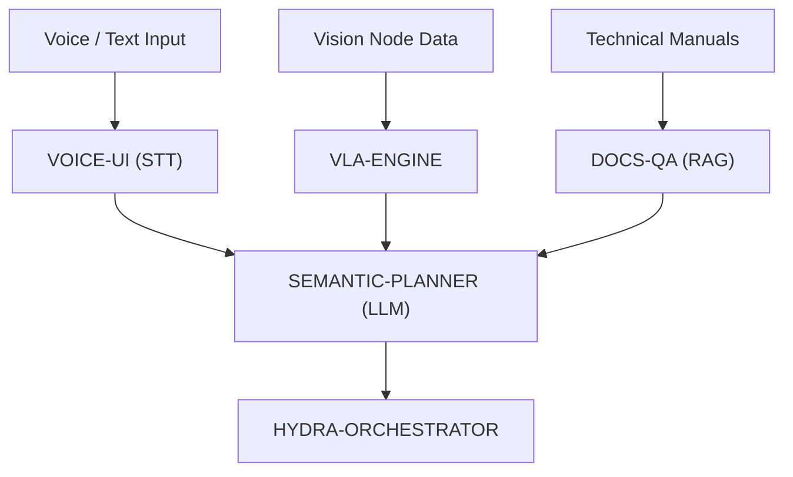

<p align="center">
  
</p>

# 🧠 HYDRA-UMC-COGNITIVE-NODE

<p align="center"><a href="README.md">🇺🇸 English</a> | <a href="README_spa.md">🇪🇸 Español</a> | <a href="README_fra.md">🇫🇷 Français</a> | <a href="README_ita.md">🇮🇹 Italiano</a> | <a href="README_deu.md">🇩🇪 Deutsch</a> | <a href="README_zho.md">🇨🇳 简体中文</a> | <a href="README_jpn.md">🇯🇵 日本語</a> | 🇵🇹 <b>Português</b></p>

### 🤖 Nó de borda de raciocínio semântico e IA generativa (Hailo-10 + Raspberry Pi CM5)

<p align="center">
  
  
  
  
</p>

> **Verificação de honestidade - o que realmente funciona hoje:** a verificação de prontidão da família e o seu esquema JSON versionado (`family.py`, `manifest.py`, `models.py`) e a superfície HTTP simples da biblioteca padrão (`api.py`) são reais e estão cobertos por 35 testes a passar (`pytest tests/` - `test_manifest.py`, `test_models.py`, `test_family.py`, `test_api.py`, `test_cli.py`). Este nó não executa nenhum modelo ele próprio: "Execução local de LLM", "Integração VLA" e "Processamento de comandos de voz" nas Funcionalidades principais abaixo estão explicitamente marcados `(planeado)` - não há código de execução do Hailo-10 neste repositório. O `docker-compose.yml` refere agora um Dockerfile real para os 4 filhos, mas nunca foi realmente executado como um único stack neste ambiente de desenvolvimento (não há ambiente de execução Docker aqui) - o mapeamento de comando/porta de cada Dockerfile foi conferido à mão com o que a unidade systemd de cada filho já executa no CM5 real, não verificado em direto. Veja o `CHANGELOG.md` para saber exatamente o que foi entregue até agora.

---

## 1. 🛠️ VISÃO TÉCNICA GERAL

O **HYDRA-UMC-COGNITIVE-NODE** serve de "lobo frontal" do ecossistema HYDRA-UMC. Alimentado pela NPU Hailo-10 (40 TOPS), permite raciocínio semântico complexo, compreensão de linguagem natural e planeamento de tarefas visão-linguagem-ação (VLA) diretamente na periferia.

Transforma instruções humanas de alto nível em sequências robóticas lógicas, gerindo a recuperação de erros e a otimização de missões sem dependência da nuvem.

### Funcionalidades principais:
* 🧠 **Execução local de LLM:** inferência acelerada por hardware para modelos quantizados (Llama/Mistral). *(planeado - precisa do ambiente de execução real de modelos do Hailo-10)*
* 👁️ **Integração VLA:** modelos visão-linguagem-ação para uma execução intuitiva de tarefas. *(planeado)*
* 🎙️ **Processamento de comandos de voz:** STT/TTS em tempo real para a interação humano-robô. *(planeado)*
* 🛡️ **Privacidade em primeiro lugar:** processamento 100 % offline de todas as tarefas cognitivas. *(verdadeiro por desenho assim que o acima existir - nada aqui contacta uma rede hoje)*
* 🧩 **Centro de integração (v0):** detém a imagem HydraOS partilhada e os pesos de modelos quantizados
  consumidos pelos seus quatro filhos, e liga-os como serviços irmãos num único `docker-compose.yml`.
  A verificação real `family-status` lê o manifesto de cada filho para reportar presença/versão/
  maturidade. *(implementado como verificação real de prontidão - veja COMPILAR E EXECUTAR
  abaixo)*
* 🔒 **Esquema de estado versionado + leituras de manifestos com recursos limitados:** o `family-status --json` imprime um resultado real, versionado e legível por máquina; qualquer manifesto de um irmão com mais de 64 KiB (uma cópia corrompida/maliciosa) degrada para "não encontrado" em vez de ser lido sem limite. *(implementado)*
* 🪫 **Verificação de degradação dos pesos de modelos partilhados:** o `family-status` reporta honestamente se o próprio diretório `models/` deste nó tem de facto pesos reais, e não apenas se os repositórios irmãos estão clonados. *(implementado)*
* 📦 **Versionamento ao estilo conta-quilómetros:** cada compilação real sobe automaticamente a versão do
  `pyproject.toml` (`bump_version.py`) - sem edições manuais de versão.

---

## 2. 🔄 FLUXO COGNITIVO



---

## 3. 🧱 ARQUITETURA E DECISÕES DE DESENHO

Este repositório é o **pai/ponto de integração** da família do Nó de IA Cognitiva.
Não executa ele próprio nenhum modelo - detém os recursos partilhados e a ligação
que permitem aos seus quatro filhos atuar como uma só unidade cognitiva
na mesma placa física:

* **Porque este nó não tem hardware/firmware próprios.** Ao contrário do firmware
  ao nível da placa-mãe do HYDRA-UMC, este nó corre inteiramente num
  Raspberry Pi CM5 + módulo M.2 Hailo-10 existentes - não há nenhuma PCB nem
  microcontrolador à medida para desenhar aqui, pelo que as pastas `hardware/`/`firmware/`
  foram retiradas em vez de deixadas vazias.
* **Porque `os/` e `models/` vivem apenas no pai.** A imagem HydraOS
  e os pesos quantizados de LLM/VLA são recursos partilhados ao nível da placa -
  manter uma cópia no pai e montá-la só de leitura no contentor de cada
  filho (veja `docker-compose.yml`) evita quatro cópias divergentes de pesos de
  modelos com vários gigabytes.
* **Porque uma estrutura `src/`.** Mantém o pacote instalável
  (`hydra_umc_cognitive_node`) separado das ferramentas da raiz do repositório
  (`bump_version.py`, `docker-compose.yml`) e corresponde à estrutura usada
  por todos os outros projetos Python do ecossistema.
* **Porque o ponto de entrada só imprime a identidade/versão/papel hoje.** Esta
  é a fase de andaimes (scaffolding): provar que o pacote instala,
  compila e importa limpo - na versão de Python de destino - é
  um pré-requisito para acrescentar mais tarde a lógica real de orquestração de LLM/VLA/voz,
  e mantém esse trabalho posterior isolado das questões de empacotamento.
* **Porque o `docker-compose.yml` documenta o contrato de integração, e não apenas
  liga imagens.** Decidir que serviço depende de qual e de que montagens de
  dispositivos/volumes cada um precisa foi escrito antes de qualquer filho ter
  um Dockerfile - evitando que essa forma fosse inventada ad hoc mais tarde. Os
  quatro filhos (VLA-Engine, Voice-UI, Semantic-Planner, Docs-QA) têm agora
  um Dockerfile real próprio, fechando uma lacuna real - o `docker compose up`
  constrói e executa a coisa a sério.
* **Como isto se encaixa no resto do ecossistema.** Este nó fica uma camada
  acima da perceção (HYDRA-UMC-VISION-NODE, Hailo-8) e uma camada abaixo da
  orquestração de missões (HYDRA-UMC-ORCHESTRATOR): transforma instruções de voz/texto
  e deteções em decisões semânticas, que o orquestrador converte depois em comandos
  físicos para o robô.
* **Porque o `family-status` lê o manifesto de cada filho em vez de uma lista
  mantida à mão.** O `hydra-umc.project.json` já é a única fonte de verdade
  em que o painel e o atualizador de todo o ecossistema confiam - uma segunda
  lista aqui divergiria no momento
  em que a maturidade real de um filho mudasse e ninguém se lembrasse de a atualizar.
* **Porque uma cópia de irmão em falta é um "não encontrado" real e honesto, e não um
  erro.** Um centro de integração genuinamente não sabe se um programador
  clonou localmente os quatro filhos - o `manifest.py` devolve
  `None` para todos os modos de falha reais (repositório em falta, manifesto em falta,
  JSON malformado), para que o `family-status` o reporte com clareza em vez de
  falhar.
* **Porque as leituras de manifestos de irmãos têm um limite de 64 KiB.** Todos os manifestos reais
  deste ecossistema têm de algumas centenas de bytes a um par de KiB - uma cópia corrompida
  ou maliciosa cujo manifesto tenha sido substituído por um ficheiro sobredimensionado nunca deve fazer
  uma verificação de prontidão de rotina carregar uma quantidade ilimitada de dados para a memória.
  Degrada para `None`, tal como qualquer outro manifesto malformado.
* **Porque o `family-status` reporta o `models/` mesmo que este nó não execute
  nenhum modelo.** "Os repositórios irmãos estão clonados" e "os pesos partilhados de que
  precisariam estão realmente presentes" são dois factos reais diferentes -
  o `check_shared_models()` do `models.py` verifica o segundo com
  honestidade (vazio mas presente conta como em falta) em vez de deixar um
  operador presumir a prontidão só pela presença dos filhos.

---

## 📂 ESTRUTURA DE DIRETÓRIOS

```text
HYDRA-UMC-COGNITIVE-NODE/
├── src/hydra_umc_cognitive_node/
│   ├── manifest.py                 # Leitor real e defensivo do manifesto próprio de um irmão (limite de 64 KiB)
│   ├── models.py                   # Verificação real do diretório de pesos de modelos partilhados deste nó
│   ├── family.py                    # Verificação real de prontidão da família + esquema JSON versionado
│   ├── api.py                         # Superfície JSON/HTTP simples (http.server da biblioteca padrão) sobre o `family-status`
│   └── main.py                        # Ponto de entrada + subcomandos reais `family-status [--json]` e `serve`
├── tests/                          # Testes reais: leitura de manifestos, modelos, estado da família, api, CLI de ponta a ponta
├── docs/
│   └── CLI_REFERENCE.md            # Referência completa de comandos: cada opção, saída real capturada, códigos de saída
├── os/                             # Imagem/configuração do HydraOS para o CM5 - preenchida na implementação (não está no git)
├── models/                         # Pesos otimizados para o Hailo-10 (LLM/VLA, partilhados pelos 4 filhos) - preenchidos na implementação (não estão no git)
├── images/                         # Multimédia e diagramas
├── systemd/
│   └── hydra-umc-cognitive-node.service # Unidade systemd da API local family-status do CM5
├── tools/
│   ├── build_test.py               # Verificação de compilação sem subir a versão
│   └── ci_validate.py              # Validação de manifesto/CHANGELOG/documentação usada pelo CI
├── build/                          # Saída da compilação local (ignorada pelo git)
├── pyproject.toml                  # Metadados do pacote (versão subida ao estilo conta-quilómetros em cada compilação real)
├── bump_version.py                 # Subida de versão nativa ao estilo conta-quilómetros (usada pelo build.sh/.bat)
├── bump_manifest_version.py        # Sincroniza a versão do hydra-umc.project.json com a nativa (--sync)
├── docker-compose.yml              # Mapa de integração dos 4 serviços filhos
├── build.sh / build.bat            # Cria o venv, instala (com extras de desenvolvimento), executa os testes, verifica a importação
└── run.sh / run.bat                # Executa o ponto de entrada (reencaminha argumentos, por exemplo `family-status`)
```

> **Nota:** `hardware/` e `firmware/` foram retirados - este nó corre num
> CM5 + módulo M.2 Hailo-10 existentes, sem desenho de hardware/firmware próprio.
> Poderá acrescentar-se mais tarde um microcontrolador auxiliar dedicado, se
> se tornar necessário.

---

## ⚙️ GUIA DE COMPILAÇÃO E EXECUÇÃO

Requer o Python >= 3.10.

```bash
# Linux / macOS / Git Bash
./build.sh   # cria o .venv, instala o pacote (editável), verifica a importação
./run.sh     # executa o ponto de entrada

# Windows (cmd)
build.bat
run.bat
```

O `build.sh`/`build.bat` sobe a versão (ao estilo conta-quilómetros, veja
`bump_version.py`) antes de cada compilação real e executa a suite de testes real
(`pytest tests/`). Saída esperada de um `run.sh` simples:

```text
HYDRA-UMC-COGNITIVE-NODE v0.1.4
Semantic reasoning & GenAI edge node (Hailo-10) - integrates VLA-Engine, Voice-UI, Semantic-Planner and Docs-QA into one cognitive node.
```

Veja o `docker-compose.yml` para saber como os quatro serviços filhos (VLA-Engine,
Voice-UI, Semantic-Planner, Docs-QA) se ligam a este nó - cada um traz agora
o seu Dockerfile real.

O subcomando real `family-status` verifica os filhos reais numa cópia
local real:

```bash
./run.sh family-status
./run.sh family-status --workspace /path/to/some/other/checkout
./run.sh family-status --json

# Windows
run.bat family-status
```

O `family-status` reporta sempre também os pesos de modelos partilhados deste nó
- um `models/` real e vazio numa máquina de desenvolvimento é honestamente `MISSING`,
nunca ignorado em silêncio:

```text
Cognitive AI Node family status (workspace: /path/to/workspace):
  HYDRA-UMC-VLA-ENGINE: v0.1.0, maturity=established, role=service
  ...

Shared model weights: MISSING (.../HYDRA-UMC-COGNITIVE-NODE/models) - this node's own os/models weights have not been provisioned on this machine; children that need them will run in their own honest degraded/no-hardware mode.

All 4 children present.
```

O `--json` imprime os mesmos dados reais como um objeto versionado e
legível por máquina:

```bash
$ ./run.sh family-status --json
{
  "schema_version": "1.0",
  "shared_models": { "present": false, "path": ".../models" },
  "children": [
    { "name": "HYDRA-UMC-VLA-ENGINE", "present": true, "version": "0.1.0", "maturity": "established", "role": "service" },
    ...
  ],
  "all_children_present": true
}
```

Por omissão usa o diretório pai deste próprio repositório - a estrutura que todas as
cópias reais deste ecossistema já usam (todos os repositórios como irmãos numa
só pasta de trabalho). Termina com `1` se algum filho real estiver em falta.

### 🌐 API HTTP (`serve`)

O `serve` executa essa mesma verificação `family-status` como um pequeno
`http.server` da biblioteca padrão em vez de uma chamada única da CLI - é o comando real que a
unidade systemd `hydra-umc-cognitive-node.service` do próprio CM5 executa em
produção:

```bash
./run.sh serve --addr 127.0.0.1 --port 8096
# GET /family-status  -> o mesmo JSON que o `family-status --json` imprime acima
# GET /stats          -> { "status": "ok" }
```

O `GET /family-status` analisa o workspace fixado no arranque do serviço (`--workspace`, `--models-dir` ou `HYDRA_UMC_COGNITIVE_NODE_WORKSPACE` / `HYDRA_UMC_COGNITIVE_NODE_MODELS_DIR`) e responde `400` se um pedido tentar escolher outro; qualquer outro
caminho devolve `404`. Veja a [Referência da CLI](docs/CLI_REFERENCE.md) para a
referência completa de comandos: cada opção, saída real capturada de `-h`/`curl` e
a tabela de códigos de saída.

### 🩺 Resolução de problemas

* **`python: command not found` / a compilação falha no passo 1.** Requer o
  Python >= 3.10 no `PATH`. No Windows, instale a partir de
  [python.org](https://python.org) e confirme que "Add to PATH" ficou
  marcado durante a instalação; `python3` é o nome habitual no Linux/macOS.
* **O `build.sh` falha ao ativar o venv.** O `python3 -m venv .venv`
  dispõe o script de ativação de forma diferente por plataforma:
  `.venv/bin/activate` no Linux/macOS, `.venv/Scripts/activate` no
  Windows (incluindo um venv de Python do Windows usado a partir do Git Bash). O `build.sh`
  já verifica ambos os caminhos - se ainda assim falhar, apague o `.venv/` e
  volte a executar `./build.sh` para o reconstruir de raiz.
* **O `pip install -e .` falha.** Normalmente um `.venv/` obsoleto. Apague a
  pasta `.venv/` e volte a executar `./build.sh`/`build.bat` para a recriar.
* **O `import OK` nunca aparece.** Significa que o próprio `python -c "import
  hydra_umc_cognitive_node"` falhou - volte a executar com o venv ativo
  para ver o traceback real (uma edição quebrada do `pyproject.toml` é a causa habitual
  depois de uma fusão manual).
* **O `docker compose up` não consegue arrancar o `voice-ui`.** O seu próprio contentor
  recusa-se a ligar para lá do loopback sem um `HYDRA_UMC_VOICE_UI_TOKEN` real
  (por desenho - veja o comentário do próprio `docker-compose.yml`); defina-o num
  ficheiro `.env` real ou no seu gestor de segredos, nunca faça commit de um. Executar cada
  serviço diretamente com o seu próprio `run.sh`/`run.bat` durante o desenvolvimento
  não precisa desse token, já que o `--host` aí fica em loopback.

---

## 🚀 ROTEIRO
* **Fase 1:** implementação do motor VLA e processamento de entrada multimodal no Hailo-10.
* **Fase 2:** integração do planeador semântico com modelos comportamentais do enxame e memória de longo prazo.
* **Fase 3:** execução local de baixa latência da Voice UI e cancelamento de ruído industrial.
* **Fase 4:** auditorias de decisão autónoma e integração total com o Dashboard AI para um retorno "Ver e Perguntar".

---

## 🔗 Projetos relacionados

Este projeto faz parte do ecossistema de robótica HYDRA-UMC do mesmo autor (JuanenRac / Electro Hobby 3D). Vale a pena conhecê-los, porque um pedido pode ser, na verdade, sobre um destes e não sobre este repositório.

**Projetos filhos** — quatro são etapas do próprio fluxo cognitivo deste nó (entrada de voz, decisão, ação, ancoragem); o quinto é uma aplicação de manutenção separada, construída sobre o mesmo pipeline Hailo-10
- **[HYDRA-UMC-VOICE-UI](https://github.com/JuanenRac/HYDRA-UMC-VOICE-UI)** — front-end de voz real (VAD + analisador de intenções) com um relé para o relógio limitado e protegido por confirmação.
- **[HYDRA-UMC-SEMANTIC-PLANNER](https://github.com/JuanenRac/HYDRA-UMC-SEMANTIC-PLANNER)** — decomposição real de tarefas baseada em regras e recuperação semântica de erros sobre os códigos de erro do MCU.
- **[HYDRA-UMC-VLA-ENGINE](https://github.com/JuanenRac/HYDRA-UMC-VLA-ENGINE)** — codificação/descodificação real de tokens de ação e geração de trajetórias para um modelo Visão-Linguagem-Ação.
- **[HYDRA-UMC-DOCS-QA](https://github.com/JuanenRac/HYDRA-UMC-DOCS-QA)** — pesquisa real de documentos TF-IDF só com a biblioteca padrão sobre a documentação Markdown deste ecossistema.
- **[HYDRA-UMC-LOCAL-TECHNICIAN](https://github.com/JuanenRac/HYDRA-UMC-LOCAL-TECHNICIAN)** — técnico de manutenção de IA local, protegido por políticas, para o próprio ecossistema: observa, diagnostica e propõe correções; os dois níveis de maior risco não estão implementados de propósito.

**Diretamente relacionados**
- **[HYDRA-UMC-ORCHESTRATOR](https://github.com/JuanenRac/HYDRA-UMC-ORCHESTRATOR)** — centro de integração com um contrato real de relatório de saúde gRPC/Protobuf e uma máquina de estados de missões; é o que dá a este nó as suas ordens de missão.
- **[HYDRA-UMC-VISION-NODE](https://github.com/JuanenRac/HYDRA-UMC-VISION-NODE)** — centro de integração do pipeline de visão Hailo-8, com uma verificação real de prontidão de hardware por etapa; a camada semântica deste nó consome as suas deteções.
- **[HYDRA-UMC-STUDIO](https://github.com/JuanenRac/HYDRA-UMC-STUDIO)** — painel web de controlo com visualização 3D em tempo real de vários robôs; uma das superfícies de controlo por voz deste nó.
- **[HYDRA-UMC-DSI](https://github.com/JuanenRac/HYDRA-UMC-DSI)** — interface tátil nativa para o ecrã tátil DSI de 7" integrado, executada no próprio CM5; a outra superfície de controlo por voz deste nó.

**Também fazem parte do ecossistema**

*Hardware e plataforma centrais*
- **[HYDRA-UMC](https://github.com/JuanenRac/HYDRA-UMC)** — a placa-mãe física do braço robótico: anfitrião CM5 + STM32H745 de dois núcleos, que orquestra até 8 braços de ferramenta por CAN-OTA/SPI-OTA.
- **[HYDRA-UMC-OS](https://github.com/JuanenRac/HYDRA-UMC-OS)** — camada de produto reproduzível do Raspberry Pi OS para o CM5: agente só de leitura, configuração/perfis validados, aprovisionamento Wi-Fi de primeiro contacto.
- **[HYDRA-UMC-SDK](https://github.com/JuanenRac/HYDRA-UMC-SDK)** — o contrato JSON-Schema partilhado e a fronteira de portas de segurança contra a qual cada bridge valida os seus comandos.
- **[HYDRA-UMC-CONNECTOR-HUB](https://github.com/JuanenRac/HYDRA-UMC-CONNECTOR-HUB)** — registo declarativo de manifestos de adaptador e validador para conectores de máquinas externas; estende a ideia de contrato do SDK a máquinas externas sem substituir os projetos de gateway industrial.

*Backend central e clientes*
- **[HYDRA-UMC-SERVER](https://github.com/JuanenRac/HYDRA-UMC-SERVER)** — o back-end headless real (REST/WebSocket) com que todos os clientes de controlo realmente comunicam.
- **[HYDRA-UMC-SUITE](https://github.com/JuanenRac/HYDRA-UMC-SUITE)** — centro de comando de enxame para desktop (PySide6) para vários servidores ao mesmo tempo, empacotado como executável independente.
- **[HYDRA-UMC-ANDROID-CONTROL](https://github.com/JuanenRac/HYDRA-UMC-ANDROID-CONTROL)** — aplicação Android nativa de controlo, com início de sessão biométrico e um companheiro Wear OS emparelhado.
- **[HYDRA-UMC-IOS-CONTROL](https://github.com/JuanenRac/HYDRA-UMC-IOS-CONTROL)** — aplicação de controlo para iOS/iPadOS (Flutter) com sincronização WebSocket em tempo real.
- **[HYDRA-UMC-EDITOR-URDF](https://github.com/JuanenRac/HYDRA-UMC-EDITOR-URDF)** — criador/editor gráfico de URDF para desktop que envia os modelos concluídos para o catálogo do STUDIO.
- **[HYDRA-UMC-EDITOR-STL](https://github.com/JuanenRac/HYDRA-UMC-EDITOR-STL)** — editor de modelos STL para desktop que transforma/substitui/remove/adiciona peças reais no mesmo catálogo de modelos que o HYDRA-UMC-EDITOR-URDF também edita.
- **[HYDRA-UMC-BRIDGE-AMR](https://github.com/JuanenRac/HYDRA-UMC-BRIDGE-AMR)** — fronteira de coordenação para frotas AGV/AMR através de um publicador MQTT VDA 5050 real.
- **[HYDRA-UMC-BRIDGE-CNC](https://github.com/JuanenRac/HYDRA-UMC-BRIDGE-CNC)** — coordenador de células CNC de alto nível com acesso real ao estado GRBL e aos bytes de controlo.
- **[HYDRA-UMC-BRIDGE-DROIDS](https://github.com/JuanenRac/HYDRA-UMC-BRIDGE-DROIDS)** — fronteira de coordenação para droides com patas/humanoides, com um emissor real de comandos para o Boston Dynamics Spot.
- **[HYDRA-UMC-BRIDGE-LASER](https://github.com/JuanenRac/HYDRA-UMC-BRIDGE-LASER)** — coordenador de segurança de células laser que lê 3 proteções reais por GPIO (chave, caixa e interlock).
- **[HYDRA-UMC-BRIDGE-OPENPNP](https://github.com/JuanenRac/HYDRA-UMC-BRIDGE-OPENPNP)** — coordenador seguro de fluxo de placa de alto nível para pick-and-place com OpenPnP.
- **[HYDRA-UMC-BRIDGE-PRINTER3D](https://github.com/JuanenRac/HYDRA-UMC-BRIDGE-PRINTER3D)** — fronteira de coordenação segura para impressoras 3D Moonraker/Klipper, com comandos de trabalho reais protegidos por portas.
- **[HYDRA-UMC-BRIDGE-ROS2](https://github.com/JuanenRac/HYDRA-UMC-BRIDGE-ROS2)** — coordenador de segurança com um transporte ROS 2 real baseado em rclpy importado sob demanda.
- **[HYDRA-UMC-BRIDGE-UAV](https://github.com/JuanenRac/HYDRA-UMC-BRIDGE-UAV)** — fronteira de coordenação para UAV com câmara, com um emissor real de comandos MAVLink.

*Plataforma de ferramentas URTC*
- **[URTC](https://github.com/JuanenRac/URTC)** — firmware da placa física Universal Robot Tool Controller, mais de 25 perfis de ferramenta por barramento CAN.
- **[URTC-FLASHER](https://github.com/JuanenRac/URTC-FLASHER)** — ferramenta gráfica de gravação para desktop das placas URTC, por CAN-OTA e também SWD/JTAG de chip completo.
- **[URTC-TESTER](https://github.com/JuanenRac/URTC-TESTER)** — ferramenta de diagnóstico CAN em tempo real para desktop das placas URTC, com um painel por perfil de ferramenta.
- **[URTC-WEB-STUDIO](https://github.com/JuanenRac/URTC-WEB-STUDIO)** — alternativa no navegador ao URTC-TESTER através da Web Serial API, sem instalação local.

*Nó de IA de visão (Hailo-8)*
- **[HYDRA-UMC-DETECTION-HEF](https://github.com/JuanenRac/HYDRA-UMC-DETECTION-HEF)** — registo real de modelos compilados com verificação segura de carga por arquitetura Hailo e soma de verificação.
- **[HYDRA-UMC-VISION-STREAMER](https://github.com/JuanenRac/HYDRA-UMC-VISION-STREAMER)** — pipeline GStreamer real e gerador de configuração MediaMTX com uma fronteira de integração HailoRT real.
- **[HYDRA-UMC-VISUAL-SERVOING-API](https://github.com/JuanenRac/HYDRA-UMC-VISUAL-SERVOING-API)** — lei de correção real de servovisão baseada em posição, protegida pelo estado da zona a montante.
- **[HYDRA-UMC-SAFETY-ZONES](https://github.com/JuanenRac/HYDRA-UMC-SAFETY-ZONES)** — verificação real de violação de zonas e pedido de E-STOP, com exigência de calibração recente.

*Orquestração e enxame*
- **[HYDRA-UMC-JOB-DISPATCHER](https://github.com/JuanenRac/HYDRA-UMC-JOB-DISPATCHER)** — fila real de trabalhos por prioridade com deduplicação, sobre uma API HTTP real.
- **[HYDRA-UMC-NODE-HEALING](https://github.com/JuanenRac/HYDRA-UMC-NODE-HEALING)** — vigilante real de saúde da frota por gRPC com repetição/recuo e deteção de identidade incoerente.
- **[HYDRA-UMC-PATH-PLANNER-3D](https://github.com/JuanenRac/HYDRA-UMC-PATH-PLANNER-3D)** — planeador real de trajetórias 3D baseado em RRT com validação real de colisões com obstáculos e espaço de trabalho.
- **[HYDRA-UMC-SWARM-SYNC](https://github.com/JuanenRac/HYDRA-UMC-SWARM-SYNC)** — sincronização real de estado CRDT LWW-Element-Map, testada por propriedades para a convergência de várias células.

*Gémeo digital e simulação*
- **[HYDRA-UMC-TWIN](https://github.com/JuanenRac/HYDRA-UMC-TWIN)** — centro de integração do motor de gémeo digital, com um contrato real de sincronização de compatibilidade de versões.
- **[HYDRA-UMC-HIL-BRIDGE](https://github.com/JuanenRac/HYDRA-UMC-HIL-BRIDGE)** — interlock de segurança real de hardware-in-the-loop que encaminha comandos entre a simulação e o hardware real.
- **[HYDRA-UMC-PHYSICS-REPLICA](https://github.com/JuanenRac/HYDRA-UMC-PHYSICS-REPLICA)** — cinemática direta real e validação de limites de juntas sobre um subconjunto real de URDF.
- **[HYDRA-UMC-SYNTHETIC-DATA-GEN](https://github.com/JuanenRac/HYDRA-UMC-SYNTHETIC-DATA-GEN)** — gerador procedural real de cenas 2D com exportação de anotações YOLO/COCO.

*Dados e análise*
- **[HYDRA-UMC-DATALAKE](https://github.com/JuanenRac/HYDRA-UMC-DATALAKE)** — armazém real de séries temporais sobre sqlite3 com uma API HTTP real de ingestão/consulta.
- **[HYDRA-UMC-ANOMALY-DETECTOR](https://github.com/JuanenRac/HYDRA-UMC-ANOMALY-DETECTOR)** — detetor real de anomalias por FFT e linha de base estatística, com monitorização de deriva.
- **[HYDRA-UMC-PRODUCTION-REPORTS](https://github.com/JuanenRac/HYDRA-UMC-PRODUCTION-REPORTS)** — cálculo real de OEE/disponibilidade sobre o histórico do DATALAKE, com exportação CSV reprodutível.
- **[HYDRA-UMC-TELEMETRY-COLLECTOR](https://github.com/JuanenRac/HYDRA-UMC-TELEMETRY-COLLECTOR)** — pipeline real de ingestão CAN/WebSocket para o DATALAKE, com deduplicação por sequência.

*Gateway industrial*
- **[HYDRA-UMC-GATEWAY-INDUSTRIAL](https://github.com/JuanenRac/HYDRA-UMC-GATEWAY-INDUSTRIAL)** — centro de integração que retransmite para protocolos industriais, com uma camada real de lista de comandos permitidos e contrapressão.
- **[HYDRA-UMC-OPCUA-SERVER](https://github.com/JuanenRac/HYDRA-UMC-OPCUA-SERVER)** — espaço de endereços OPC-UA real, verificado com uma sessão de cliente real do protocolo binário.
- **[HYDRA-UMC-MQTT-BROKER](https://github.com/JuanenRac/HYDRA-UMC-MQTT-BROKER)** — broker MQTT real com autenticação opcional por cliente e ACL de tópicos.
- **[HYDRA-UMC-MTCONNECT-ADAPTER](https://github.com/JuanenRac/HYDRA-UMC-MTCONNECT-ADAPTER)** — endpoints XML MTConnect `/probe` e `/current` reais com saída em modo degradado.

*Ferramentas complementares e operações do ecossistema*
- **[HYDRA-UMC-DASHBOARD-AI](https://github.com/JuanenRac/HYDRA-UMC-DASHBOARD-AI)** — painéis de Resumos Inteligentes e Realce de Anomalias sobre o DATALAKE/ANOMALY-DETECTOR, com um recurso estatístico honesto.
- **[HYDRA-UMC-TOOL-CLI](https://github.com/JuanenRac/HYDRA-UMC-TOOL-CLI)** — CLI da frota com um contrato de códigos de saída real e estável, um cliente vivo genuíno da API do HYDRA-UMC-SERVER.
- **[HYDRA-UMC-WATCH](https://github.com/JuanenRac/HYDRA-UMC-WATCH)** — aplicação companheira WearOS com alertas hápticos reais e um relé de voz para o telemóvel emparelhado.
- **[URTC-SMART-RACK](https://github.com/JuanenRac/URTC-SMART-RACK)** — firmware de um rack de montagem de placas com descodificação real do ID da ferramenta e lógica de pré-aquecimento Smart Idle.
- **[URTC-VISION-TOOL](https://github.com/JuanenRac/URTC-VISION-TOOL)** — firmware mais um companheiro de visão em Python real para uma cabeça de ferramenta de inspeção térmica/RGB.
- **[HYDRA-UMC-UPDATER](https://github.com/JuanenRac/HYDRA-UMC-UPDATER)** — ferramenta administrativa de desktop que descobre, clona e atualiza todos os repositórios deste ecossistema.
- **[HYDRA-UMC-OS-REBUILDER](https://github.com/JuanenRac/HYDRA-UMC-OS-REBUILDER)** — ferramenta de desktop para Windows/Linux que constrói uma imagem do CM5 pronta a gravar com as versões mais recentes do ecossistema, com configuração de primeiro arranque de Wi-Fi/utilizador/SSH ao estilo do Raspberry Pi Imager.
- **[HYDRA-UMC-OPS-AGENT](https://github.com/JuanenRac/HYDRA-UMC-OPS-AGENT)** — coordenador de incidentes de manutenção: um papel de borda de poucos privilégios recolhe um inventário/estado higienizado, um papel de plano de controlo mostra-o só de leitura e pede a um fornecedor de IA que sugira um diagnóstico; nunca aplica um patch nem implanta nada.
- **[HYDRA-UMC-DEV-SERVER](https://github.com/JuanenRac/HYDRA-UMC-DEV-SERVER)** — anfitrião de desenvolvimento reproduzível (Raspberry Pi 5 / CM5) que guarda o código-fonte do ecossistema e executa tarefas limitadas de compilação/teste numa fila durável; um papel de desenvolvimento dedicado, explicitamente não um CM5 operacional.

---

## 📚 Documentação e comunidade

- **[CONTRIBUTING.md](CONTRIBUTING.md)** — pilha tecnológica e diretrizes de código para um pull request.
- **[CODE_OF_CONDUCT.md](CODE_OF_CONDUCT.md)** — as normas de comportamento esperadas nesta comunidade.
- **[SECURITY.md](SECURITY.md)** — como comunicar uma vulnerabilidade e as áreas de segurança em que este projeto se concentra.
- **[SUPPORT.md](SUPPORT.md)** — onde fazer perguntas e comunicar erros.
- **[LICENSE.md](LICENSE.md)** — a licença deste projeto.

## 👤 AUTOR
**JuanenRac** (Electro Hobby 3D)
📧 electrohobby3d@gmail.com
📺 [youtube.com/@electrohobby3d](https://youtube.com/@electrohobby3d)

## 📜 LICENÇA
GPL-3.0-or-later - consulte LICENSE para mais detalhes.

