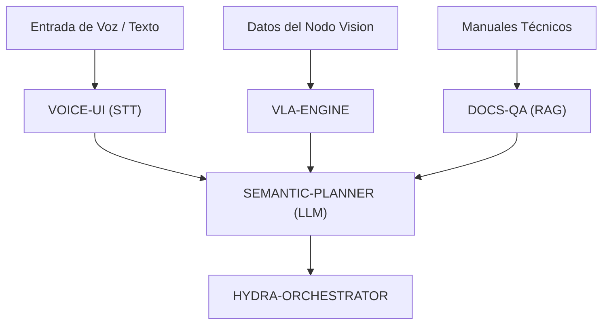

<!-- =============================================================================
HYDRA-UMC-COGNITIVE-NODE - Cognitive AI node (Hailo-10)
Copyright (C) JuanenRac (Electro Hobby 3D) <electrohobby3d@gmail.com>
GPL-3.0-or-later - see LICENSE
============================================================================= -->

<p align="center">
  
</p>

# 🧠 HYDRA-UMC-COGNITIVE-NODE

<p align="center"><a href="README.md">🇺🇸 English</a> | 🇪🇸 <b>Español</b> | <a href="README_fra.md">🇫🇷 Français</a> | <a href="README_ita.md">🇮🇹 Italiano</a> | <a href="README_deu.md">🇩🇪 Deutsch</a> | <a href="README_zho.md">🇨🇳 简体中文</a> | <a href="README_jpn.md">🇯🇵 日本語</a> | <a href="README_por.md">🇵🇹 Português</a></p>

### 🤖 Nodo de IA de Borde para Razonamiento Semántico y GenAI (Hailo-10 + Raspberry Pi CM5)

<p align="center">
  
  
  
  
  
  
</p>

---

> **Comprobación de honestidad - qué funciona realmente hoy:** la comprobación de disponibilidad de familia y su esquema JSON versionado (`family.py`, `manifest.py`, `models.py`) y la superficie HTTP plana de la stdlib (`api.py`) son reales y están cubiertas por 56 tests que pasan (`pytest tests/` - `test_manifest.py`, `test_models.py`, `test_family.py`, `test_api.py`, `test_cli.py`). Este nodo no ejecuta ningún modelo por sí mismo: "Ejecución local de LLM", "Integración VLA" y "Procesamiento de comandos de voz" en las Funciones Clave de más abajo están explícitamente marcadas como `(planificado)` - no hay código de runtime de Hailo-10 en este repositorio. `docker-compose.yml` ahora referencia un Dockerfile real para los 4 hijos, pero nunca se ha ejecutado realmente como un único stack en este entorno de desarrollo (no hay runtime de Docker disponible aquí) - el mapeo de comando/puerto de cada Dockerfile se comprobó a mano contra lo que el propio systemd unit de cada hijo ya ejecuta en la CM5 real, no verificado en vivo. Ver `CHANGELOG.md` para lo que se ha entregado exactamente hasta ahora.

> **Estado de seguridad física y de ciberseguridad:** este ecosistema no es un sistema de seguridad certificado. Todavía no existe una ruta de E-STOP por hardware, ni límites ni enclavamientos aplicados por el firmware, ni un comando de movimiento verificado; las imágenes de firmware se comprueban con CRC32 y un HMAC-SHA256 de clave compartida, no con una firma asimétrica; TLS y TLS mutuo son opcionales y están desactivados por defecto; aún no se ha poblado ni probado ninguna placa propia. Lee la [línea base de seguridad](https://github.com/JuanenRac/HYDRA-UMC-DOCS/blob/main/docs/SECURITY_BASELINE.md) y el [modelo de amenazas](https://github.com/JuanenRac/HYDRA-UMC-DOCS/blob/main/docs/THREAT_MODEL.md) antes de fiarte de cualquier afirmación de aquí para la seguridad de una persona.

---

## 📋 De un vistazo

| | |
|---|---|
| Versión | `0.1.5` |
| Madurez | Funcional |
| Tests | 56 (`python -m pytest -q tests`) |
| Tecnología | Python / CM5 / Hailo-10 |
| Destino | La Raspberry Pi CM5 de una celda HYDRA-UMC |
| En hardware real | Todavía no: no consta ninguna ejecución en hardware real para esta versión |

**Ir a:** [Resumen](#-resumen) · [Arquitectura](#-arquitectura) · [Funciones](#-funciones) · [Seguridad y protección](#-seguridad-y-protección) · [Interfaces](#-interfaces) · [Configuración](#-configuración) · [Inicio rápido](#-inicio-rápido) · [Pruebas](#-pruebas) · [Resolución de problemas](#-resolución-de-problemas) · [Estructura del repositorio](#-estructura-del-repositorio) · [Proyectos relacionados](#-proyectos-relacionados)

## 🚦 Estado del proyecto

Cada línea es una parte de este repositorio y la luz dice hasta dónde llega hoy. Se escribe con lo que el repositorio puede demostrar (pruebas, compilaciones, ejecuciones), no con lo previsto.

🟢 Hecho y verificado · 🟡 Funciona, con límites conocidos · 🟠 Hecho a medias o sin verificar · 🔴 Sin hacer o sin funcionar

| Área | Estado | Qué significa aquí |
|---|---|---|
| Software | 🟡 | Funciona para su propósito principal; la comprobación de honestidad de arriba lista lo que aún falta |
| Pruebas | 🟢 | 56 pruebas automáticas, ejecutadas en cada cambio |
| Hardware real | 🔴 | Todavía no: no consta ninguna ejecución en hardware real para esta versión |
| Documentación | 🟢 | README en ocho idiomas, comprobado contra el manifiesto en cada cambio |

## 🎯 Resumen

**HYDRA-UMC-COGNITIVE-NODE** actúa como el "lóbulo frontal" del ecosistema HYDRA-UMC. Impulsado por la NPU Hailo-10 (40 TOPS), permite el razonamiento semántico complejo, la comprensión del lenguaje natural y la planificación de tareas vision-language-action (VLA) directamente en el borde.

Transforma instrucciones humanas de alto nivel en secuencias robóticas lógicas, gestionando la recuperación de errores y la optimización de misiones sin dependencia de la nube.

## 🧩 Papel en HYDRA-UMC

**HYDRA-UMC-COGNITIVE-NODE** es el punto de integración de la familia cognitiva Hailo-10. Hoy su trabajo real es una comprobación de preparación: lee el manifiesto de los cuatro hijos (VLA-ENGINE, VOICE-UI, SEMANTIC-PLANNER, DOCS-QA), mira la carpeta de pesos de modelos compartida y, si se le pide, sondea cada hijo por HTTP. No es un motor de razonamiento.

## 🏛️ Arquitectura

<p align="center">
  
</p>

<details>
<summary>Versión en texto del diagrama (Mermaid)</summary>



</details>

**Por qué está hecho así**

Este repositorio es el **punto padre/de integración** de la familia
Cognitive AI Node. No ejecuta ningún modelo por sí mismo - posee los
recursos compartidos y el cableado que permite a sus cuatro hijos actuar
como una sola unidad cognitiva sobre la misma placa física:

* **Por qué este nodo no tiene hardware/firmware propio.** A diferencia
  del firmware a nivel de placa madre de HYDRA-UMC, este nodo corre por
  completo sobre una Raspberry Pi CM5 + módulo M.2 Hailo-10 ya
  existentes - no hay ninguna PCB o microcontrolador propio que diseñar
  aquí, así que las carpetas `hardware/`/`firmware/` se podaron en vez de
  dejarlas vacías.
* **Por qué `os/` y `models/` viven solo en el padre.** La imagen HydraOS
  y los pesos LLM/VLA cuantizados son recursos compartidos a nivel de
  placa - mantener una única copia en el padre y montarla de solo lectura
  en cada contenedor hijo (ver `docker-compose.yml`) evita cuatro copias
  divergentes de pesos de varios gigabytes.
* **Por qué una estructura `src/`.** Mantiene el paquete instalable
  (`hydra_umc_cognitive_node`) separado del tooling en la raíz del repo
  (`bump_version.py`, `docker-compose.yml`), igual que el resto de
  proyectos Python del ecosistema.
* **Por qué el punto de entrada solo imprime identidad/versión/rol hoy.**
  Esta es la etapa de andamiaje: demostrar que el paquete se instala,
  compila e importa correctamente - en la versión real de Python objetivo
  - es un requisito previo antes de añadir lógica real de orquestación
  LLM/VLA/voz, y mantiene ese trabajo posterior aislado de los problemas
  de empaquetado.
* **Por qué `docker-compose.yml` documenta el contrato de integración,
  no solo conecta imágenes.** Decidir qué servicio depende de cuál y qué
  montajes de dispositivo/volumen necesita cada uno se documentó antes
  de que ningún hijo tuviera Dockerfile, evitando que esa forma se
  inventara más adelante de manera improvisada. Los 4 hijos (VLA-Engine,
  Voice-UI, Semantic-Planner, Docs-QA) ya tienen su propio Dockerfile
  real, cerrando un hueco real - `docker compose up` construye y
  ejecuta lo real.
* **Cómo encaja en el resto del ecosistema.** Este nodo se sitúa una capa
  por encima de la percepción (HYDRA-UMC-VISION-NODE, Hailo-8) y una capa
  por debajo de la orquestación de misión (HYDRA-UMC-ORCHESTRATOR):
  convierte instrucciones de voz/texto y detecciones en decisiones
  semánticas, que el orquestador convierte después en comandos físicos
  para los robots.
* **Por qué `family-status` lee el manifiesto propio de cada hijo en vez
  de una lista mantenida a mano.** `hydra-umc.project.json` ya es la
  única fuente de verdad en la que confían el dashboard y el updater de
  todo el ecosistema - una segunda lista
  aquí se desincronizaría en cuanto cambiara la madurez real de un hijo y
  nadie se acordara de actualizarla.
* **Por qué un hijo sin checkout local es un "no encontrado" real y
  honesto, no un error.** Un centro de integración genuinamente no sabe
  si un desarrollador tiene los cuatro hijos clonados en local -
  `manifest.py` devuelve `None` para cada fallo real (repo ausente,
  manifiesto ausente, JSON malformado) para que `family-status` lo
  reporte con claridad en vez de reventar.
* **Por qué las lecturas del manifiesto de un hermano tienen un límite de
  64 KiB.** Cada manifiesto real de todo este ecosistema pesa de unos
  pocos cientos de bytes a un par de KiB - un checkout corrupto o
  malicioso cuyo manifiesto haya sido reemplazado por un archivo de
  tamaño desmedido nunca debe hacer que un chequeo de disponibilidad
  rutinario cargue una cantidad ilimitada de datos en memoria. Degrada a
  `None`, igual que cualquier otro manifiesto malformado.
* **Por qué `family-status` reporta `models/` aunque este nodo no
  ejecute ningún modelo.** "Los repos hermanos están clonados" y "los
  pesos compartidos que necesitarían están realmente presentes" son dos
  hechos reales distintos - `check_shared_models()` de `models.py`
  comprueba el segundo con honestidad (vacío pero presente cuenta como
  ausente) en vez de dejar que un operador asuma disponibilidad solo por
  la presencia de los hijos.

## ✨ Funciones

* 🧠 **Ejecución de LLM Local:** Inferencia acelerada por hardware para modelos cuantizados (Llama/Mistral). *(planeado - necesita el runtime real de modelos de Hailo-10)*
* 👁️ **Integración VLA:** Modelos Vision-Language-Action para ejecución intuitiva de tareas. *(planeado)*
* 🎙️ **Procesamiento de Comandos de Voz:** STT/TTS en tiempo real para interacción humano-robot. *(planeado)*
* 🛡️ **Privacidad Primero:** Procesamiento 100% offline de todas las tareas cognitivas. *(cierto por diseño una vez existan las anteriores - nada aquí llama a ninguna red hoy)*
* 🧩 **Centro de Integración (v0):** Posee la imagen HydraOS compartida y los
  pesos de modelos cuantizados que consumen sus 4 hijos, y los conecta
  entre sí como servicios hermanos en un único `docker-compose.yml`.
  Chequeo real `family-status` lee el manifiesto real de cada hijo para
  reportar presencia/versión/madurez. *(implementado como un chequeo de
  disponibilidad real - ver BUILD Y EJECUCIÓN abajo)*
* 🔒 **Esquema de estado versionado + lecturas de manifiesto con límite de recursos:** `family-status --json` imprime un resultado real, versionado y legible por máquina; cualquier manifiesto de un hermano que supere los 64 KiB (un checkout corrupto o malicioso) degrada a "no encontrado" en vez de leerse sin límite. *(implementado)*
* 🩺 **Salud de los hijos en marcha, etiquetas de imagen y los pesos en el contenedor del motor:** `family-status --probe` (o `GET /family-status?probe=1`) pregunta además a cada hijo en marcha por su salud, en la ruta que declara su propio manifiesto (`/stats` si no declara ninguna), e informa de si contestó, con qué estado y con qué rapidez, y de lo que el propio hijo dice de sí mismo; termina con código distinto de cero si alguno no está bien. Dónde están los hijos se fija al arrancar el nodo: sus puertos de loopback por defecto, o `HYDRA_UMC_COGNITIVE_NODE_CHILD_URLS` (como lo fija el fichero compose dentro de la pila). Las imágenes del fichero compose se etiquetan con `HYDRA_UMC_<NOMBRE>_VERSION` (del `.env`; `family-versions` imprime esas líneas desde los manifiestos) o `latest`, nunca con un número inventado, el contenedor vla-engine tiene ahora `models/` montado donde el motor lo busca, y un segundo flujo de trabajo comprueba que `docker compose config` sigue resolviéndose. *(probado con servicios simulados, no con los hijos reales ni con un Hailo-10)*
* 🪫 **Chequeo de degradación de los pesos de modelo compartidos:** `family-status` reporta honestamente si el propio directorio `models/` de este nodo tiene realmente pesos reales, no solo si los repos hermanos están clonados. *(implementado)*
* 📦 **Versionado Cuentakilómetros:** La versión de `pyproject.toml` solo la sube el comando `bump` explícito (`python tools/hydra_project_tool.py bump`, que ejecuta `bump_version.py`) - compilar nunca la cambia.

## 🔒 Seguridad y protección

| Amenaza | Defensa | Dónde |
|---|---|---|
| Un manifiesto gigante u hostil, una carpeta de modelos gigante | El manifiesto de un hermano se lee hasta 64 KiB; la carpeta de modelos se inspecciona hasta 20 000 ficheros y solo cuentan los sufijos de pesos `.bin .gguf .har .hef .onnx .safetensors .tflite` | `manifest.py`, `models.py` |
| Un hijo que responde con basura o se cuelga | La sonda espera como máximo 2 segundos y lee como máximo 64 KiB; la ruta de salud de un manifiesto solo se acepta si empieza por `/`, mide menos de 128 caracteres y no lleva espacios; si no, se usa `/stats` | `probe.py` |
| Exposición a la red | La interfaz HTTP es de solo lectura y escucha en `127.0.0.1:8096` por defecto; recorre el espacio de trabajo fijado al arrancar y responde `400` a una petición que intenta elegir otro. No tiene token: si lo necesita sigue abierto | `api.py`, `main.py` |

**Lo que nunca hace:** no es un motor de razonamiento: en este repositorio no se ejecuta ningún modelo y no escribe nada en los hijos.

## 🔌 Interfaces

`family-status [--workspace DIR] [--models-dir DIR] [--probe] [--json]` y `serve [--addr 127.0.0.1] [--port 8096] [--workspace DIR] [--models-dir DIR]`. Los puertos por defecto de los hijos son VLA-ENGINE 8098, VOICE-UI 8091, SEMANTIC-PLANNER 8109 y DOCS-QA 8110.

`serve` ejecuta esa misma comprobación `family-status` como un pequeño
`http.server` de la biblioteca estándar en vez de una llamada CLI puntual
- es el comando que el propio unit systemd
`hydra-umc-cognitive-node.service` de la CM5 está configurado para ejecutar:

```bash
./run.sh serve --addr 127.0.0.1 --port 8096
# GET /family-status  -> el mismo JSON que imprime `family-status --json` arriba
# GET /stats          -> { "status": "ok" }
```

`GET /family-status` examina el workspace fijado al arrancar el servicio (`--workspace`, `--models-dir` o `HYDRA_UMC_COGNITIVE_NODE_WORKSPACE` / `HYDRA_UMC_COGNITIVE_NODE_MODELS_DIR`) y responde `400` si una petición intenta elegir otro; cualquier otra ruta devuelve `404`. Consulta la
[Referencia de la CLI](docs/CLI_REFERENCE.md) para la referencia completa
de comandos: cada flag, salida real capturada de `-h`/`curl`, y la tabla
de códigos de salida.

## ⚙️ Configuración

| Variable | Por defecto | Qué fija |
|---|---|---|
| `HYDRA_UMC_COGNITIVE_NODE_WORKSPACE` | la carpeta padre de este repositorio | dónde están los repositorios hermanos |
| `HYDRA_UMC_COGNITIVE_NODE_MODELS_DIR` | `models/` | los pesos de modelos compartidos |
| `HYDRA_UMC_COGNITIVE_NODE_CHILD_URLS` | los puertos por defecto de arriba | las URL de los hijos para `--probe` |

## 🚀 Inicio rápido

Requiere Python >= 3.10.

```bash
# Linux / macOS / Git Bash
./build.sh   # crea .venv, instala el paquete (editable), verifica la importación
./run.sh     # ejecuta el punto de entrada

# Windows (cmd)
build.bat
run.bat
```

`build.sh`/`build.bat` nunca cambian la versión (solo `python tools/hydra_project_tool.py bump` la sube), y corren la suite de tests
real (`pytest tests/`). Salida esperada de un `run.sh` sin argumentos:

```text
HYDRA-UMC-COGNITIVE-NODE v0.1.5
Semantic reasoning & GenAI edge node (Hailo-10) - integrates VLA-Engine, Voice-UI, Semantic-Planner and Docs-QA into one cognitive node.
```

Ver `docker-compose.yml` para cómo se conectan los cuatro servicios hijos
(VLA-Engine, Voice-UI, Semantic-Planner, Docs-QA) a este nodo - cada uno
ya tiene su propio Dockerfile real.

El subcomando real `family-status` comprueba los hijos reales en un
checkout local real:

```bash
./run.sh family-status
./run.sh family-status --workspace /ruta/a/otro/checkout
./run.sh family-status --json

# Windows
run.bat family-status
```

`family-status` siempre reporta también los pesos de modelo compartidos
propios de este nodo - un `models/` real y vacío en una máquina de
desarrollo es honestamente `MISSING`, nunca se ignora en silencio:

```text
Cognitive AI Node family status (workspace: /path/to/workspace):
  HYDRA-UMC-VLA-ENGINE: v0.1.8, maturity=functional, role=service
  ...

Shared model weights: MISSING (.../HYDRA-UMC-COGNITIVE-NODE/models) - this node's own os/models weights have not been provisioned on this machine; children that need them will run in their own honest degraded/no-hardware mode.

All 4 children present.
```

`--json` imprime los mismos datos reales como un objeto versionado y
legible por máquina en su lugar:

```bash
$ ./run.sh family-status --json
{
  "schema_version": "1.0",
  "shared_models": { "present": false, "path": ".../models" },
  "children": [
    { "name": "HYDRA-UMC-VLA-ENGINE", "present": true, "version": "0.1.8", "maturity": "functional", "role": "service" },
    ...
  ],
  "all_children_present": true
}
```

Por defecto usa el propio directorio padre de este repo - el mismo
layout que ya usa cualquier checkout real de este ecosistema (todos los
repos como hermanos bajo una misma carpeta de workspace). Sale con `1`
si falta algún hijo real.

## 🧪 Pruebas

56 pruebas automáticas se ejecutan con `python -m pytest -q tests`. Comprueban los manifiestos, la carpeta de modelos, la sonda, la línea de órdenes y la interfaz HTTP con montajes locales; sin hardware ni red externa.

El CI ejecuta `HYDRA_UMC_CI=1 python tools/ci_validate.py`, que comprueba el manifiesto, los documentos, los ocho README y las imágenes.

## 🏗️ Compilación y publicación

No hay nada que compilar para publicar: `build.sh` / `build.bat` crean el entorno virtual, instalan el paquete en modo editable y ejecutan las pruebas, y `build-test` solo comprueba. Compilar nunca cambia la versión; solo la sube `python tools/hydra_project_tool.py bump`, que también mueve el registro de cambios. La versión del paquete, la del manifiesto y la del registro de cambios deben coincidir, y `ci_validate.py` falla si no lo hacen.

## 🩺 Resolución de problemas

* **`python: comando no encontrado` / el build falla en el paso 1.**
  Requiere Python >= 3.10 en el `PATH`. En Windows, instálalo desde
  [python.org](https://python.org) y marca "Add to PATH" durante la
  instalación; en Linux/macOS suele llamarse `python3`.
* **`build.sh` no consigue activar el venv.** `python3 -m venv .venv`
  coloca el script de activación en una ruta distinta según la
  plataforma: `.venv/bin/activate` en Linux/macOS, `.venv/Scripts/activate`
  en Windows (también con un venv de Python de Windows usado desde Git
  Bash). `build.sh` ya comprueba ambas rutas - si sigue fallando, borra
  `.venv/` y vuelve a ejecutar `./build.sh` para reconstruirlo desde cero.
* **`pip install -e .` falla.** Normalmente por un `.venv/` obsoleto.
  Borra la carpeta `.venv/` y vuelve a ejecutar `./build.sh`/`build.bat`
  para recrearla.
* **`import OK` nunca se imprime.** Significa que `python -c "import
  hydra_umc_cognitive_node"` falló - vuelve a ejecutarlo con el venv
  activo para ver el traceback real (una edición manual rota de
  `pyproject.toml` suele ser la causa tras un merge manual).
* **`docker compose up` falla al arrancar `voice-ui`.** Su contenedor se
  niega a escuchar más allá de loopback sin un `HYDRA_UMC_VOICE_UI_TOKEN`
  real (a propósito - ver el propio comentario de `docker-compose.yml`);
  defínelo en un `.env` real o tu gestor de secretos, nunca lo
  commitees. Ejecutar cada servicio directamente con su propio
  `run.sh`/`run.bat` durante el desarrollo no necesita ese token, ya que
  ahí `--host` se queda en loopback.

## 📂 Estructura del repositorio

<p align="center">
  
</p>

<details>
<summary>Versión en texto del árbol</summary>

```text
HYDRA-UMC-COGNITIVE-NODE/
├── src/hydra_umc_cognitive_node/
│   ├── family.py                                preparación de los cuatro servicios hijos
│   ├── manifest.py                              lee el manifiesto de un hermano
│   ├── models.py                                comprueba la carpeta de pesos compartida
│   ├── probe.py                                 ¿contesta cada hijo por HTTP?
│   └── api.py main.py                           interfaz HTTP y línea de órdenes
├── tests/                                       56 pruebas
├── docs/                                        la referencia de la línea de órdenes
├── models/                                      pesos de modelos compartidos
├── os/                                          notas de la capa del SO
├── tools/                                       ejecutor de compilación y pruebas, subida de versión, validador de CI, generadores y comprobaciones de README e imágenes
├── images/                                      banner y las imágenes del README
├── .github/                                     flujo de CI y plantillas de incidencias
├── pyproject.toml                               metadatos del paquete y dependencias
├── hydra-umc.project.json                       manifiesto: versión, madurez, familia
├── CHANGELOG.md                                 qué cambió en cada versión
├── build.sh build.bat                           scripts de compilación (nunca cambian la versión)
├── build-test.sh build-test.bat                 scripts de compilación (nunca cambian la versión)
├── test.sh test.bat                             ejecutan las pruebas
├── systemd/                                     unidad de servicio para la CM5
├── docker-compose.yml / Dockerfile              el nodo con sus cuatro hijos
├── bump_version.py / bump_manifest_version.py   subida de versión explícita
├── run.sh run.bat                               arrancar el nodo
└── SECURITY.md SUPPORT.md CONTRIBUTING.md CODE_OF_CONDUCT.md LICENSE LICENSE.md
```

</details>

## 🗺️ Hoja de ruta y límites conocidos

**Límites conocidos hoy**

* **Fase 1:** Despliegue del motor VLA y procesamiento de entrada multi-modal en Hailo-10.
* **Fase 2:** Integración del planificador semántico con modelos de comportamiento de enjambre y memoria a largo plazo.
* **Fase 3:** Ejecución local de baja latencia de Voice UI y cancelación de ruido industrial.
* **Fase 4:** Auditorías de toma de decisiones autónomas e integración total con Dashboard AI para feedback "Ver y Preguntar".

## 🌍 Idiomas

Este README y los documentos del repositorio existen en ocho idiomas: inglés, español, alemán, francés, italiano, japonés, chino y portugués (Portugal). Se escriben a la vez y el CI comprueba que los ocho ficheros tengan las mismas secciones y los mismos enlaces. Este repositorio no tiene pantalla ni catálogo de mensajes propios, así que no hay cadenas de interfaz que traducir.

## 🔗 Proyectos relacionados

Este proyecto es parte del ecosistema de robótica HYDRA-UMC del mismo autor (JuanenRac / Electro Hobby 3D). Vale la pena conocerlo, ya que una petición podría en realidad ser sobre alguno de estos en vez de sobre este repositorio.

**Proyectos Hijos** — cuatro son etapas del propio flujo cognitivo de este nodo (entrada de voz, decisión, acción, fundamentación); el quinto es una aplicación de mantenimiento independiente construida sobre el mismo pipeline Hailo-10
- **[HYDRA-UMC-VOICE-UI](https://github.com/JuanenRac/HYDRA-UMC-VOICE-UI)** — front-end de voz real (VAD + analizador de intención) con un relé a Watch acotado y con confirmación.
- **[HYDRA-UMC-SEMANTIC-PLANNER](https://github.com/JuanenRac/HYDRA-UMC-SEMANTIC-PLANNER)** — descomposición real de tareas basada en reglas y recuperación semántica de errores sobre códigos de error del MCU.
- **[HYDRA-UMC-VLA-ENGINE](https://github.com/JuanenRac/HYDRA-UMC-VLA-ENGINE)** — codificación/decodificación real de tokens de acción y generación de trayectoria para un modelo Vision-Language-Action.
- **[HYDRA-UMC-DOCS-QA](https://github.com/JuanenRac/HYDRA-UMC-DOCS-QA)** — búsqueda real de documentos TF-IDF (solo librería estándar) sobre los propios documentos Markdown de este ecosistema.
- **[HYDRA-UMC-LOCAL-TECHNICIAN](https://github.com/JuanenRac/HYDRA-UMC-LOCAL-TECHNICIAN)** — técnico de mantenimiento con IA local y con puertas de política para el propio ecosistema - observa, diagnostica y propone arreglos; los dos niveles de riesgo más altos están deliberadamente sin implementar todavía.

**Directamente Relacionados**
- **[HYDRA-UMC-ORCHESTRATOR](https://github.com/JuanenRac/HYDRA-UMC-ORCHESTRATOR)** — nodo de integración con un contrato real de informe de salud gRPC/Protobuf y una máquina de estados de misión; es quien le da a este nodo sus propias órdenes de misión.
- **[HYDRA-UMC-VISION-NODE](https://github.com/JuanenRac/HYDRA-UMC-VISION-NODE)** — nodo de integración para el pipeline de visión Hailo-8, con una comprobación real de disponibilidad de hardware por etapa; la capa semántica de este nodo consume sus detecciones.
- **[HYDRA-UMC-STUDIO](https://github.com/JuanenRac/HYDRA-UMC-STUDIO)** — panel de control web con visualización 3D multi-robot en tiempo real; una de las superficies de control por voz de este nodo.
- **[HYDRA-UMC-DSI](https://github.com/JuanenRac/HYDRA-UMC-DSI)** — interfaz táctil nativa para la pantalla táctil DSI de 7" a bordo, embebida en el propio CM5; la otra superficie de control por voz de este nodo.

**También Forma Parte del Ecosistema**

*Hardware y Plataforma Base*
- **[HYDRA-UMC](https://github.com/JuanenRac/HYDRA-UMC)** — el diseño de la placa madre del brazo robótico: host CM5 + coprocesador STM32H745 de doble núcleo, pensado para coordinar hasta 8 brazos herramienta por CAN-OTA/SPI-OTA (firmware en fase temprana; todavía no hay ninguna placa poblada).
- **[HYDRA-UMC-OS](https://github.com/JuanenRac/HYDRA-UMC-OS)** — capa de producto reproducible sobre Raspberry Pi OS para el CM5: agente de solo lectura, config/perfiles validados, aprovisionamiento WiFi de primer contacto.
- **[HYDRA-UMC-SDK](https://github.com/JuanenRac/HYDRA-UMC-SDK)** — el contrato JSON-Schema compartido y la barrera de software de puerta de trabajos contra la que cada bridge valida sus comandos (no es una función de seguridad certificada).
- **[HYDRA-UMC-CONNECTOR-HUB](https://github.com/JuanenRac/HYDRA-UMC-CONNECTOR-HUB)** — registro declarativo y validador de manifiestos de adaptador para conectores de máquinas externas; extiende la propia idea de contrato del SDK a máquinas externas sin sustituir a los proyectos de pasarela industrial.

*Backend Central y Clientes*
- **[HYDRA-UMC-SERVER](https://github.com/JuanenRac/HYDRA-UMC-SERVER)** — el backend headless real (REST/WebSocket) con el que habla de verdad cada cliente de control.
- **[HYDRA-UMC-SUITE](https://github.com/JuanenRac/HYDRA-UMC-SUITE)** — centro de mando de enjambre de escritorio (PySide6) para varios servidores a la vez, empaquetado como ejecutable independiente.
- **[HYDRA-UMC-ANDROID-CONTROL](https://github.com/JuanenRac/HYDRA-UMC-ANDROID-CONTROL)** — app nativa de control para Android con inicio de sesión biométrico y un compañero Wear OS emparejado.
- **[HYDRA-UMC-IOS-CONTROL](https://github.com/JuanenRac/HYDRA-UMC-IOS-CONTROL)** — app de control para iOS/iPadOS (Flutter) con sincronización en tiempo real por WebSocket.
- **[HYDRA-UMC-EDITOR-URDF](https://github.com/JuanenRac/HYDRA-UMC-EDITOR-URDF)** — creador/editor gráfico de URDF de escritorio que envía los modelos terminados al propio catálogo de STUDIO.
- **[HYDRA-UMC-EDITOR-STL](https://github.com/JuanenRac/HYDRA-UMC-EDITOR-STL)** — editor de escritorio de modelos STL, que transforma/reemplaza/quita/añade piezas reales en el mismo catálogo de modelos que también edita HYDRA-UMC-EDITOR-URDF.
- **[HYDRA-UMC-BRIDGE-AMR](https://github.com/JuanenRac/HYDRA-UMC-BRIDGE-AMR)** — barrera de coordinación para flotas AGV/AMR mediante un publicador MQTT VDA 5050 (probado solo contra una flota emulada).
- **[HYDRA-UMC-BRIDGE-CNC](https://github.com/JuanenRac/HYDRA-UMC-BRIDGE-CNC)** — coordinador de alto nivel para celdas CNC con acceso a estado/bytes de control GRBL (probado solo contra un emulador).
- **[HYDRA-UMC-BRIDGE-DROIDS](https://github.com/JuanenRac/HYDRA-UMC-BRIDGE-DROIDS)** — barrera de coordinación para droides con patas/humanoides, con un emisor de comandos para Boston Dynamics Spot (probado solo contra un emulador).
- **[HYDRA-UMC-BRIDGE-LASER](https://github.com/JuanenRac/HYDRA-UMC-BRIDGE-LASER)** — coordinador de celdas láser que lee 3 señales GPIO de llave/carcasa/enclavamiento (probado solo contra un chip simulado; no puede armar ni disparar un láser).
- **[HYDRA-UMC-BRIDGE-OPENPNP](https://github.com/JuanenRac/HYDRA-UMC-BRIDGE-OPENPNP)** — coordinador de alto nivel seguro para el flujo de placas de pick-and-place OpenPnP.
- **[HYDRA-UMC-BRIDGE-PRINTER3D](https://github.com/JuanenRac/HYDRA-UMC-BRIDGE-PRINTER3D)** — barrera de coordinación segura para impresoras 3D Moonraker/Klipper, con comandos de trabajo reales y controlados.
- **[HYDRA-UMC-BRIDGE-ROS2](https://github.com/JuanenRac/HYDRA-UMC-BRIDGE-ROS2)** — coordinador con un transporte ROS 2 rclpy importado de forma perezosa (todavía no ejecutado contra una instalación de ROS 2).
- **[HYDRA-UMC-BRIDGE-UAV](https://github.com/JuanenRac/HYDRA-UMC-BRIDGE-UAV)** — barrera de coordinación para UAV equipados con cámara, con un emisor de comandos MAVLink (probado solo contra un emulador).

*Plataforma de Herramientas URTC*
- **[URTC](https://github.com/JuanenRac/URTC)** — firmware para la placa física del Universal Robot Tool Controller, más de 25 perfiles de herramienta por bus CAN.
- **[URTC-FLASHER](https://github.com/JuanenRac/URTC-FLASHER)** — herramienta de escritorio con GUI para flashear placas URTC, CAN-OTA más SWD/JTAG de chip completo.
- **[URTC-TESTER](https://github.com/JuanenRac/URTC-TESTER)** — herramienta de escritorio de diagnóstico CAN-bus en vivo para placas URTC, un panel por perfil de herramienta.
- **[URTC-WEB-STUDIO](https://github.com/JuanenRac/URTC-WEB-STUDIO)** — alternativa basada en navegador a URTC-TESTER mediante la Web Serial API, sin instalación local.
- **[URTC-GATEWAY](https://github.com/JuanenRac/URTC-GATEWAY)** — pasarela delante del bus CAN de URTC: lista de identificadores permitidos, límite de tasa y clave de sesión; software probado en ordenador, aún no en un bus real.

*Nodo IA de Visión (Hailo-8)*
- **[HYDRA-UMC-DETECTION-HEF](https://github.com/JuanenRac/HYDRA-UMC-DETECTION-HEF)** — registro real de modelos compilados con verificación de carga segura por arquitectura Hailo/checksum.
- **[HYDRA-UMC-VISION-STREAMER](https://github.com/JuanenRac/HYDRA-UMC-VISION-STREAMER)** — generador real de pipeline GStreamer + config MediaMTX, con una frontera de integración HailoRT real.
- **[HYDRA-UMC-VISUAL-SERVOING-API](https://github.com/JuanenRac/HYDRA-UMC-VISUAL-SERVOING-API)** — ley de corrección Position-Based Visual Servoing con autorización condicionada al estado de zona; todavía sin estimación de pose por cámara.
- **[HYDRA-UMC-SAFETY-ZONES](https://github.com/JuanenRac/HYDRA-UMC-SAFETY-ZONES)** — lógica v0 de invasión de zona, vigencia de calibración y solicitud de E-STOP que toma las posiciones de los objetos de un fichero; ningún detector la alimenta y todavía no hay un E-STOP físico conectado.

*Orquestación y Enjambre*
- **[HYDRA-UMC-JOB-DISPATCHER](https://github.com/JuanenRac/HYDRA-UMC-JOB-DISPATCHER)** — cola de trabajos real basada en prioridad con deduplicación, sobre una API HTTP real.
- **[HYDRA-UMC-NODE-HEALING](https://github.com/JuanenRac/HYDRA-UMC-NODE-HEALING)** — watchdog de salud de flota real basado en gRPC, con reintento/backoff y detección de discrepancia de identidad.
- **[HYDRA-UMC-PATH-PLANNER-3D](https://github.com/JuanenRac/HYDRA-UMC-PATH-PLANNER-3D)** — planificador de rutas 3D real basado en RRT, con validación real de colisión de obstáculos/espacio de trabajo.
- **[HYDRA-UMC-SWARM-SYNC](https://github.com/JuanenRac/HYDRA-UMC-SWARM-SYNC)** — sincronización de estado real mediante CRDT LWW-Element-Map, con pruebas de propiedades para convergencia multi-celda.

*Gemelo Digital y Simulación*
- **[HYDRA-UMC-TWIN](https://github.com/JuanenRac/HYDRA-UMC-TWIN)** — nodo de integración para el motor de gemelo digital, con un contrato real de sincronización por compatibilidad de versión.
- **[HYDRA-UMC-HIL-BRIDGE](https://github.com/JuanenRac/HYDRA-UMC-HIL-BRIDGE)** — enrutador hardware-in-the-loop con un enclavamiento de software por colisión entre simulación y hardware real (probado sin hardware real).
- **[HYDRA-UMC-PHYSICS-REPLICA](https://github.com/JuanenRac/HYDRA-UMC-PHYSICS-REPLICA)** — cinemática directa real y validación de límites articulares sobre un subconjunto real de URDF.
- **[HYDRA-UMC-SYNTHETIC-DATA-GEN](https://github.com/JuanenRac/HYDRA-UMC-SYNTHETIC-DATA-GEN)** — generador real de escenas 2D procedurales con exportación de anotaciones YOLO/COCO.

*Datos y Analítica*
- **[HYDRA-UMC-DATALAKE](https://github.com/JuanenRac/HYDRA-UMC-DATALAKE)** — almacén de series temporales real respaldado por sqlite3, con una API HTTP real de ingesta/consulta.
- **[HYDRA-UMC-ANOMALY-DETECTOR](https://github.com/JuanenRac/HYDRA-UMC-ANOMALY-DETECTOR)** — detector de anomalías real basado en FFT + línea base estadística, con monitorización de deriva.
- **[HYDRA-UMC-PRODUCTION-REPORTS](https://github.com/JuanenRac/HYDRA-UMC-PRODUCTION-REPORTS)** — cálculo real de OEE/disponibilidad sobre el histórico de DATALAKE, con exportación CSV reproducible.
- **[HYDRA-UMC-TELEMETRY-COLLECTOR](https://github.com/JuanenRac/HYDRA-UMC-TELEMETRY-COLLECTOR)** — pipeline real de ingesta CAN/WebSocket hacia DATALAKE, con deduplicación por secuencia.

*Pasarela Industrial*
- **[HYDRA-UMC-GATEWAY-INDUSTRIAL](https://github.com/JuanenRac/HYDRA-UMC-GATEWAY-INDUSTRIAL)** — nodo de integración que retransmite a protocolos industriales, con una capa real de lista blanca de comandos/contrapresión.
- **[HYDRA-UMC-OPCUA-SERVER](https://github.com/JuanenRac/HYDRA-UMC-OPCUA-SERVER)** — espacio de direcciones OPC-UA real, verificado con una sesión de cliente real del protocolo binario.
- **[HYDRA-UMC-MQTT-BROKER](https://github.com/JuanenRac/HYDRA-UMC-MQTT-BROKER)** — broker MQTT real con autenticación por cliente opcional y ACL de tópicos.
- **[HYDRA-UMC-MTCONNECT-ADAPTER](https://github.com/JuanenRac/HYDRA-UMC-MTCONNECT-ADAPTER)** — endpoints XML reales `/probe` y `/current` de MTConnect, con salida en modo degradado.

*Herramientas Complementarias y Operaciones del Ecosistema*
- **[HYDRA-UMC-DASHBOARD-AI](https://github.com/JuanenRac/HYDRA-UMC-DASHBOARD-AI)** — paneles de Resúmenes Inteligentes y Resaltado de Anomalías sobre DATALAKE/ANOMALY-DETECTOR, con un respaldo estadístico honesto.
- **[HYDRA-UMC-TOOL-CLI](https://github.com/JuanenRac/HYDRA-UMC-TOOL-CLI)** — CLI de flota con un contrato real y estable de códigos de salida, cliente real y en vivo de la propia API de HYDRA-UMC-SERVER.
- **[HYDRA-UMC-WATCH](https://github.com/JuanenRac/HYDRA-UMC-WATCH)** — app compañera de WearOS con patrones de alerta háptica y un relé de voz al teléfono emparejado (todavía no ejecutada en un reloj físico).
- **[URTC-SMART-RACK](https://github.com/JuanenRac/URTC-SMART-RACK)** — firmware para un rack de montaje de placas con decodificación real de ID de herramienta y lógica de precalentamiento Smart Idle.
- **[URTC-VISION-TOOL](https://github.com/JuanenRac/URTC-VISION-TOOL)** — firmware más un compañero de visión real en Python para un cabezal de inspección térmica/RGB.
- **[HYDRA-UMC-UPDATER](https://github.com/JuanenRac/HYDRA-UMC-UPDATER)** — herramienta administrativa de escritorio que descubre, clona y actualiza cada repositorio de este ecosistema.
- **[HYDRA-UMC-OS-REBUILDER](https://github.com/JuanenRac/HYDRA-UMC-OS-REBUILDER)** — herramienta de escritorio Windows/Linux que construye una imagen de la CM5 lista para grabar, precargada con las versiones más actuales del ecosistema, con configuración de primer arranque de Wi-Fi/usuario/SSH al estilo de Raspberry Pi Imager.
- **[HYDRA-UMC-OPS-AGENT](https://github.com/JuanenRac/HYDRA-UMC-OPS-AGENT)** — coordinador de incidencias de mantenimiento: un rol edge de bajo privilegio recopila un snapshot de inventario/salud saneado, un rol control-plane lo renderiza de solo lectura y pide a un proveedor de IA que sugiera un diagnóstico - nunca aplica un parche ni despliega nada.
- **[HYDRA-UMC-DEV-SERVER](https://github.com/JuanenRac/HYDRA-UMC-DEV-SERVER)** — host de desarrollo reproducible (Raspberry Pi 5 / CM5) que almacena el código del ecosistema y ejecuta tareas acotadas de compilación/pruebas bajo una cola duradera; un rol de desarrollo dedicado, explícitamente distinto de un CM5 operativo.

## 📚 Documentación

Dónde leer más:

* [docs/CLI_REFERENCE.md](docs/CLI_REFERENCE.md) - cada orden y opción, salida real capturada y los códigos de salida
* [Base de seguridad del ecosistema](https://github.com/JuanenRac/HYDRA-UMC-DOCS/blob/main/docs/SECURITY_BASELINE.md)
* [Modelo de amenazas del ecosistema](https://github.com/JuanenRac/HYDRA-UMC-DOCS/blob/main/docs/THREAT_MODEL.md)
* [Historial de cambios de este repositorio](CHANGELOG.md)
* [Licencia de este repositorio](LICENSE.md)

## 🤝 Contribuir y comunidad

* Antes de un pull request ejecuta `HYDRA_UMC_CI=1 py -3 tools/ci_validate.py` (o `HYDRA_UMC_CI=1 python3 tools/ci_validate.py`): debe imprimir `CI_VALIDATION=PASS`. No ejecutes `build.sh` ni `build.bat` para esta comprobación; compilar no es comprobar.
* Los ocho README se escriben desde una sola fuente en HYDRA-UMC-DOCS; no los edites a mano. Cambia la fuente y vuelve a escribirlos con `tools/make_readmes.py`.
* No afirmes en un README lo que no se ha ejecutado: di «simulado» o «sin probar en hardware» cuando esa sea la verdad.
* Mira [CONTRIBUTING.md](CONTRIBUTING.md), el [código de conducta](CODE_OF_CONDUCT.md), [SECURITY.md](SECURITY.md) y [SUPPORT.md](SUPPORT.md).

## 👤 AUTOR

**JuanenRac (Electro Hobby 3D)** · electrohobby3d@gmail.com

## 📜 LICENCIA

GPL-3.0-or-later - [LICENSE](LICENSE).
